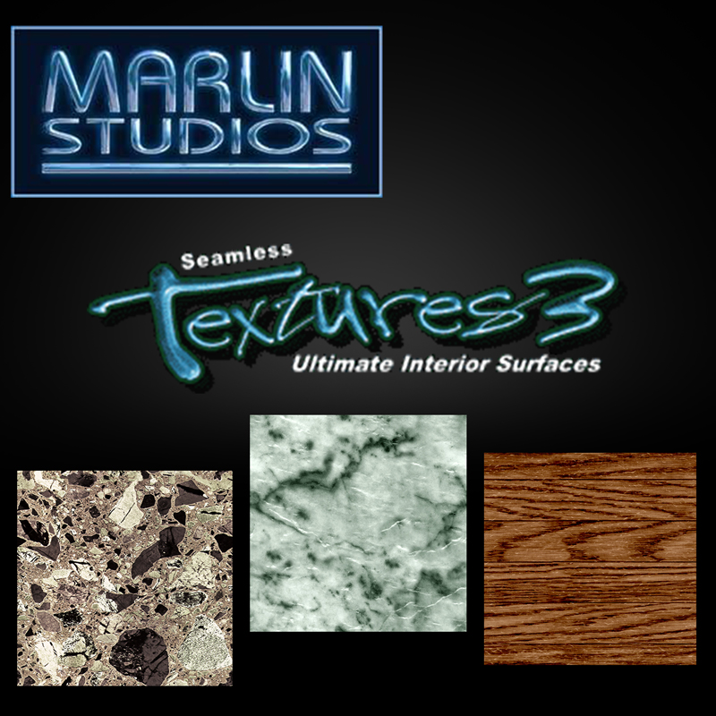
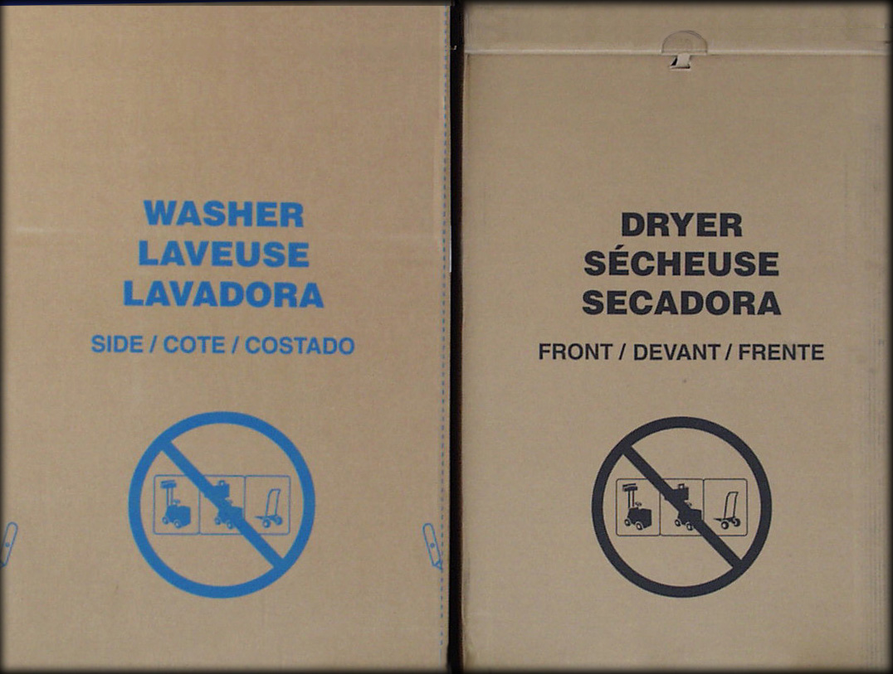

## Counter-Strike: Source

&nbsp;&nbsp;
<a href="https://archive.org/details/marlin-studios-seamless-textures-3-ultimate-interior-surfaces/carpets1.JPG" style="vertical-align: middle;">Marlin Studios - Seamless Textures 3 - Ultimate Interior Surfaces</a>

| Source Texture | Counter-Strike: Source |
| -------------- | ---------------------- |
|  | Origem: `cstrike_pak_dir` |
|||
| Caminho: `Textures\Large\pile02L.jpg` |  Caminho: `materials\models\props\cs_assault\washer_box.vtf` |

&nbsp;&nbsp;
<a href="https://archive.org/details/marlin-studios-seamless-textures-5-downtown-surfaces-signs" style="vertical-align: middle;">Marlin Studios - Seamless Textures 5 - Downtown Surfaces & Signs</a>

| Source Texture | Counter-Strike: Source |
| -------------- | ---------------------- |
| | Origem: `cstrike_pak_dir` |
|||
| Caminho: `Signs\Large800Max\park10L.tga` |  Caminho: `materials\cs_assault\assault_parking_decal01.vtf` |

| Source Texture | Counter-Strike: Source |
| -------------- | ---------------------- |
| | Origem: `cstrike_pak_dir` |
|||
| Caminho: `Signs\Large800Max\dngr03L.jpg` `Signs\Large800Max\park13L.jpg` `Signs\Large800Max\dngr06L.tga` |  Caminho: `materials\de_nuke\nuksign01.vtf` |

| Source Texture | Counter-Strike: Source |
| -------------- | ---------------------- |
| | Origem: `cstrike_pak_dir` |
|||
| Caminho: `Textures\Large1600x1200Max\cran01L.tga` |  Caminho: `materials\cs_assault\assault_skybox_building03.vtf` |

| Source Texture | Counter-Strike: Source |
| -------------- | ---------------------- |
| | Origem: `cstrike_pak_dir` |
|||
| Caminho: `Textures\Large1600x1200Max\comr17L.jpg` |  Caminho: `materials\cs_assault\assault_dumping_decal_02.vtf` |