## Counter-Strike: Source

&nbsp;&nbsp;
<a href="https://archive.org/details/marlin-studios-seamless-textures-3-ultimate-interior-surfaces" style="vertical-align: middle;">`Marlin Studios - Seamless Textures 3 - Ultimate Interior Surfaces`</a>

&nbsp;&nbsp;
<a href="https://archive.org/details/Seamless-textures-7-europe" style="vertical-align: middle;">`Marlin Studios - Seamless Textures 7 - Great Textures of Europe`</a>

| Source Texture | Final Texture |
| -------------- | ------------- |
|  | Origem: `cstrike_pak_dir` |
|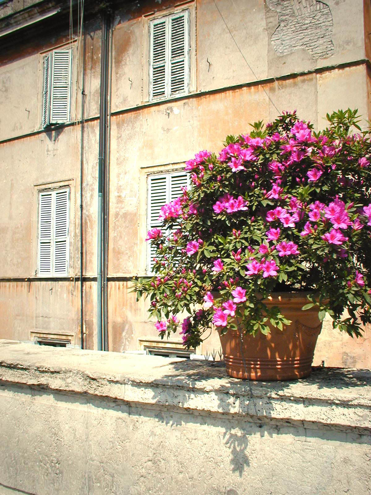||
| Caminho: `Disk 1\photos\P1011340.jpg` |  Caminho: `materials\models\props\cs_office\offpaintingf.vtf` |

| Source Texture | Final Texture |
| -------------- | ------------- |
|  | Origem: `cstrike_pak_dir` |
|||
| Caminho: `Disk 1\photos\P1010811.jpg` |  Caminho: `materials\models\props\cs_office\offpaintingh.vtf` |

| Source Texture | Final Texture |
| -------------- | ------------- |
|  | Origem: `cstrike_pak_dir` |
||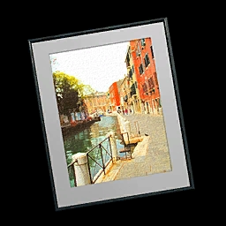|
| Caminho: `Disk 1\photos\P1010965.jpg` |  Caminho: `materials\models\props\cs_office\offpaintingo.vtf` |

| Source Texture | Final Texture |
| -------------- | ------------- |
|  | Origem: `cstrike_pak_dir` |
|||
| Caminho: `Disk 1\photos\P1010800.jpg` |  Caminho: `materials\models\props\cs_office\offpaintingl.vtf` |

| Source Texture | Final Texture |
| -------------- | ------------- |
|  | Origem: `cstrike_pak_dir` |
|||
| Caminho: `Disk 1\photos\P1010785.jpg` |  Caminho: `materials\models\props\cs_office\offpaintingk.vtf` |

| Source Texture | Final Texture |
| -------------- | ------------- |
|  | Origem: `cstrike_pak_dir` |
|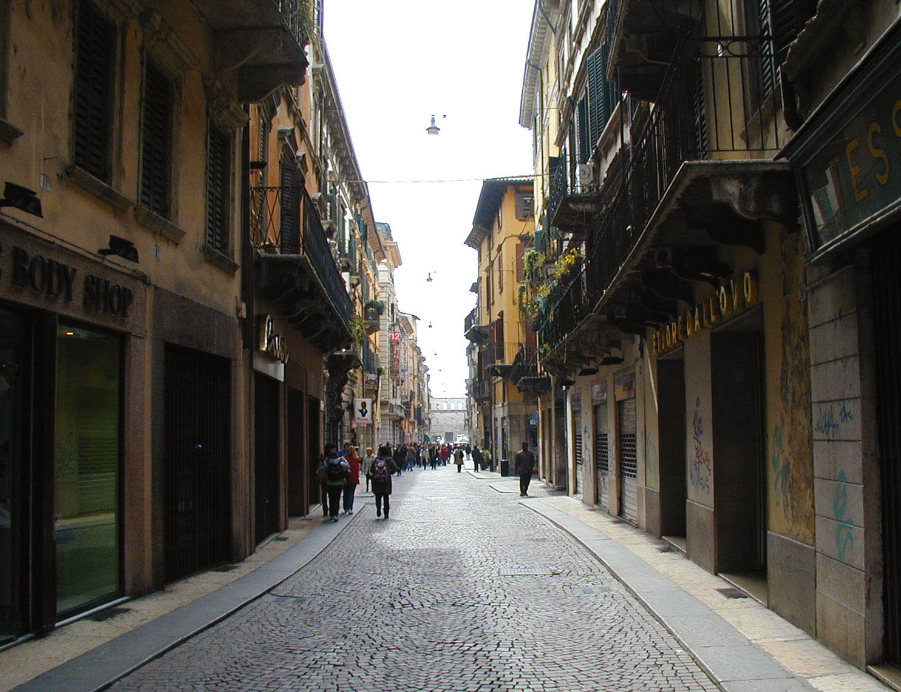||
| Caminho: `Disk 1\photos\P1010663.jpg` |  Caminho: `materials\models\props\cs_office\offpaintingj.vtf` |

| Source Texture | Final Texture |
| -------------- | ------------- |
|  | Origem: `cstrike_pak_dir` |
|||
| Caminho: `Disk 1\photos\P1010439.jpg` |  Caminho: `materials\models\props\cs_office\offpaintingi.vtf` |

| Source Texture | Final Texture |
| -------------- | ------------- |
|  | Origem: `cstrike_pak_dir` |
|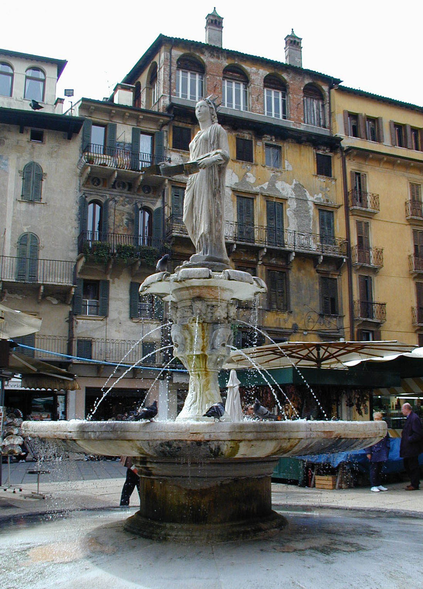|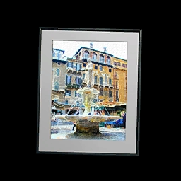|
| Caminho: `Disk 1\photos\P1010659.jpg` |  Caminho: `materials\models\props\cs_office\offpaintingg.vtf` |

| Source Texture | Final Texture |
| -------------- | ------------- |
|  | Origem: `cstrike_pak_dir` |
|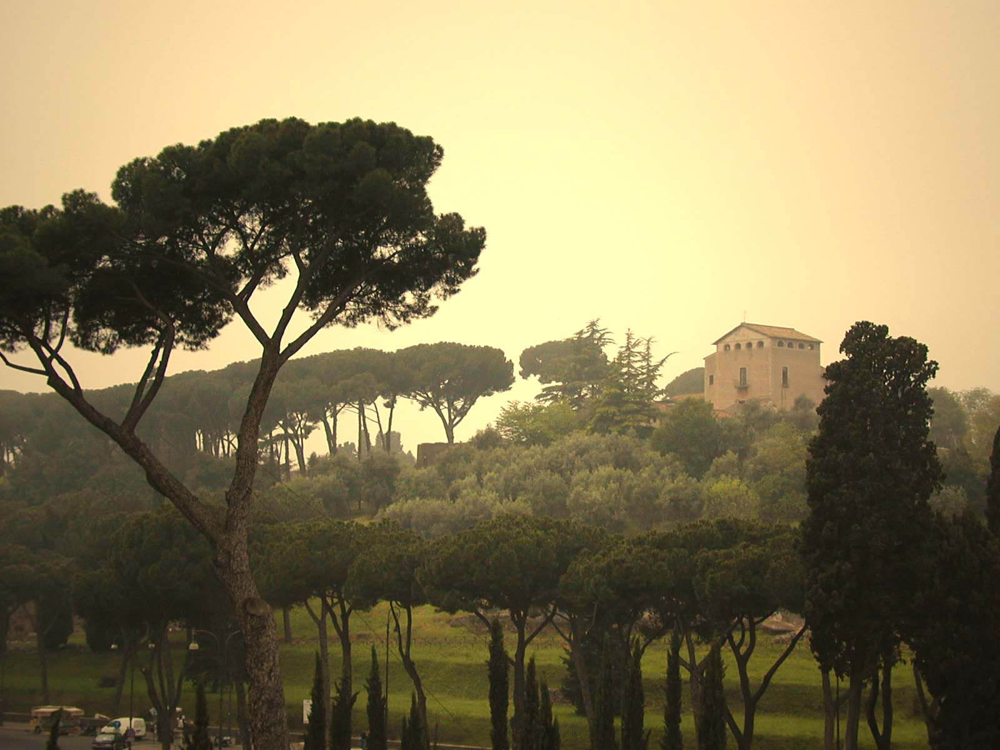||
| Caminho: `Disk 1\photos\P1011283.jpg` |  Caminho: `materials\models\props\cs_office\offpaintinge.vtf` |

| Source Texture | Final Texture |
| -------------- | ------------- |
|  | Origem: `cstrike_pak_dir` |
|||
| Caminho: `Disk 1\photos\P1011082.jpg` |  Caminho: `materials\models\props\cs_office\offpaintingd.vtf` |

| Source Texture | Final Texture |
| -------------- | ------------- |
|  | Origem: `cstrike_pak_dir` |
|||
| Caminho: `Disk 1\photos\P1010666.jpg` |  Caminho: `materials\models\props\cs_office\offpaintinga.vtf` |

| Source Texture | Final Texture |
| -------------- | ------------- |
|  | Origem: `cstrike_pak_dir` |
|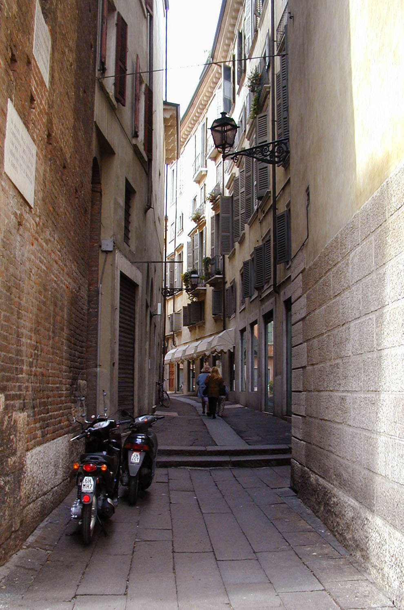|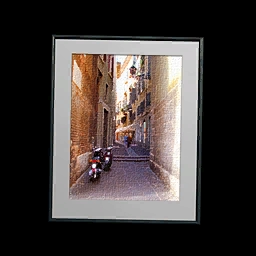|
| Caminho: `Disk 1\photos\P1010662.jpg` |  Caminho: `materials\models\props\cs_office\offpaintingb.vtf` |

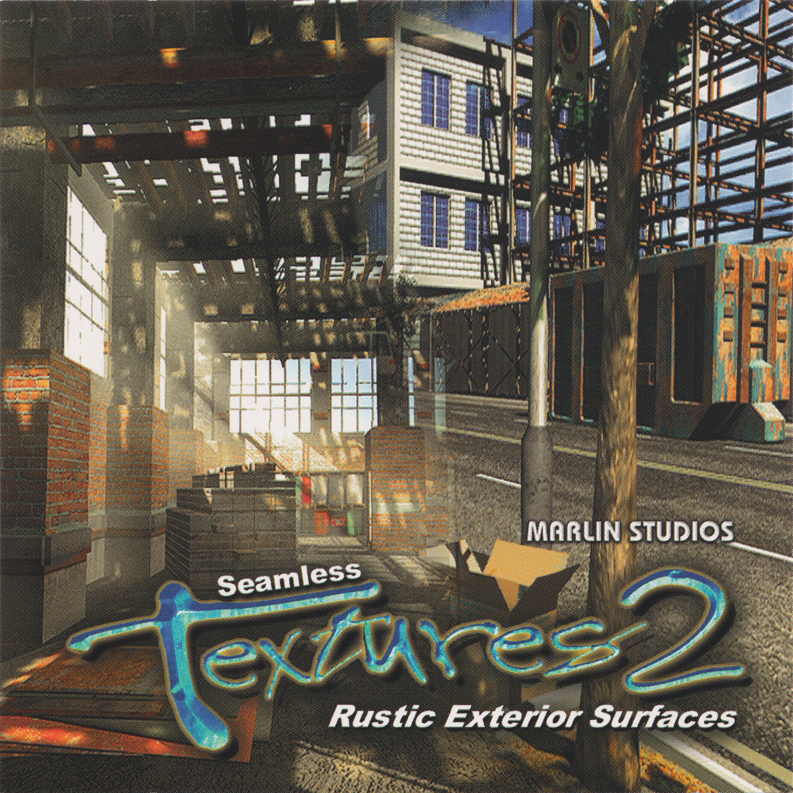&nbsp;&nbsp;
<a href="https://archive.org/details/marlin-studios-seamless-textures-2-rustic-exterior-surfaces" style="vertical-align: middle;">`Marlin Studios - Seamless Textures 2 - Rustic Exterior Surfaces`</a>

| Source Texture | Final Texture |
| -------------- | ------------- |
|  | Origem: `cstrike_pak_dir` |
|||
| Caminho: `Textures\Large\pile02L.jpg` |  Caminho: `materials\models\props\cs_assault\washer_box.vtf` |

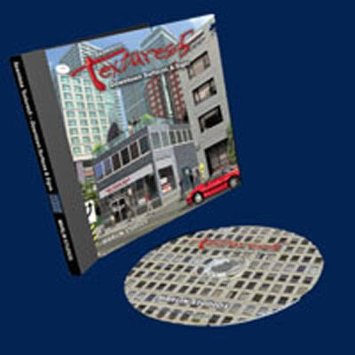&nbsp;&nbsp;
<a href="https://archive.org/details/marlin-studios-seamless-textures-5-downtown-surfaces-signs" style="vertical-align: middle;">`Marlin Studios - Seamless Textures 5 - Downtown Surfaces & Signs`</a>

| Source Texture | Final Texture |
| -------------- | ------------- |
| | Origem: `cstrike_pak_dir` |
|||
| Caminho: `Textures\Large1600x1200Max\antn06L.tga` |  Caminho: `materials\building\antn03.vtf` |

| Source Texture | Final Texture |
| -------------- | ------------- |
| | Origem: `cstrike_pak_dir` |
|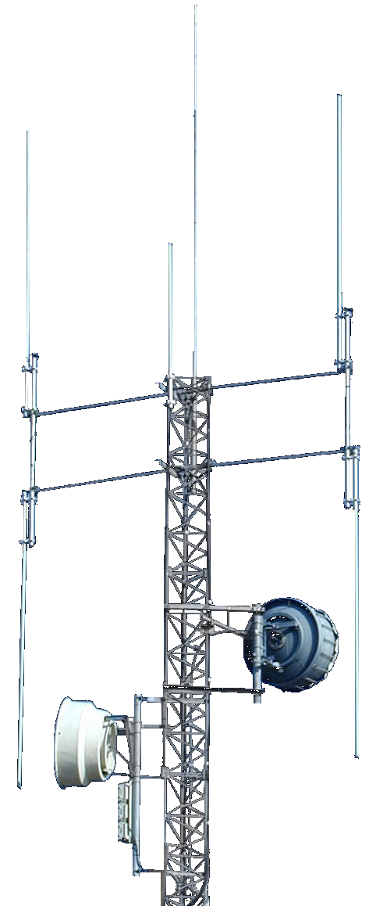||
| Caminho: `Textures\Large1600x1200Max\antn07L.tga` |  Caminho: `materials\building\antn04.vtf` |

| Source Texture | Final Texture |
| -------------- | ------------- |
| | Origem: `cstrike_pak_dir` |
|||
| Caminho: `Textures\Large1600x1200Max\antn13L.tga` |  Caminho: `materials\building\antn02.vtf` |

| Source Texture | Counter-Strike: Source |
| -------------- | ---------------------- |
| | Origem: `cstrike_pak_dir` |
|||
| Caminho: `Textures\Large1600x1200Max\antn15L.tga` |  Caminho: `materials\building\antn01.vtf` |

| Source Texture | Final Texture |
| -------------- | ------------- |
| | Origem: `cstrike_pak_dir` |
|||
| Caminho: `Textures\Large1600x1200Max\antn15L.tga` |  Caminho: `materials\building\antn01.vtf` |

| Source Texture | Final Texture |
| -------------- | ------------- |
| | Origem: `cstrike_pak_dir` |
|||
| Caminho: `Signs\Large800Max\park10L.tga` |  Caminho: `materials\cs_assault\assault_parking_decal01.vtf` |

| Source Texture | Final Texture |
| -------------- | ------------- |
| | Origem: `cstrike_pak_dir` |
|||
| Caminho: `Signs\Large800Max\dngr03L.jpg` `Signs\Large800Max\park13L.jpg` `Signs\Large800Max\dngr06L.tga` |  Caminho: `materials\de_nuke\nuksign01.vtf` |

| Source Texture | Final Texture |
| -------------- | ------------- |
| | Origem: `cstrike_pak_dir` |
||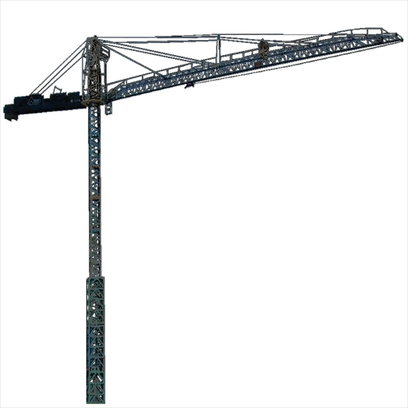|
| Caminho: `Textures\Large1600x1200Max\cran01L.tga` |  Caminho: `materials\cs_assault\assault_skybox_building03.vtf` |

| Source Texture | Final Texture |
| -------------- | ------------- |
| | Origem: `cstrike_pak_dir` |
|||
| Caminho: `Textures\Large1600x1200Max\comr17L.jpg` |  Caminho: `materials\cs_assault\assault_dumping_decal_02.vtf` |

| Source Texture | Final Texture |
| -------------- | ------------- |
| | Origem: `cstrike_pak_dir` |
||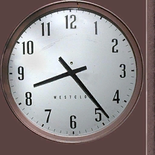|
| Caminho: `Signs\Textures\Large1600x1200Max\clok01L.tga` |  Caminho: `materials\models\props\de_nuke\clock.vtf` |

