# Seamless Textures 5 - Downtown Surfaces & Signs

{ width="500" }

[Link Archive](https://archive.org/details/marlin-studios-seamless-textures-5-downtown-surfaces-signs/)

> Esta biblioteca com 496 texturas de cidades e 105 placas permite criar uma cena de rua detalhada ou uma paisagem urbana completa. As texturas são fornecidas tanto para cidades modernas quanto para cidades antigas. Inclui diversos mapas alfa e mapas de relevo. As texturas também podem ser usadas na biblioteca de modelos de edifícios urbanos de alta resolução da Marlin Studios.

Contém texturas usadas em jogos como: Grand Theft Auto 3, Grand Theft Auto Vice City, Grand Theft Auto San Andreas, Midnight Club 2, Half-Life 2, Need for Speed ​​Underground 1 e 2, Need for Speed ​​Hot Pursuit 2, Silent Hill e muitos outros! https://www.youtube.com/watch?v=i__614yy53Y&t=915s 

---

| Source Texture | Final Texture |
| -------------- | ------------- |
| | Origem: `cstrike_pak_dir` |
|||
| Caminho: `Signs\Large800Max\park10L.tga` |  Caminho: `materials\cs_assault\assault_parking_decal01.vtf` |

| Source Texture | Final Texture |
| -------------- | ------------- |
| | Origem: `cstrike_pak_dir` |
|||
| Caminho: `Signs\Large800Max\dngr03L.jpg` `Signs\Large800Max\park13L.jpg` `Signs\Large800Max\dngr06L.tga` |  Caminho: `materials\de_nuke\nuksign01.vtf` |

| Source Texture | Final Texture |
| -------------- | ------------- |
| | Origem: `cstrike_pak_dir` |
|||
| Caminho: `Textures\Large1600x1200Max\comr17L.jpg` |  Caminho: `materials\cs_assault\assault_dumping_decal_02.vtf` |

| Source Texture | Final Texture |
| -------------- | ------------- |
| | Origem: `cstrike_pak_dir` |
||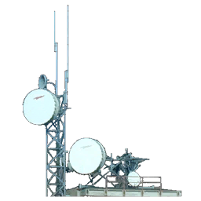|
| Caminho: `Textures\Large1600x1200Max\antn06L.tga` |  Caminho: `materials\building\antn03.vtf` |

| Source Texture | Final Texture |
| -------------- | ------------- |
| | Origem: `cstrike_pak_dir` |
||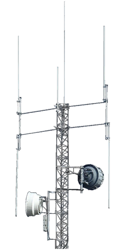|
| Caminho: `Textures\Large1600x1200Max\antn07L.tga` |  Caminho: `materials\building\antn04.vtf` |

| Source Texture | Final Texture |
| -------------- | ------------- |
| | Origem: `cstrike_pak_dir` |
||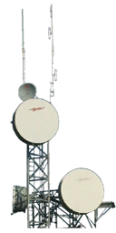|
| Caminho: `Textures\Large1600x1200Max\antn13L.tga` |  Caminho: `materials\building\antn02.vtf` |

| Source Texture | Counter-Strike: Source |
| -------------- | ---------------------- |
| | Origem: `cstrike_pak_dir` |
|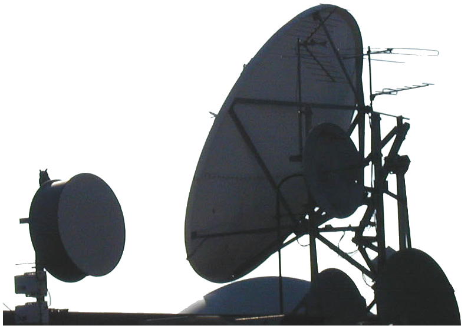||
| Caminho: `Textures\Large1600x1200Max\antn15L.tga` |  Caminho: `materials\building\antn01.vtf` |

| Source Texture | Counter-Strike: Source |
| -------------- | ---------------------- |
| | Origem: `cstrike_pak_dir` |
|||
| Caminho: `Signs\Textures\Large1600x1200Max\clok01L.tga` |  Caminho: `materials\models\props\de_nuke\clock.vtf` |

| Source Texture | Counter-Strike: Source |
| -------------- | ---------------------- |
| | Origem: `cstrike_pak_dir` |
|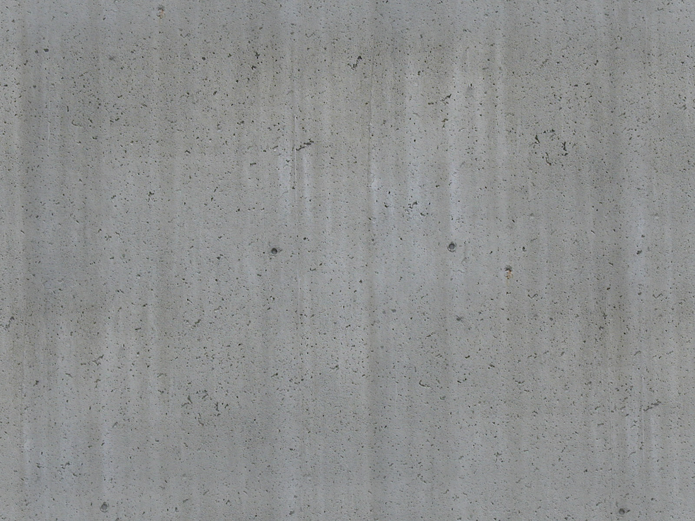||
| Caminho: `Signs\Textures\Large1600x1200Max\cncr24L.jpg` |  Caminho: `materials\models\props_c17\.vtf` |

| Source Texture | Final Texture |
| -------------- | ------------- |
| | Origem: `cstrike_pak_dir` |
|||
| Caminho: `Textures\Large1600x1200Max\cran01L.tga` |  Caminho: `materials\cs_assault\assault_skybox_building03.vtf` |

| Source Texture | Final Texture |
| -------------- | ------------- |
| | Origem: `cstrike_pak_dir` |
||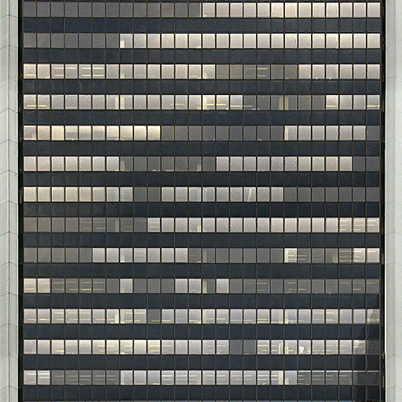|
| Caminho: `Signs\Textures\Large1600x1200Max\skyr11L.jpg` |  Caminho: `materials\buildings\gen01.vtf` |

| Source Texture | Final Texture |
| -------------- | ------------- |
| | Origem: `cstrike_pak_dir` |
|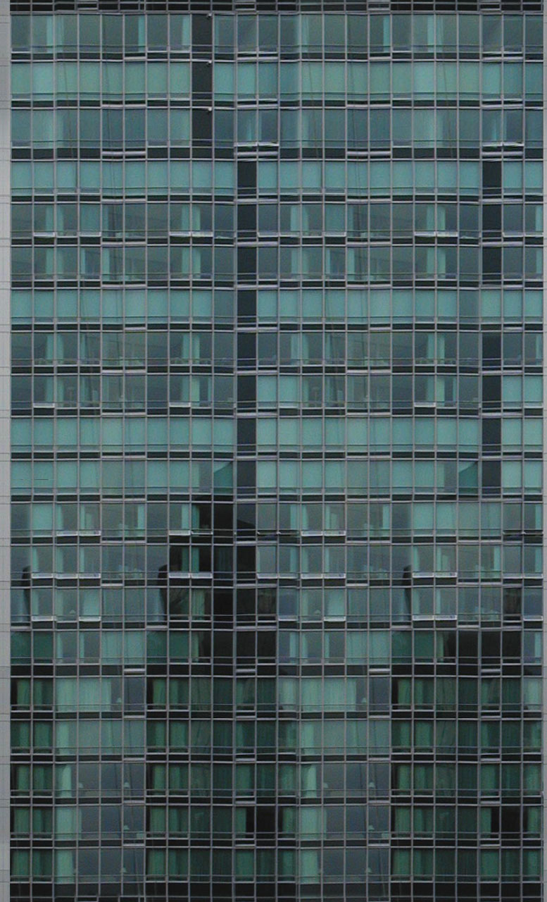||
| Caminho: `Signs\Textures\Large1600x1200Max\skyr12L.jpg` |  Caminho: `materials\buildings\gen02.vtf` |

| Source Texture | Final Texture |
| -------------- | ------------- |
| | Origem: `cstrike_pak_dir` |
|||
| Caminho: `Signs\Textures\Large1600x1200Max\skyr13L.jpg` |  Caminho: `materials\buildings\gen03.vtf` |

| Source Texture | Final Texture |
| -------------- | ------------- |
| | Origem: `cstrike_pak_dir` |
|||
| Caminho: `Signs\Textures\Large1600x1200Max\skyr15L.jpg` |  Caminho: `materials\buildings\gen04.vtf` |

| Source Texture | Final Texture |
| -------------- | ------------- |
| | Origem: `cstrike_pak_dir` |
||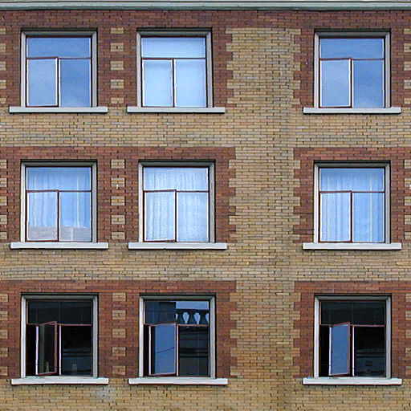|
| Caminho: `Signs\Textures\Large1600x1200Max\skyr21L.jpg` |  Caminho: `materials\buildings\gen05.vtf` |

| Source Texture | Final Texture |
| -------------- | ------------- |
| | Origem: `cstrike_pak_dir` |
|||
| Caminho: `Signs\Textures\Large1600x1200Max\skyr22L.jpg` |  Caminho: `materials\buildings\gen06.vtf` |

| Source Texture | Final Texture |
| -------------- | ------------- |
| | Origem: `cstrike_pak_dir` |
||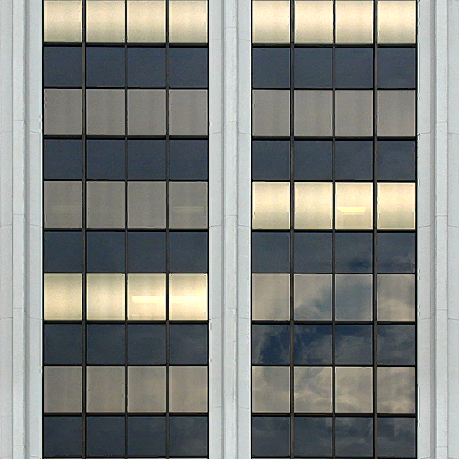|
| Caminho: `Signs\Textures\Large1600x1200Max\skyr23L.jpg` |  Caminho: `materials\buildings\gen07.vtf` |

| Source Texture | Final Texture |
| -------------- | ------------- |
| | Origem: `cstrike_pak_dir` |
||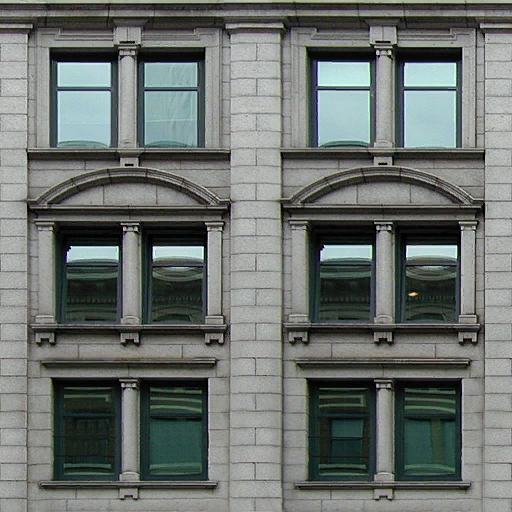|
| Caminho: `Signs\Textures\Large1600x1200Max\skyr25L.jpg` |  Caminho: `materials\buildings\gen08.vtf` |

| Source Texture | Final Texture |
| -------------- | ------------- |
| | Origem: `cstrike_pak_dir` |
|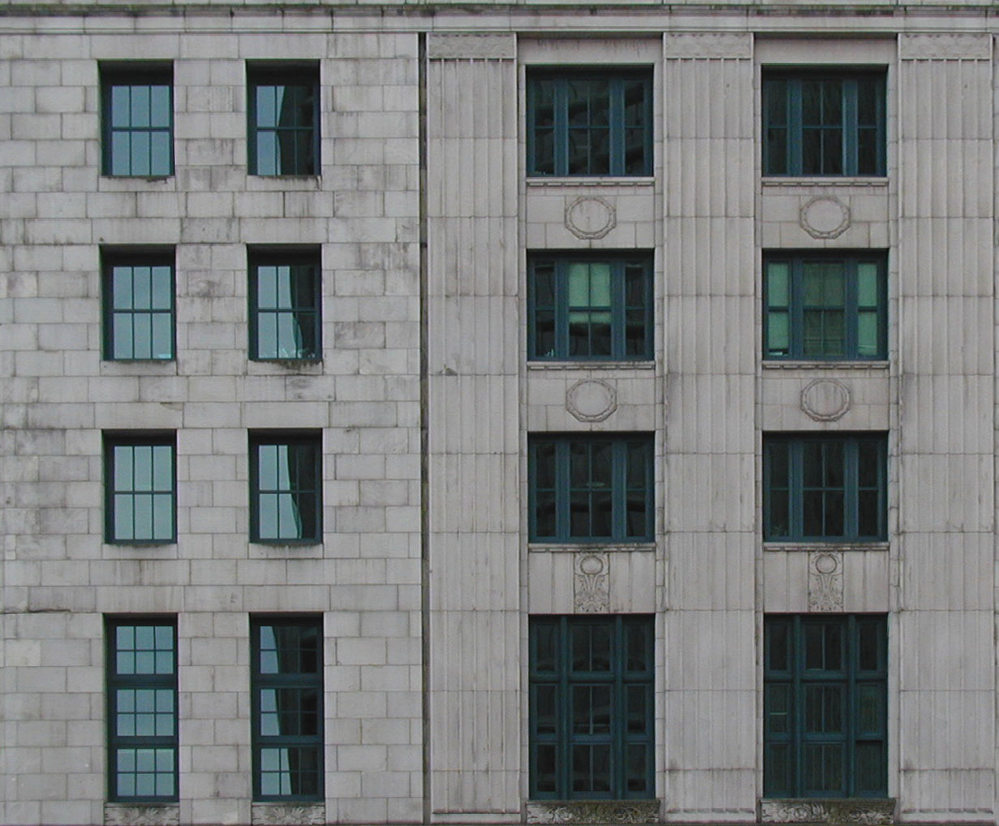|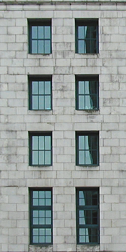|
| Caminho: `Signs\Textures\Large1600x1200Max\skyr28L.jpg` |  Caminho: `materials\buildings\gen09.vtf` `materials\buildings\gen10.vtf` |

| Source Texture | Final Texture |
| -------------- | ------------- |
| | Origem: `cstrike_pak_dir` |
||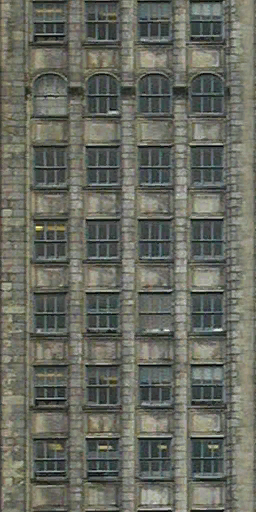|
| Caminho: `Signs\Textures\Large1600x1200Max\skyr30L.jpg` |  Caminho: `materials\buildings\gen11.vtf` |

| Source Texture | Final Texture |
| -------------- | ------------- |
| | Origem: `cstrike_pak_dir` |
|||
| Caminho: `Signs\Textures\Large1600x1200Max\skyr32L.jpg` |  Caminho: `materials\buildings\gen12.vtf` |

| Source Texture | Final Texture |
| -------------- | ------------- |
| | Origem: `cstrike_pak_dir` |
|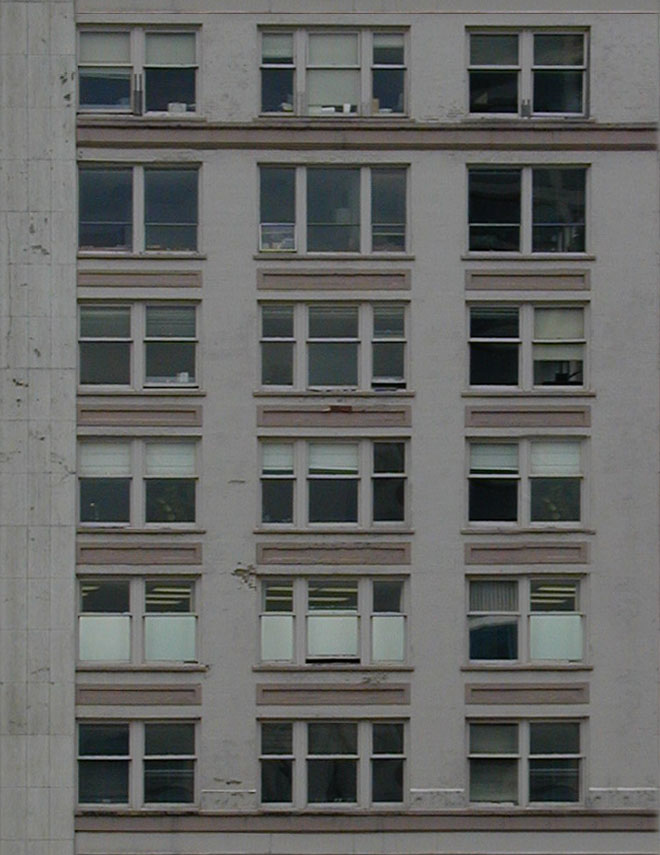||
| Caminho: `Signs\Textures\Large1600x1200Max\skyr33L.jpg` |  Caminho: `materials\buildings\gen13.vtf` |

| Source Texture | Final Texture |
| -------------- | ------------- |
| | Origem: `cstrike_pak_dir` |
||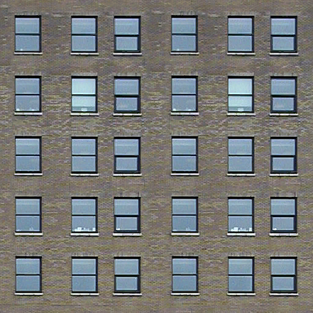|
| Caminho: `Signs\Textures\Large1600x1200Max\skyr34L.jpg` |  Caminho: `materials\buildings\gen14.vtf` |

| Source Texture | Final Texture |
| -------------- | ------------- |
| | Origem: `cstrike_pak_dir` |
|||
| Caminho: `Signs\Textures\Large1600x1200Max\skyr36L.jpg` |  Caminho: `materials\buildings\gen15.vtf` |

| Source Texture | Final Texture |
| -------------- | ------------- |
| | Origem: `cstrike_pak_dir` |
|||
| Caminho: `Signs\Textures\Large1600x1200Max\skyr37L.jpg` |  Caminho: `materials\buildings\gen16.vtf` |

| Source Texture | Final Texture |
| -------------- | ------------- |
| | Origem: `cstrike_pak_dir` |
||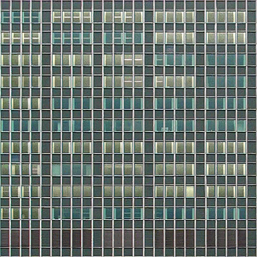|
| Caminho: `Signs\Textures\Large1600x1200Max\skyr39L.jpg` |  Caminho: `materials\buildings\gen17.vtf` |

| Source Texture | Counter-Strike: Source |
| -------------- | ---------------------- |
| | Origem: `cstrike_pak_dir` |
|||
| Caminho: `Signs\Textures\Large1600x1200Max\skyr59L.jpg` |  Caminho: `materials\buildings\gen23.vtf` |

| Source Texture | Final Texture |
| -------------- | ------------- |
| | Origem: `cstrike_pak_dir` |
|||
| Caminho: `Signs\Textures\Large1600x1200Max\skyr41L.jpg` |  Caminho: `materials\buildings\gen18.vtf` |

| Source Texture | Final Texture |
| -------------- | ------------- |
| | Origem: `cstrike_pak_dir` |
|||
| Caminho: `Signs\Textures\Large1600x1200Max\skyr42L.jpg` |  Caminho: `materials\buildings\gen19.vtf` |

| Source Texture | Final Texture |
| -------------- | ------------- |
| | Origem: `cstrike_pak_dir` |
|||
| Caminho: `Signs\Textures\Large1600x1200Max\skyr46L.jpg` |  Caminho: `materials\buildings\gen20.vtf` |