# Counter-Strike: Source

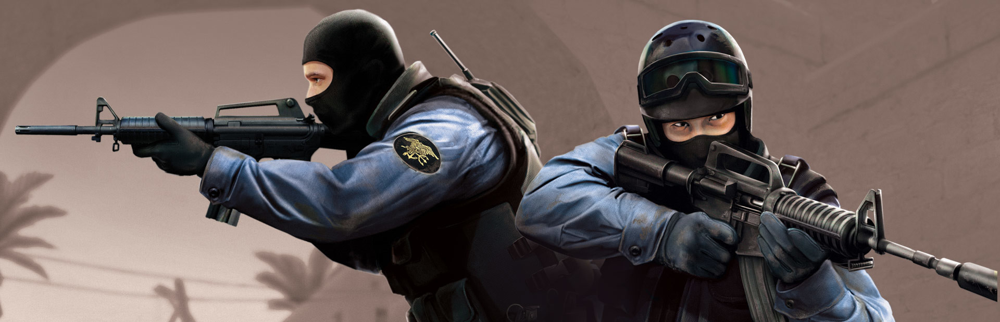

CS Source é um baaaita jogo lançado 2004 juntamente com HL2, eu acho?... não lembro, só tinha 1 ano quando isso aconteceu.

## O resultado atual está incompleto e está em processo.
Obtenha discos antes de 2004, pois seria impossível ter conteúdo do jogo após isso.

## Texture CD List
|Empresa|Biblioteca|Abandonware?|
|---|---|---|
|Marlin Studios|[Seamless Textures 2 - Rustic Exterior Surfaces](Seamless Textures 2/index.md)|Sim|
|Marlin Studios|[Seamless Textures 3 - Ultimate Interior Surfaces](Seamless Textures 3/index.md)|Sim|
|Marlin Studios|[Seamless Textures 5 - Downtown Surfaces & Signs](Seamless Textures 5/index.md)|Sim|
|Marlin Studios|[Seamless Textures 7 - Great Textures of Europe](Seamless Textures 7/index.md)|Sim|

## Disco 2
| Source Texture | Final Texture |
| -------------- | ------------- |
|  | Origem: `cstrike_pak_dir` |
|||
|`Textures\Large\pile02L.jpg` | `materials\models\props\cs_assault\washer_box.vtf` |

| Source Texture | Final Texture |
| -------------- | ------------- |
|  | Origem: `cstrike_pak_dir` |
|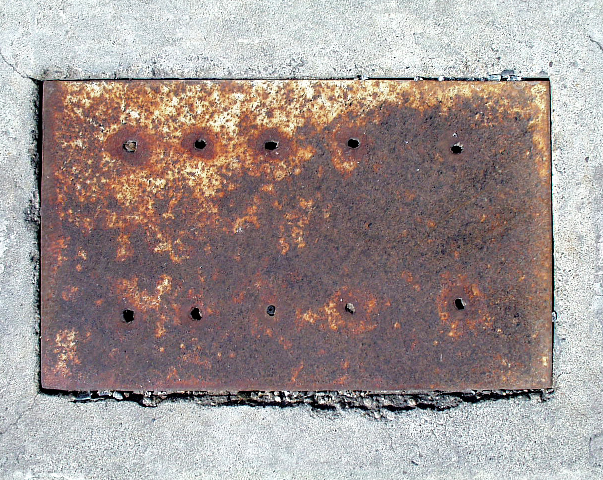|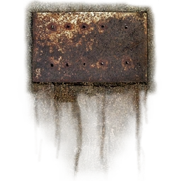|
|`Textures\Large\grat07L.jpg` | `materials\decals\prodplatea.vtf` |

| Source Texture | Final Texture |
| -------------- | ------------- |
|  | Origem: `cstrike_pak_dir` |
|||
|`Textures\Large\grat07L.jpg` | `materials\decals\prodventa.vtf` |

## Disco 5
| Source Texture | Final Texture |
| -------------- | ------------- |
| | Origem: `cstrike_pak_dir` |
|||
|`Signs\Large800Max\park10L.tga` | `materials\cs_assault\assault_parking_decal01.vtf` |

| Source Texture | Final Texture |
| -------------- | ------------- |
| | Origem: `cstrike_pak_dir` |
|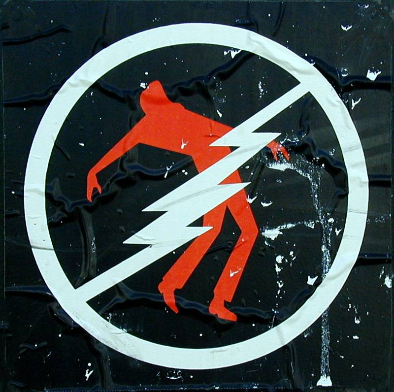||
|`Signs\Large800Max\dngr03L.jpg` `Signs\Large800Max\park13L.jpg` `Signs\Large800Max\dngr06L.tga` | `materials\de_nuke\nuksign01.vtf` |

| Source Texture | Final Texture |
| -------------- | ------------- |
| | Origem: `cstrike_pak_dir` |
|||
|`Signs\Large1600x1200Max\comr17L.jpg` | `materials\cs_assault\assault_dumping_decal_02.vtf` |

| Source Texture | Final Texture |
| -------------- | ------------- |
| | Origem: `cstrike_pak_dir` |
|||
|`Textures\Large1600x1200Max\antn06L.tga` | `materials\building\antn03.vtf` |

| Source Texture | Final Texture |
| -------------- | ------------- |
| | Origem: `cstrike_pak_dir` |
|||
|`Textures\Large1600x1200Max\antn07L.tga` | `materials\building\antn04.vtf` |

| Source Texture | Final Texture |
| -------------- | ------------- |
| | Origem: `cstrike_pak_dir` |
|||
|`Textures\Large1600x1200Max\antn13L.tga` | `materials\building\antn02.vtf` |

| Source Texture | Final Texture |
| -------------- | ---------------------- |
| | Origem: `cstrike_pak_dir` |
|||
|`Textures\Large1600x1200Max\antn15L.tga` | `materials\building\antn01.vtf` |

| Source Texture | Final Texture |
| -------------- | ---------------------- |
| | Origem: `cstrike_pak_dir` |
|||
|`Textures\Large1600x1200Max\clok01L.tga` | `materials\models\props\de_nuke\clock.vtf` |

| Source Texture | Final Texture |
| -------------- | ------------- |
| | Origem: `cstrike_pak_dir` |
|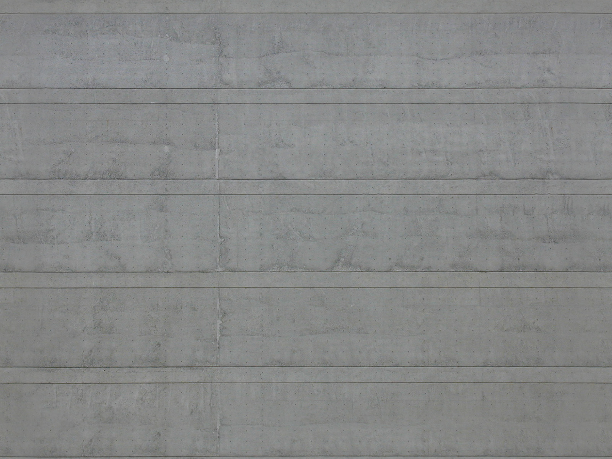|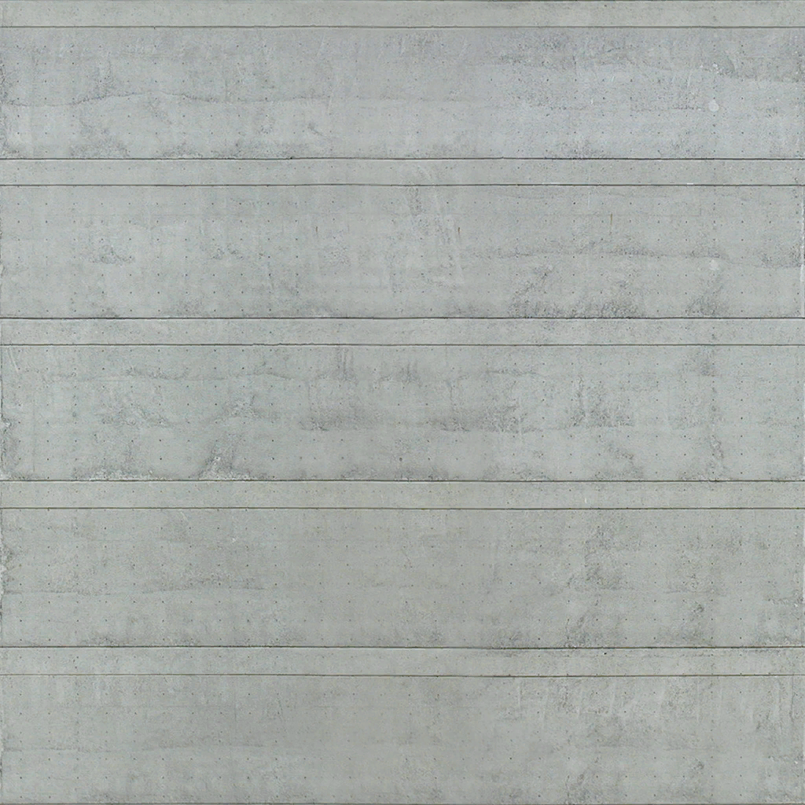|
|`Textures\Large1600x1200Max\cncr21L.jpg` | `materials\de_nuke\nukconcretewallb.vtf`  `materials\de_nuke\nukconcretewalla.vtf` `materials\de_nuke\nukconcretewallc.vtf` |

| Source Texture | Final Texture |
| -------------- | ------------- |
| | Origem: `cstrike_pak_dir` |
|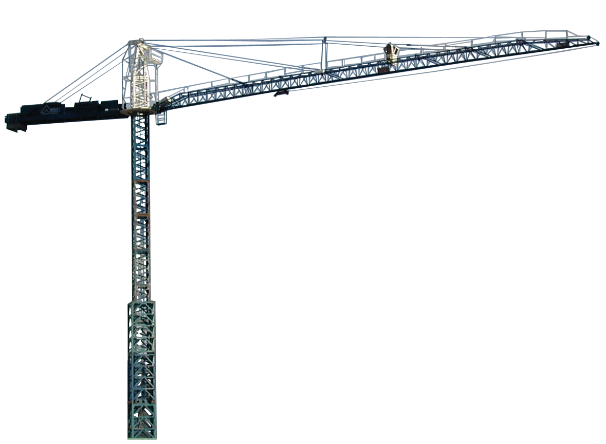||
|`Textures\Large1600x1200Max\cran01L.tga` | `materials\cs_assault\assault_skybox_building03.vtf` |

| Source Texture | Final Texture |
| -------------- | ------------- |
| | Origem: `cstrike_pak_dir` |
|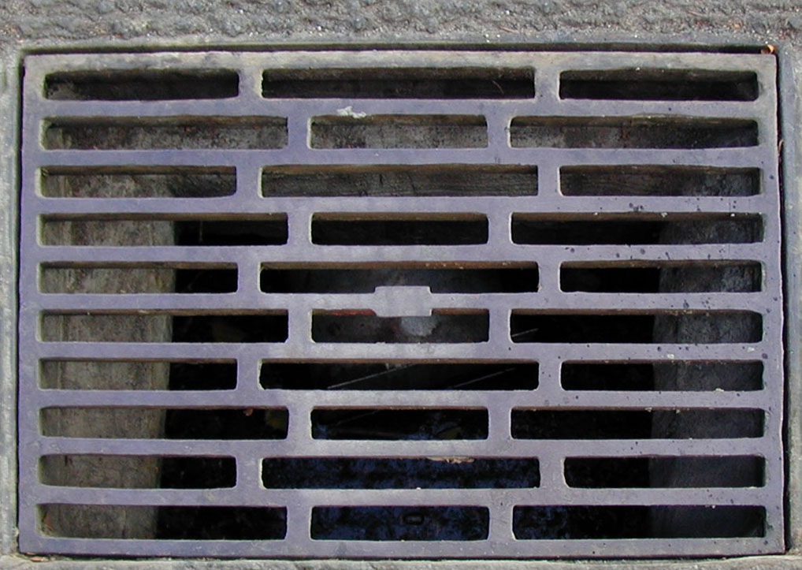|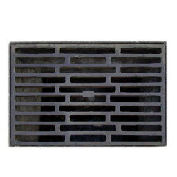|
|`Textures\Large1600x1200Max\grat21L.jpg` | `materials\de_nuke\nukfloorc_detaile.vtf` |

| Source Texture | Final Texture |
| -------------- | ------------- |
| | Origem: `cstrike_pak_dir` |
|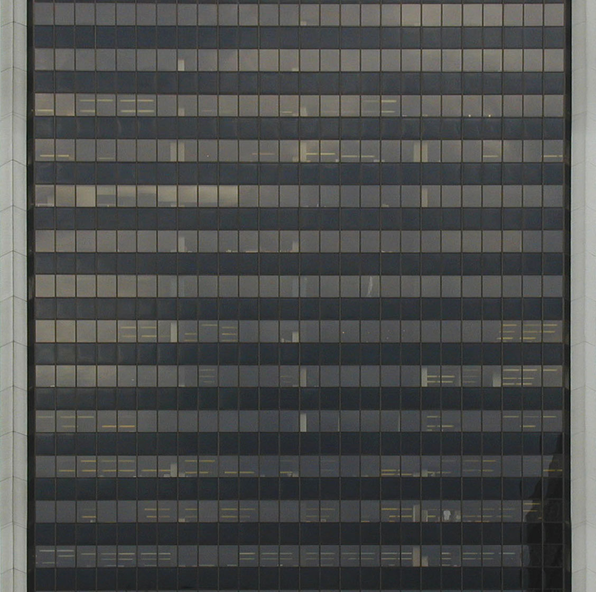||
|`Textures\Large1600x1200Max\skyr11L.jpg` | `materials\buildings\gen01.vtf` |

| Source Texture | Final Texture |
| -------------- | ------------- |
| | Origem: `cstrike_pak_dir` |
|||
|`Textures\Large1600x1200Max\skyr12L.jpg` | `materials\buildings\gen02.vtf` |

| Source Texture | Final Texture |
| -------------- | ------------- |
| | Origem: `cstrike_pak_dir` |
||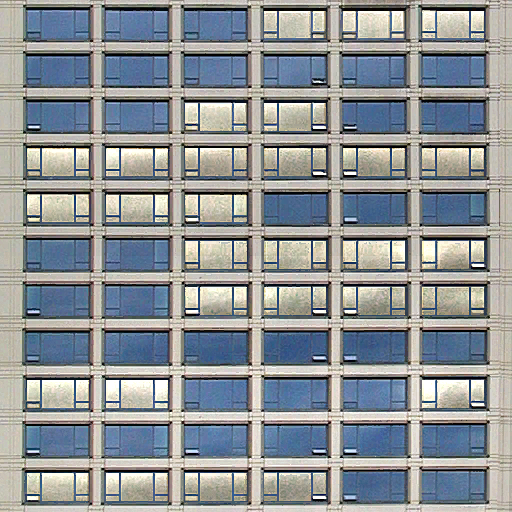|
|`Textures\Large1600x1200Max\skyr13L.jpg` | `materials\buildings\gen03.vtf` |

| Source Texture | Final Texture |
| -------------- | ------------- |
| | Origem: `cstrike_pak_dir` |
|||
|`Textures\Large1600x1200Max\skyr15L.jpg` | `materials\buildings\gen04.vtf` |

| Source Texture | Final Texture |
| -------------- | ------------- |
| | Origem: `cstrike_pak_dir` |
|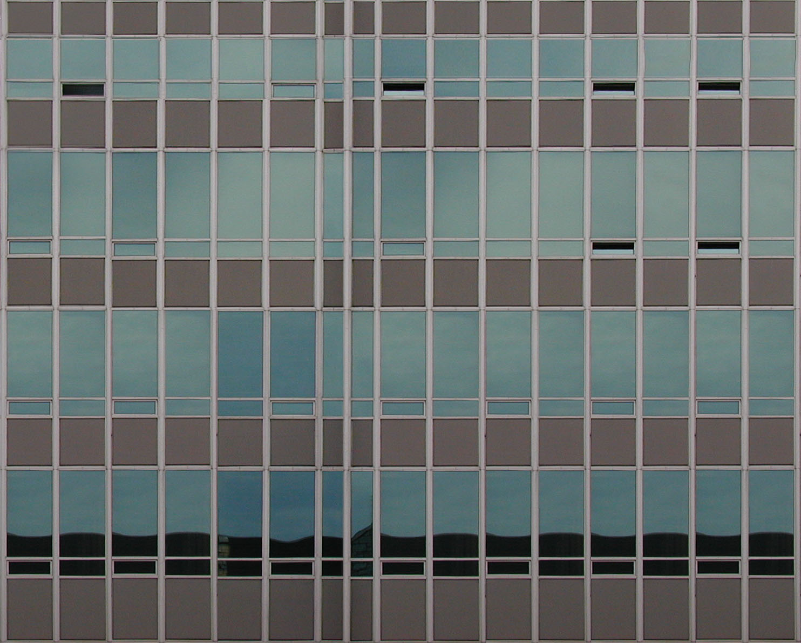||
|`Textures\Large1600x1200Max\skyr19L.jpg` | `materials\cs_assault\assault_skybox_building01.vtf` |

| Source Texture | Final Texture |
| -------------- | ------------- |
| | Origem: `cstrike_pak_dir` |
|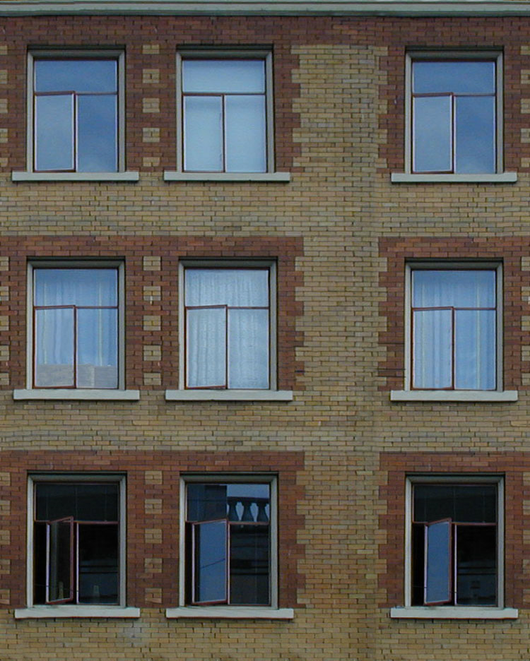||
|`Textures\Large1600x1200Max\skyr21L.jpg` | `materials\buildings\gen05.vtf` |

| Source Texture | Final Texture |
| -------------- | ------------- |
| | Origem: `cstrike_pak_dir` |
|||
|`Textures\Large1600x1200Max\skyr22L.jpg` | `materials\buildings\gen06.vtf` |

| Source Texture | Final Texture |
| -------------- | ------------- |
| | Origem: `cstrike_pak_dir` |
|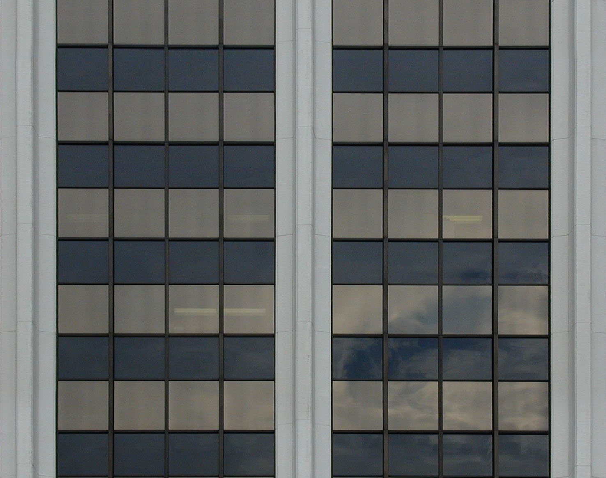||
|`Textures\Large1600x1200Max\skyr23L.jpg` | `materials\buildings\gen07.vtf` `cs_assault/assault_skybox_building02.vtf` |

| Source Texture | Final Texture |
| -------------- | ------------- |
| | Origem: `cstrike_pak_dir` |
|||
|`Textures\Large1600x1200Max\skyr25L.jpg` | `materials\buildings\gen08.vtf` |

| Source Texture | Final Texture |
| -------------- | ------------- |
| | Origem: `cstrike_pak_dir` |
|||
|`Textures\Large1600x1200Max\skyr28L.jpg` | `materials\buildings\gen09.vtf` `materials\buildings\gen10.vtf` |

| Source Texture | Final Texture |
| -------------- | ------------- |
| | Origem: `cstrike_pak_dir` |
|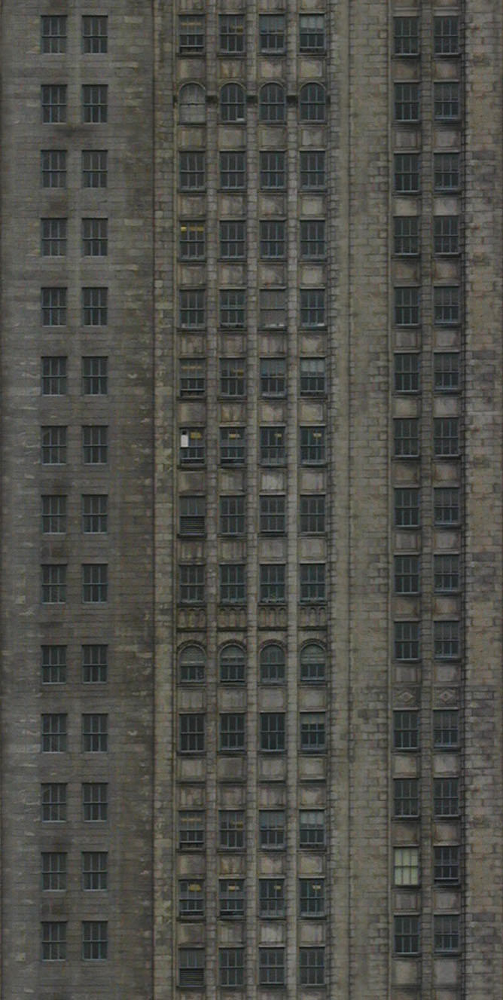||
|`Textures\Large1600x1200Max\skyr30L.jpg` | `materials\buildings\gen11.vtf` |

| Source Texture | Final Texture |
| -------------- | ------------- |
| | Origem: `cstrike_pak_dir` |
|||
|`Textures\Large1600x1200Max\skyr32L.jpg` | `materials\buildings\gen12.vtf` |

| Source Texture | Final Texture |
| -------------- | ------------- |
| | Origem: `cstrike_pak_dir` |
|||
|`Textures\Large1600x1200Max\skyr33L.jpg` | `materials\buildings\gen13.vtf` |

| Source Texture | Final Texture |
| -------------- | ------------- |
| | Origem: `cstrike_pak_dir` |
|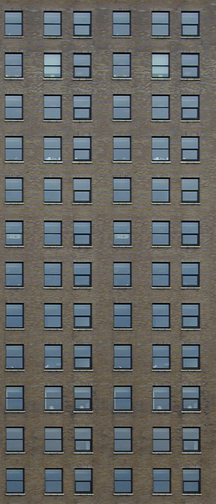||
|`Textures\Large1600x1200Max\skyr34L.jpg` | `materials\buildings\gen14.vtf` |

| Source Texture | Final Texture |
| -------------- | ------------- |
| | Origem: `cstrike_pak_dir` |
||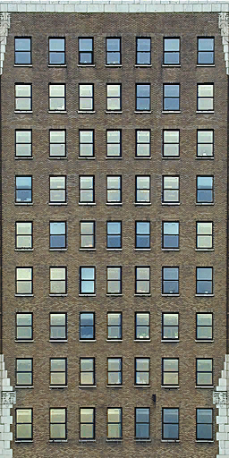|
|`Textures\Large1600x1200Max\skyr36L.jpg` | `materials\buildings\gen15.vtf` |

| Source Texture | Final Texture |
| -------------- | ------------- |
| | Origem: `cstrike_pak_dir` |
|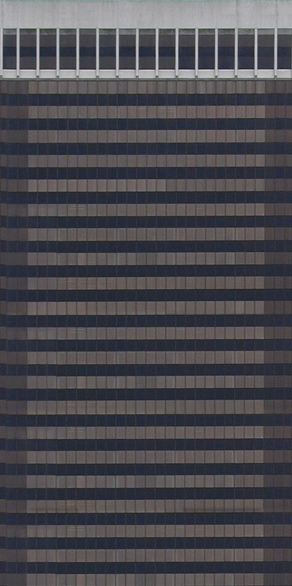||
|`Textures\Large1600x1200Max\skyr37L.jpg` | `materials\buildings\gen16.vtf` |

| Source Texture | Final Texture |
| -------------- | ------------- |
| | Origem: `cstrike_pak_dir` |
|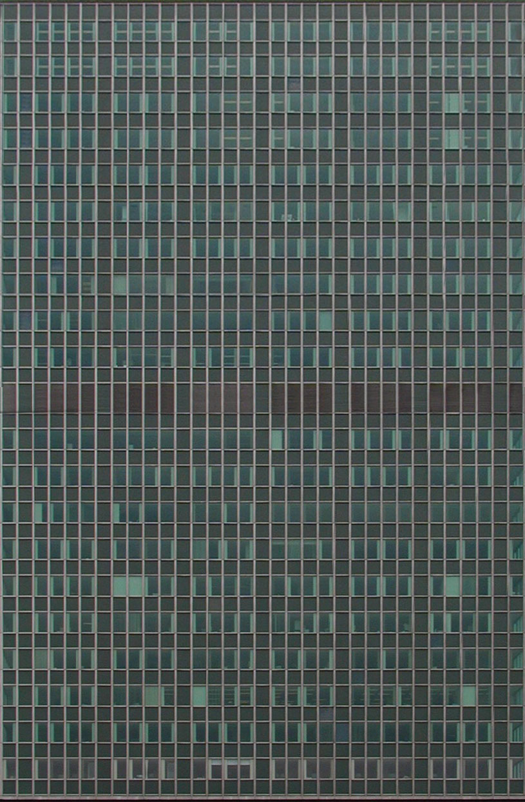||
|`Textures\Large1600x1200Max\skyr39L.jpg` | `materials\buildings\gen17.vtf` |

| Source Texture | Final Texture |
| -------------- | ------------- |
| | Origem: `cstrike_pak_dir` |
|||
|`Textures\Large1600x1200Max\skyr41L.jpg` | `materials\buildings\gen18.vtf` |

| Source Texture | Final Texture |
| -------------- | ------------- |
| | Origem: `cstrike_pak_dir` |
|||
|`Textures\Large1600x1200Max\skyr42L.jpg` | `materials\buildings\gen19.vtf` |

| Source Texture | Final Texture |
| -------------- | ------------- |
| | Origem: `cstrike_pak_dir` |
||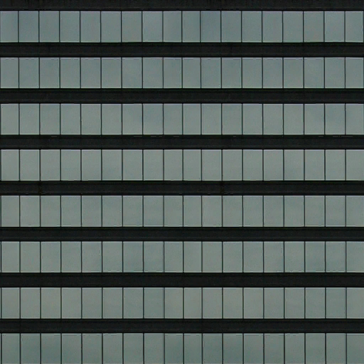|
|`Textures\Large1600x1200Max\skyr44L.jpg` | `materials\cs_assualt\assault_skybox_building04.vtf` 

| Source Texture | Final Texture |
| -------------- | ------------- |
| | Origem: `cstrike_pak_dir` |
|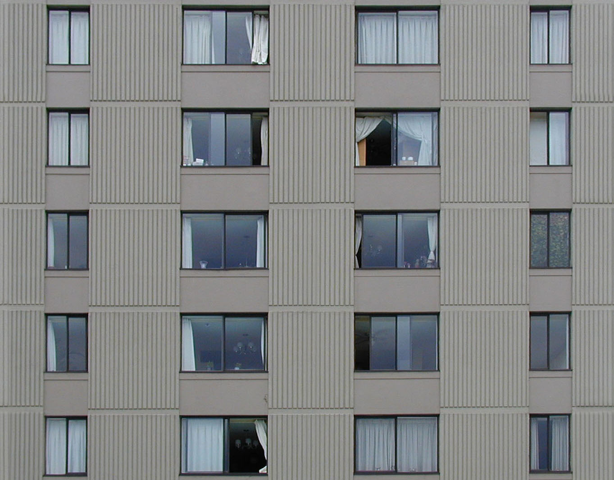|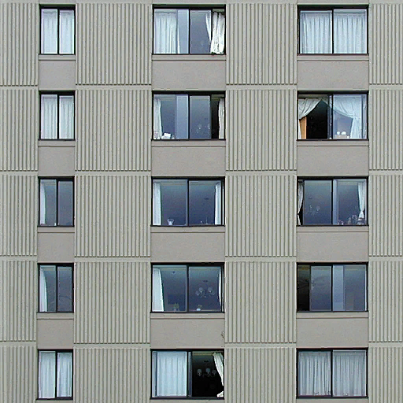|
|`Textures\Large1600x1200Max\skyr46L.jpg` | `materials\buildings\gen20.vtf` |

| Source Texture | Final Texture |
| -------------- | ------------- |
| | Origem: `cstrike_pak_dir` |
|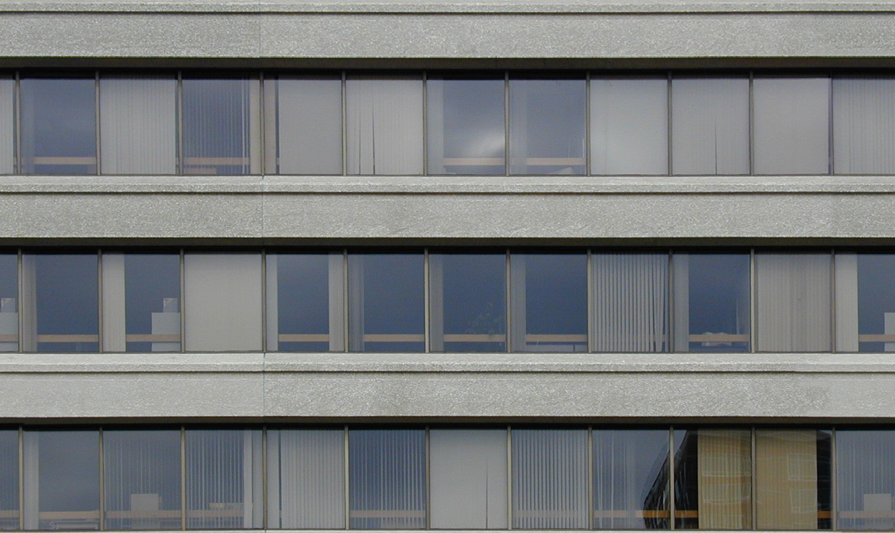|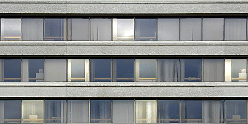|
|`Textures\Large1600x1200Max\skyr49L.jpg` | `materials\buildings\gen21.vtf` |

| Source Texture | Final Texture |
| -------------- | ------------- |
| | Origem: `cstrike_pak_dir` |
|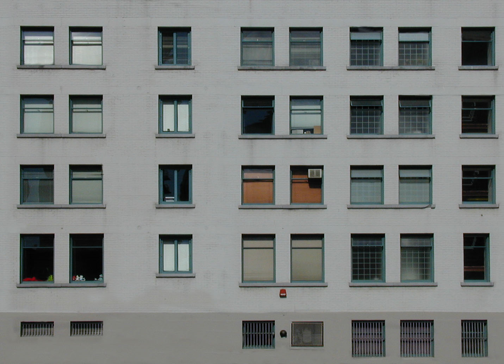|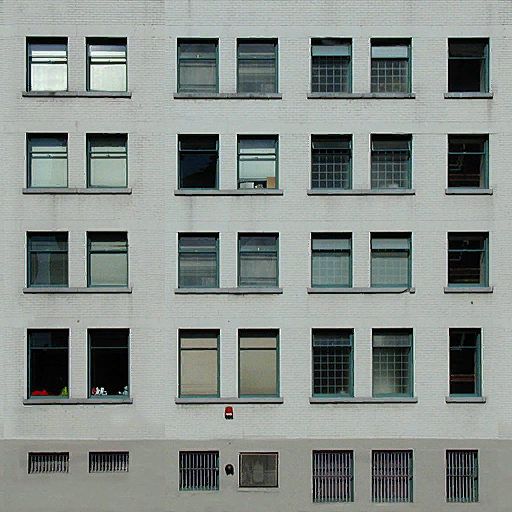|
|`Textures\Large1600x1200Max\skyr58L.jpg` | `materials\buildings\gen22.vtf` |

| Source Texture | Final Texture |
| -------------- | ------------- |
| | Origem: `cstrike_pak_dir` |
||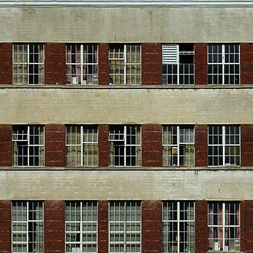|
|`Textures\Large1600x1200Max\skyr59L.jpg` | `materials\buildings\gen23.vtf` |

| Source Texture | Final Texture |
| -------------- | ---------------------- |
| | Origem: `cstrike_pak_dir` |
|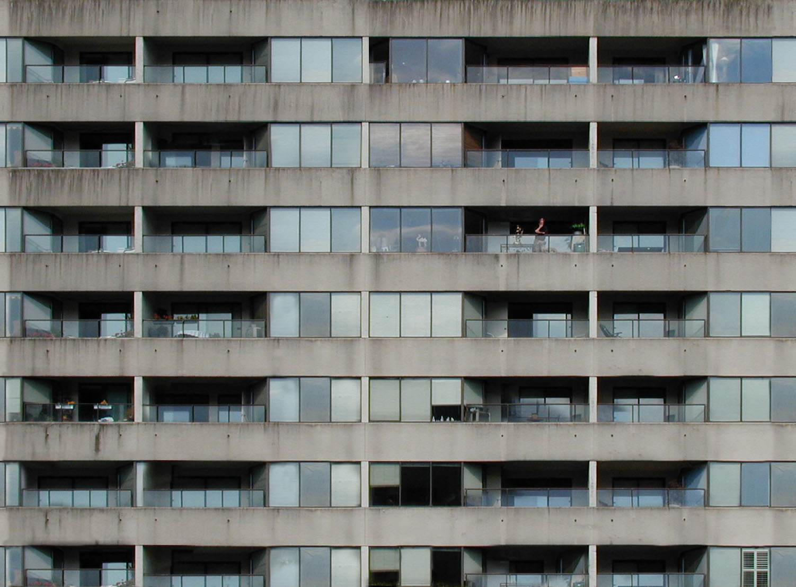|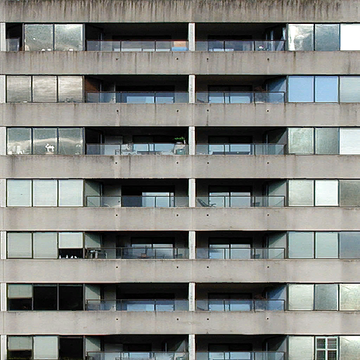|
|`Textures\Large1600x1200Max\skyr65L.jpg` | `materials\buildings\gen24.vtf` |

| Source Texture | Final Texture |
| -------------- | ---------------------- |
| | Origem: `cstrike_pak_dir` |
|||
|`Textures\Large1600x1200Max\skyr69L.jpg` | `materials\buildings\gen25.vtf` |

| Source Texture | Final Texture |
| -------------- | ---------------------- |
| | Origem: `cstrike_pak_dir` |
||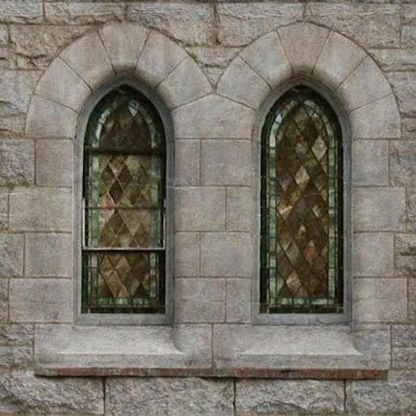|
|`Textures\Large1600x1200Max\wal102L.jpg` | `materials\models\de_cbble\wndarch.vtf` |

| Source Texture | Final Texture |
| -------------- | ---------------------- |
| | Origem: `cstrike_pak_dir` |
|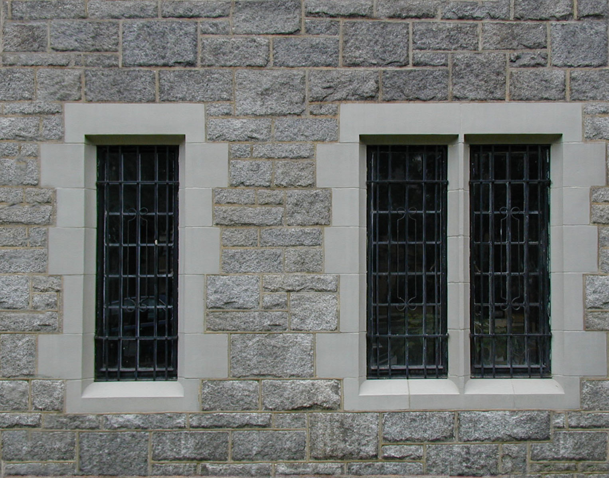|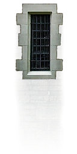|
|`Textures\Large1600x1200Max\wal107L.jpg` | `materials\models\de_cbble\wnddouble.vtf` `materials\models\de_cbble\wndsingle.vtf` `materials\de_tides\tiddecwndw01.vtf` |

| Source Texture | Final Texture |
| -------------- | ---------------------- |
| Tá faltando a porta e a grade | Origem: `cstrike_pak_dir` |
| Disco 7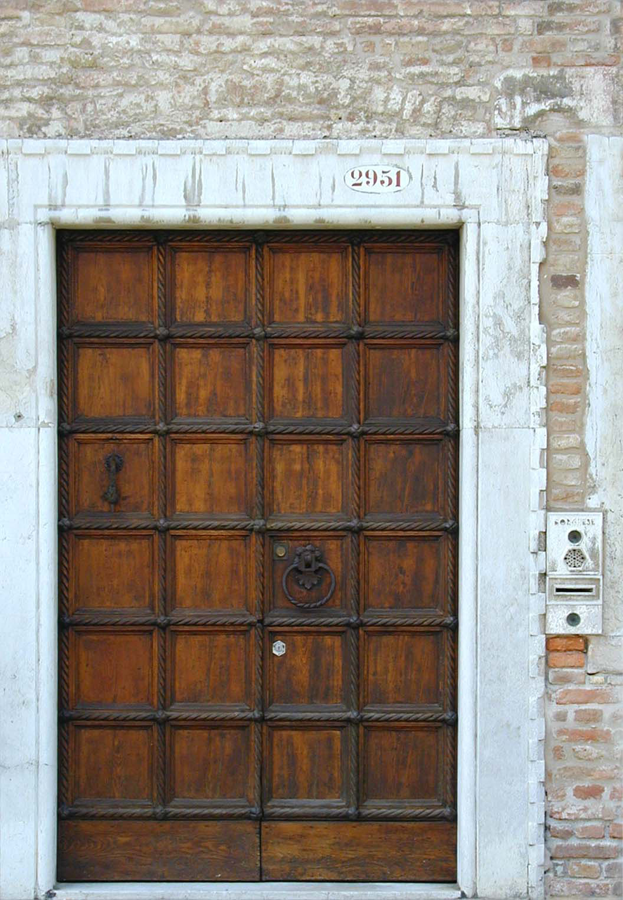||
|`Textures\Large1600x1200Max\wal105L.jpg` `Textures\Large` | `materials\models\de_cbble\doorarch.vtf` |

| Source Texture | Final Texture |
| -------------- | ---------------------- |
| | Origem: `cstrike_pak_dir` |
|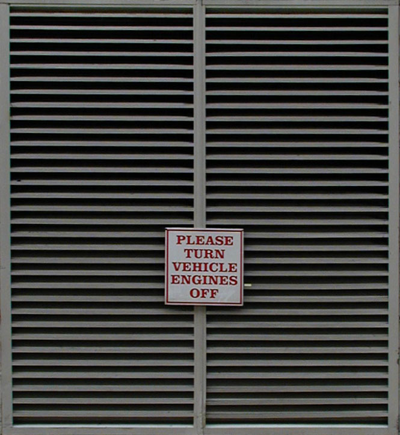||
|`Textures\Large1600x1200Max\vent04L.jpg` | `materials\de_nuke\nukventa.vtf` |

| Source Texture | Final Texture |
| -------------- | ---------------------- |
| | Origem: `cstrike_pak_dir` |
|||
|`Textures\Large1600x1200Max\wal070L.jpg` | `materials\de_nuke\nukwindowe.vtf` |

| Source Texture | Final Texture |
| -------------- | ---------------------- |
| | Origem: `cstrike_pak_dir` |
|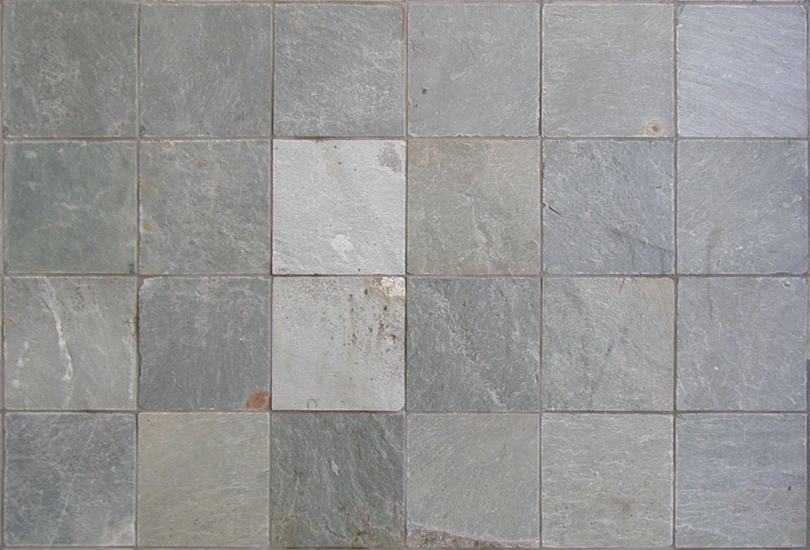||
|`Textures\Large1600x1200Max\wal156L.jpg` | `materials\de_piranese\walltrim01.vtf` |

## Disco 7
| Source Texture | Final Texture |
| -------------- | ------------- |
|  | Origem: `cstrike_pak_dir` |
|||
|`Disk 1\photos\P1011340.jpg` | `materials\models\props\cs_office\offpaintingf.vtf` |

| Source Texture | Final Texture |
| -------------- | ------------- |
|  | Origem: `cstrike_pak_dir` |
||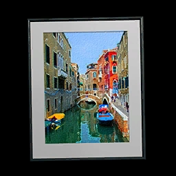|
|`Disk 1\photos\P1010811.jpg` | `materials\models\props\cs_office\offpaintingh.vtf` |

| Source Texture | Final Texture |
| -------------- | ------------- |
|  | Origem: `cstrike_pak_dir` |
|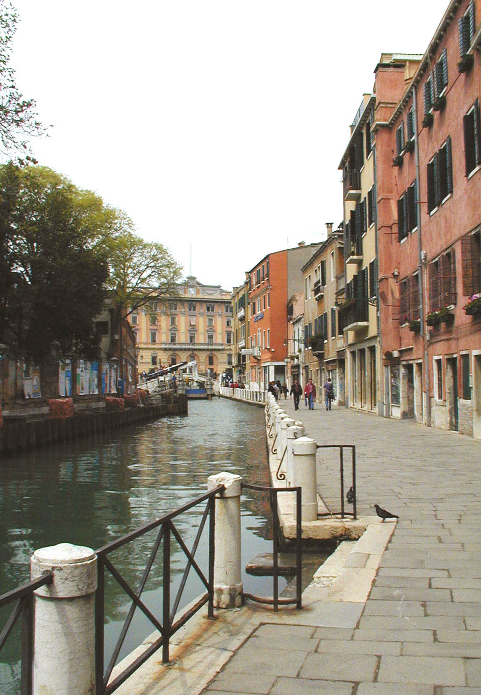||
|`Disk 1\photos\P1010965.jpg` | `materials\models\props\cs_office\offpaintingo.vtf` |

| Source Texture | Final Texture |
| -------------- | ------------- |
|  | Origem: `cstrike_pak_dir` |
||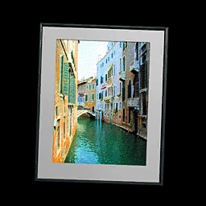|
|`Disk 1\photos\P1010800.jpg` | `materials\models\props\cs_office\offpaintingl.vtf` |

| Source Texture | Final Texture |
| -------------- | ------------- |
|  | Origem: `cstrike_pak_dir` |
|||
|`Disk 1\photos\P1010785.jpg` | `materials\models\props\cs_office\offpaintingk.vtf` |

| Source Texture | Final Texture |
| -------------- | ------------- |
|  | Origem: `cstrike_pak_dir` |
||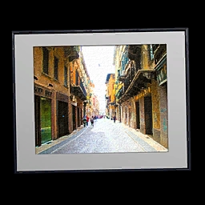|
|`Disk 1\photos\P1010663.jpg` | `materials\models\props\cs_office\offpaintingj.vtf` |

| Source Texture | Final Texture |
| -------------- | ------------- |
|  | Origem: `cstrike_pak_dir` |
|||
|`Disk 1\photos\P1010439.jpg` | `materials\models\props\cs_office\offpaintingi.vtf` |

| Source Texture | Final Texture |
| -------------- | ------------- |
|  | Origem: `cstrike_pak_dir` |
|||
|`Disk 1\photos\P1010659.jpg` | `materials\models\props\cs_office\offpaintingg.vtf` |

| Source Texture | Final Texture |
| -------------- | ------------- |
|  | Origem: `cstrike_pak_dir` |
||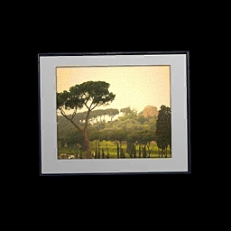|
|`Disk 1\photos\P1011283.jpg` | `materials\models\props\cs_office\offpaintinge.vtf` |

| Source Texture | Final Texture |
| -------------- | ------------- |
|  | Origem: `cstrike_pak_dir` |
||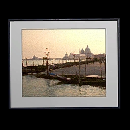|
|`Disk 1\photos\P1011082.jpg` | `materials\models\props\cs_office\offpaintingd.vtf` |

| Source Texture | Final Texture |
| -------------- | ------------- |
|  | Origem: `cstrike_pak_dir` |
|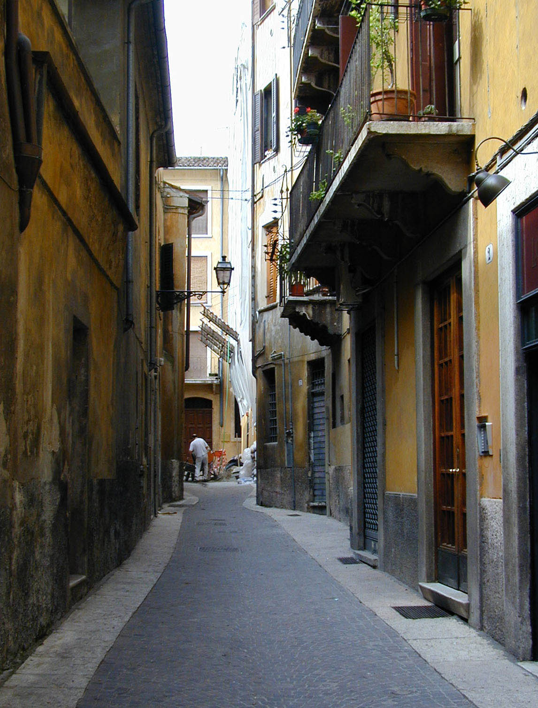||
|`Disk 1\photos\P1010666.jpg` | `materials\models\props\cs_office\offpaintinga.vtf` |

| Source Texture | Final Texture |
| -------------- | ------------- |
|  | Origem: `cstrike_pak_dir` |
|||
|`Disk 1\photos\P1010662.jpg` | `materials\models\props\cs_office\offpaintingb.vtf` |

| Source Texture | Final Texture |
| -------------- | ---------------------- |
| | Origem: `cstrike_pak_dir` |
|||
|`Textures\Large\bldg232L.jpg` | `materials\de_tides\tides_window_1.vtf` |

| Source Texture | Final Texture |
| -------------- | ---------------------- |
| | Origem: `cstrike_pak_dir` |
|||
|`Textures\Large\entr002L.jpg` | `materials\de_tides\tides_wooden_arc_door_2.vtf` |

| Source Texture | Final Texture |
| -------------- | ---------------------- |
| | Origem: `cstrike_pak_dir` |
||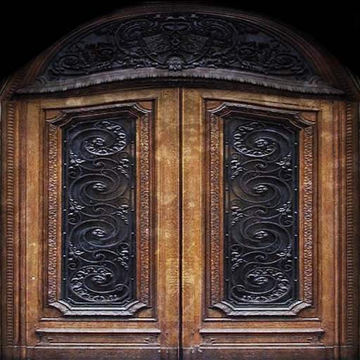|
|`Textures\Large\entr004L.jpg` | `materials\de_tides\tides_wooden_arc_door.vtf` |

| Source Texture | Final Texture |
| -------------- | ---------------------- |
| | Origem: `cstrike_pak_dir` |
|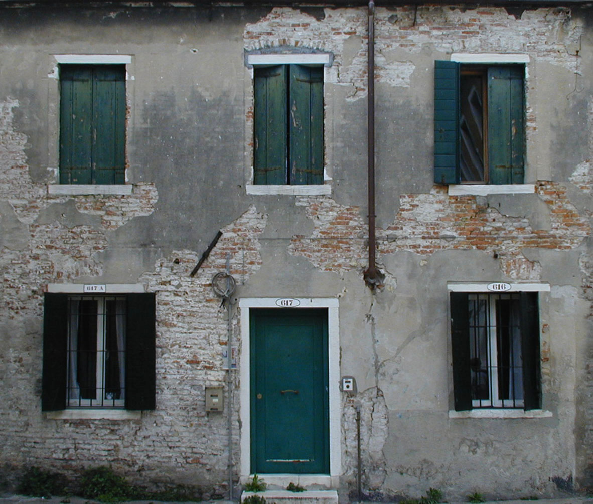|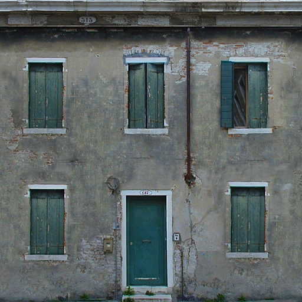|
|`Textures\Large\bldg066L.jpg` | `materials\cs_havana\bldb.vtf` |

| Source Texture | Final Texture |
| -------------- | ---------------------- |
| | Origem: `cstrike_pak_dir` |
|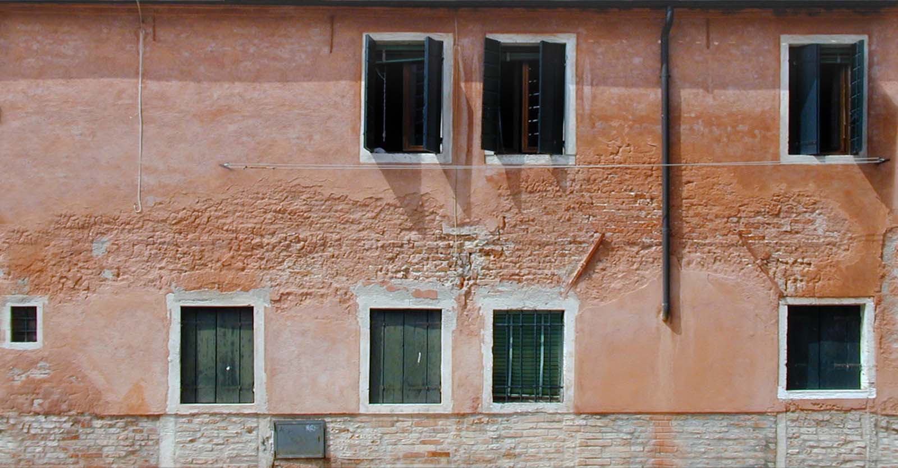|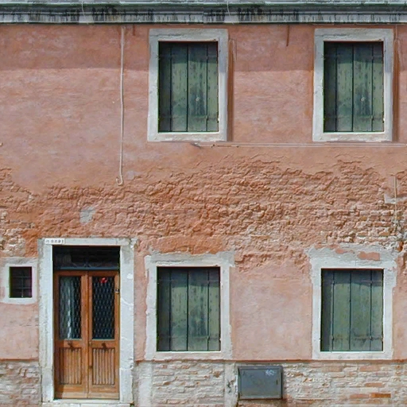|
|`Textures\Large\bldg089L.jpg` `Textures\Large\bldg091L.jpg` | `materials\cs_havana\blde.vtf` |

| Source Texture | Counter-Strike: Source |
| -------------- | ---------------------- |
| parece faltar a parede | Origem: `cstrike_pak_dir` |
||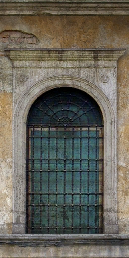|
|`Textures\Large\wndw219L.jpg` `Textures\Large\wndw209L.jpg` | `materials\models\cs_italy\wndg.vtf`|

| Source Texture | Counter-Strike: Source |
| -------------- | ---------------------- |
| | Origem: `cstrike_pak_dir` |
||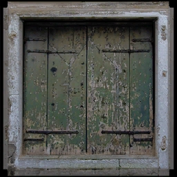|
|`Textures\Large\wndw157L.jpg`| `materials\models\de_dust\windows\window_4x4_square_flat.vtf`|

| Source Texture | Counter-Strike: Source |
| -------------- | ---------------------- |
| | Origem: `cstrike_pak_dir` |
|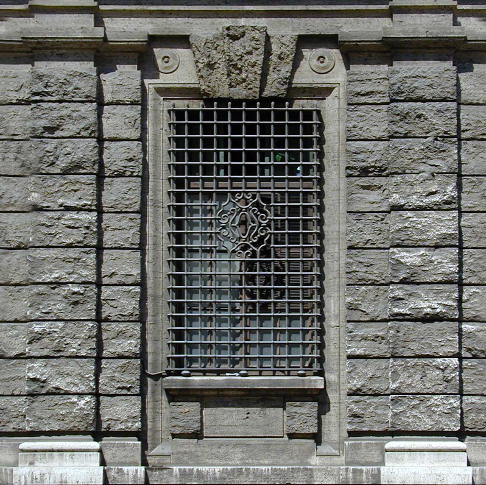||
|`Textures\Large\wndw227L.jpg` `Textures\Large\wndw021L.jpg` `Textures\Large\wndw118L.jpg`| `materials\de_tides\tides_brick_wall_l.vtf`|

| Source Texture | Counter-Strike: Source |
| -------------- | ---------------------- |
| | Origem: `cstrike_pak_dir` |
|||
|`Textures\Large\wndw126L.jpg`| `materials\models\de_dust\windows\window_4x4_square_flat.vtf`|