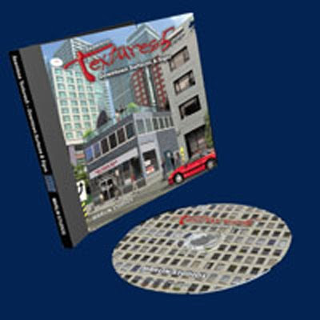

# Seamless Textures 5 - Downtown Surfaces & Signs

{ width="500" }

[Link Archive](https://archive.org/details/marlin-studios-seamless-textures-5-downtown-surfaces-signs/)

> Esta biblioteca com 496 texturas de cidades e 105 placas permite criar uma cena de rua detalhada ou uma paisagem urbana completa. As texturas são fornecidas tanto para cidades modernas quanto para cidades antigas. Inclui diversos mapas alfa e mapas de relevo. As texturas também podem ser usadas na biblioteca de modelos de edifícios urbanos de alta resolução da Marlin Studios.

Contém texturas usadas em jogos como: Grand Theft Auto 3, Grand Theft Auto Vice City, Grand Theft Auto San Andreas, Midnight Club 2, Half-Life 2, Need for Speed ​​Underground 1 e 2, Need for Speed ​​Hot Pursuit 2, Silent Hill e muitos outros! https://www.youtube.com/watch?v=i__614yy53Y&t=915s 

---

| Source Texture | Final Texture |
| -------------- | ------------- |
|`Signs\Large800Max\park10L.tga`|`materials\cs_assault\assault_parking_decal01.vtf`|

| Source Texture | Final Texture |
| -------------- | ------------- |
|`Signs\Large800Max\dngr03L.jpg`   `Signs\Large800Max\park13L.jpg`   `Signs\Large800Max\dngr06L.tga`|`materials\de_nuke\nuksign01.vtf`|

| Source Texture | Final Texture |
| -------------- | ------------- |
|`Signs\Large1600x1200Max\comr17L.jpg`|`materials\cs_assault\assault_dumping_decal_02.vtf`|

| Source Texture | Final Texture |
| -------------- | ------------- |
|`Textures\Large1600x1200Max\antn06L.tga`|`materials\building\antn03.vtf`|

| Source Texture | Final Texture |
| -------------- | ------------- |
|`Textures\Large1600x1200Max\antn07L.tga`|`materials\building\antn04.vtf`|

| Source Texture | Final Texture |
| -------------- | ------------- |
|`Textures\Large1600x1200Max\antn13L.tga`|`materials\building\antn02.vtf`|

| Source Texture | Final Texture |
| -------------- | ---------------------- |
|`Textures\Large1600x1200Max\antn15L.tga`|`materials\building\antn01.vtf`|

| Source Texture | Final Texture |
| -------------- | ---------------------- |
|`Textures\Large1600x1200Max\clok01L.tga`|`materials\models\props\de_nuke\clock.vtf`|

| Source Texture | Final Texture |
| -------------- | ------------- |
|`Textures\Large1600x1200Max\cncr21L.jpg`|`materials\de_nuke\nukconcretewallb.vtf`   `materials\de_nuke\nukconcretewalla.vtf`   `materials\de_nuke\nukconcretewallc.vtf`|

| Source Texture | Final Texture |
| -------------- | ------------- |
|`Textures\Large1600x1200Max\cran01L.tga`|`materials\cs_assault\assault_skybox_building03.vtf`|

| Source Texture | Final Texture |
| -------------- | ------------- |
|`Textures\Large1600x1200Max\door44L.jpg`|`materials\cs_assault\assault_door1.vtf`|

| Source Texture | Final Texture |
| -------------- | ------------- |
|`Textures\Large1600x1200Max\grat21L.jpg`|`materials\de_nuke\nukfloorc_detaile.vtf`|

| Source Texture | Final Texture |
| -------------- | ------------- |
|`Textures\Large1600x1200Max\skyr11L.jpg`|`materials\buildings\gen01.vtf`|

| Source Texture | Final Texture |
| -------------- | ------------- |
|`Textures\Large1600x1200Max\skyr12L.jpg`|`materials\buildings\gen02.vtf` `materials\cs_havana\gen02.vtf`|

| Source Texture | Final Texture |
| -------------- | ------------- |
|`Textures\Large1600x1200Max\skyr13L.jpg`|`materials\buildings\gen03.vtf`|

| Source Texture | Final Texture |
| -------------- | ------------- |
|`Textures\Large1600x1200Max\skyr15L.jpg`|`materials\buildings\gen04.vtf` `materials\cs_havana\gen04.vtf`|

| Source Texture | Final Texture |
| -------------- | ------------- |
|`Textures\Large1600x1200Max\skyr19L.jpg`|`materials\cs_assault\assault_skybox_building01.vtf`|

| Source Texture | Final Texture |
| -------------- | ------------- |
|`Textures\Large1600x1200Max\skyr21L.jpg`|`materials\buildings\gen05.vtf` `materials\cs_havana\gen05.vtf`|

| Source Texture | Final Texture |
| -------------- | ------------- |
|`Textures\Large1600x1200Max\skyr22L.jpg`|`materials\buildings\gen06.vtf` `materials\cs_havana\gen06.vtf`|

| Source Texture | Final Texture |
| -------------- | ------------- |
|`Textures\Large1600x1200Max\skyr23L.jpg`|`materials\buildings\gen07.vtf`   `cs_assault/assault_skybox_building02.vtf`|

| Source Texture | Final Texture |
| -------------- | ------------- |
|`Textures\Large1600x1200Max\skyr25L.jpg`|`materials\buildings\gen08.vtf`|

| Source Texture | Final Texture |
| -------------- | ------------- |
|`Textures\Large1600x1200Max\skyr28L.jpg`|`materials\buildings\gen09.vtf`   `materials\buildings\gen10.vtf` `materials\cs_havana\gen10.vtf`|

| Source Texture | Final Texture |
| -------------- | ------------- |
|`Textures\Large1600x1200Max\skyr30L.jpg`|`materials\buildings\gen11.vtf` `materials\cs_havana\gen11.vtf`|

| Source Texture | Final Texture |
| -------------- | ------------- |
|`Textures\Large1600x1200Max\skyr32L.jpg`|`materials\buildings\gen12.vtf`|

| Source Texture | Final Texture |
| -------------- | ------------- |
|`Textures\Large1600x1200Max\skyr33L.jpg`|`materials\buildings\gen13.vtf` `materials\cs_havana\gen13.vtf`|

| Source Texture | Final Texture |
| -------------- | ------------- |
|`Textures\Large1600x1200Max\skyr34L.jpg`|`materials\buildings\gen14.vtf` `materials\cs_hanava\gen14.vtf`|

| Source Texture | Final Texture |
| -------------- | ------------- |
|`Textures\Large1600x1200Max\skyr36L.jpg`|`materials\buildings\gen15.vtf`|

| Source Texture | Final Texture |
| -------------- | ------------- |
|`Textures\Large1600x1200Max\skyr37L.jpg`|`materials\buildings\gen16.vtf`|

| Source Texture | Final Texture |
| -------------- | ------------- |
|`Textures\Large1600x1200Max\skyr39L.jpg`|`materials\buildings\gen17.vtf`|

| Source Texture | Final Texture |
| -------------- | ------------- |
|`Textures\Large1600x1200Max\skyr41L.jpg`|`materials\buildings\gen18.vtf`|

| Source Texture | Final Texture |
| -------------- | ------------- |
|`Textures\Large1600x1200Max\skyr42L.jpg`|`materials\buildings\gen19.vtf`|

| Source Texture | Final Texture |
| -------------- | ------------- |
|`Textures\Large1600x1200Max\skyr44L.jpg`|`materials\cs_assualt\assault_skybox_building04.vtf`|

| Source Texture | Final Texture |
| -------------- | ------------- |
|`Textures\Large1600x1200Max\skyr46L.jpg`|`materials\buildings\gen20.vtf`|

| Source Texture | Final Texture |
| -------------- | ------------- |
|`Textures\Large1600x1200Max\skyr49L.jpg`|`materials\buildings\gen21.vtf`|

| Source Texture | Final Texture |
| -------------- | ------------- |
|`Textures\Large1600x1200Max\skyr58L.jpg`|`materials\buildings\gen22.vtf`|

| Source Texture | Final Texture |
| -------------- | ------------- |
|||
|`Textures\Large1600x1200Max\skyr59L.jpg` | `materials\buildings\gen23.vtf` |

| Source Texture | Final Texture |
| -------------- | ---------------------- |
|||
|`Textures\Large1600x1200Max\skyr65L.jpg` | `materials\buildings\gen24.vtf` |

| Source Texture | Final Texture |
| -------------- | ---------------------- |
|`Textures\Large1600x1200Max\skyr69L.jpg`|`materials\buildings\gen25.vtf`|

| Source Texture | Final Texture |
| -------------- | ---------------------- |
|`Textures\Large1600x1200Max\wal102L.jpg`|`materials\models\de_cbble\wndarch.vtf`|

| Source Texture | Final Texture |
| -------------- | ---------------------- |
|`Textures\Large1600x1200Max\wal107L.jpg`|`materials\models\de_cbble\wnddouble.vtf`   `materials\models\de_cbble\wndsingle.vtf`   `materials\de_tides\tiddecwndw01.vtf`|

| Source Texture | Final Texture |
| -------------- | ------------- |
| Tá faltando a porta e a grade |
|`Textures\Large1600x1200Max\wal105L.jpg`   Disco 7`Textures\Large\entr123L.jpg`|`materials\models\de_cbble\doorarch.vtf`|

| Source Texture | Final Texture |
| -------------- | ------------- |
|`Textures\Large1600x1200Max\vent04L.jpg`|`materials\de_nuke\nukventa.vtf`|

| Source Texture | Final Texture |
| -------------- | ------------- |
|`Textures\Large1600x1200Max\wal070L.jpg`|`materials\de_nuke\nukwindowe.vtf`|

| Source Texture | Final Texture |
| -------------- | ------------- |
|`Textures\Large1600x1200Max\wal156L.jpg`|`materials\de_piranese\walltrim01.vtf`|
