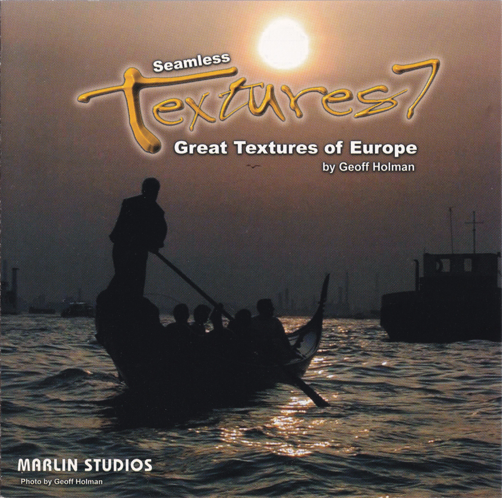
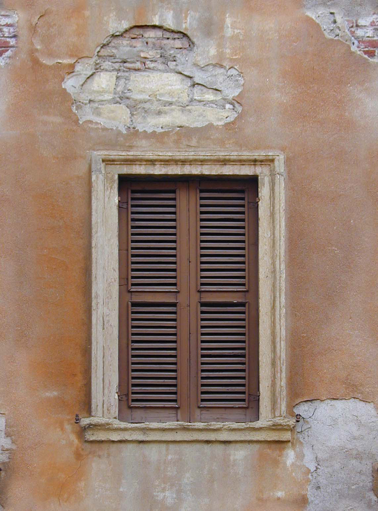

#  Seamless Textures 7 - Great Textures of Europe

{ width="500" }

[Link Archive](https://archive.org/details/Seamless-textures-7-europe/)

> Seamless Textures of Europe 
by Geoff Holman

É um disco que só foi utilizados para os quadros no mapa cs_office (até o momento).

---

| Source Texture | Final Texture |
| -------------- | ------------- |
|  | Origem: `cstrike_pak_dir` |
|||
|`Disk 1\photos\P1011340.jpg` | `materials\models\props\cs_office\offpaintingf.vtf` |

| Source Texture | Final Texture |
| -------------- | ------------- |
|  | Origem: `cstrike_pak_dir` |
|||
|`Disk 1\photos\P1010811.jpg` | `materials\models\props\cs_office\offpaintingh.vtf` |

| Source Texture | Final Texture |
| -------------- | ------------- |
|  | Origem: `cstrike_pak_dir` |
|||
|`Disk 1\photos\P1010965.jpg` | `materials\models\props\cs_office\offpaintingo.vtf` |

| Source Texture | Final Texture |
| -------------- | ------------- |
|  | Origem: `cstrike_pak_dir` |
|||
|`Disk 1\photos\P1010800.jpg` | `materials\models\props\cs_office\offpaintingl.vtf` |

| Source Texture | Final Texture |
| -------------- | ------------- |
|  | Origem: `cstrike_pak_dir` |
|||
|`Disk 1\photos\P1010785.jpg` | `materials\models\props\cs_office\offpaintingk.vtf` |

| Source Texture | Final Texture |
| -------------- | ------------- |
|  | Origem: `cstrike_pak_dir` |
|||
|`Disk 1\photos\P1010663.jpg` | `materials\models\props\cs_office\offpaintingj.vtf` |

| Source Texture | Final Texture |
| -------------- | ------------- |
|  | Origem: `cstrike_pak_dir` |
|||
|`Disk 1\photos\P1010439.jpg` | `materials\models\props\cs_office\offpaintingi.vtf` |

| Source Texture | Final Texture |
| -------------- | ------------- |
|  | Origem: `cstrike_pak_dir` |
|||
|`Disk 1\photos\P1010659.jpg` | `materials\models\props\cs_office\offpaintingg.vtf` |

| Source Texture | Final Texture |
| -------------- | ------------- |
|  | Origem: `cstrike_pak_dir` |
|||
|`Disk 1\photos\P1011283.jpg` | `materials\models\props\cs_office\offpaintinge.vtf` |

| Source Texture | Final Texture |
| -------------- | ------------- |
|  | Origem: `cstrike_pak_dir` |
|||
|`Disk 1\photos\P1011082.jpg` | `materials\models\props\cs_office\offpaintingd.vtf` |

| Source Texture | Final Texture |
| -------------- | ------------- |
|  | Origem: `cstrike_pak_dir` |
|||
|`Disk 1\photos\P1010666.jpg` | `materials\models\props\cs_office\offpaintinga.vtf` |

| Source Texture | Final Texture |
| -------------- | ------------- |
|  | Origem: `cstrike_pak_dir` |
|||
|`Disk 1\photos\P1010662.jpg` | `materials\models\props\cs_office\offpaintingb.vtf` |

| Source Texture | Final Texture |
| -------------- | ---------------------- |
| | Origem: `cstrike_pak_dir` |
|||
|`Textures\Large\bldg024L.jpg` `Textures\Large\bldg196L.jpg` | `materials\composite\buildingset022b.vtf` |

| Source Texture | Final Texture |
| -------------- | ---------------------- |
| | Origem: `cstrike_pak_dir` |
|||
|`Textures\Large\bldg066L.jpg` | `materials\cs_havana\bldb.vtf` |

| Source Texture | Final Texture |
| -------------- | ---------------------- |
| | Origem: `cstrike_pak_dir` |
|||
|`Textures\Large\bldg067L.jpg` | `materials\cs_havana\building05.vtf` |

| Source Texture | Final Texture |
| -------------- | ---------------------- |
| | Origem: `cstrike_pak_dir` |
|||
|`Textures\Large\bldg072L.jpg` | `materials\cs_havana\building03.vtf` |

| Source Texture | Final Texture |
| -------------- | ---------------------- |
| | Origem: `cstrike_pak_dir` |
|||
|`Textures\Large\bldg089L.jpg` `Textures\Large\bldg091L.jpg` | `materials\cs_havana\blde.vtf` |

| Source Texture | Final Texture |
| -------------- | ---------------------- |
| | Origem: `cstrike_pak_dir` |
|||
|`Textures\Large\bldg232L.jpg` | `materials\de_tides\tides_window_1.vtf` |

| Source Texture | Final Texture |
| -------------- | ---------------------- |
| | Origem: `cstrike_pak_dir` |
|||
|`Textures\Large\entr002L.jpg` | `materials\de_tides\tides_wooden_arc_door_2.vtf` |

| Source Texture | Final Texture |
| -------------- | ---------------------- |
| | Origem: `cstrike_pak_dir` |
|||
|`Textures\Large\entr004L.jpg` | `materials\de_tides\tides_wooden_arc_door.vtf` |

| Source Texture | Final Texture |
| -------------- | ---------------------- |
| | Origem: `cstrike_pak_dir` |
|||
|`Textures\Large\entr036L.jpg` | `materials\de_dust\door011.vtf` `materials\de_cbble\door011.vtf`|

| Source Texture | Final Texture |
| -------------- | ---------------------- |
| | Origem: `cstrike_pak_dir` |
|||
|`Textures\Large\entr057L.jpg` | `materials\cs_italy\doora.vtf` |

| Source Texture | Final Texture |
| -------------- | ---------------------- |
| | Origem: `cstrike_pak_dir` |
|||
|`Textures\Large\entr123L.jpg` | `materials\de_piranese\wooddoor01.vtf` |

| Source Texture | Final Texture |
| -------------- | ---------------------- |
| | Origem: `cstrike_pak_dir` |
|||
|`Textures\Large\entr130L.jpg` | `materials\de_cbble\door010.vtf` `materials\de_chateau\brickfdoorc01.vtf`|

| Source Texture | Final Texture |
| -------------- | ---------------------- |
| | Origem: `cstrike_pak_dir` |
|||
|`Textures\Large\entr141L.jpg` | `materials\de_chateau\extdoor01.vtf` `materials\de_chateau\brickfdoor.vtf` |

| Source Texture | Counter-Strike: Source |
| -------------- | ---------------------- |
| | Origem: `cstrike_pak_dir` |
|||
|`Textures\Large\wndw096L.jpg` `Textures\Large\wndw108L.jpg`| `materials\cs_havana\wndx2.vtf` `materials\cs_havana\wndx1.vtf`|

| Source Texture | Counter-Strike: Source |
| -------------- | ---------------------- |
| | Origem: `cstrike_pak_dir` |
|||
|`Textures\Large\wndw126L.jpg`| `materials\cs_italy\pwal8.vtf` `materials\cs_italy\cuwndg.vtf`|

| Source Texture | Counter-Strike: Source |
| -------------- | ---------------------- |
| | Origem: `cstrike_pak_dir` |
|||
|`Textures\Large\wndw157L.jpg`| `materials\models\de_dust\windows\window_4x4_square_flat.vtf`|

| Source Texture | Counter-Strike: Source |
| -------------- | ---------------------- |
| | Origem: `cstrike_pak_dir` |
|||
|`Textures\Large\wndw227L.jpg` `Textures\Large\wndw021L.jpg` `Textures\Large\wndw118L.jpg`| `materials\de_tides\tides_brick_wall_l.vtf`|

| Source Texture | Counter-Strike: Source |
| -------------- | ---------------------- |
| | Origem: `cstrike_pak_dir` |
|||
|`Textures\Large\bldg055L.jpg`| `materials\cs_havana\bldc.vtf`|

| Source Texture | Final Texture |
| -------------- | ------------- |
|  | Origem: `cstrike_pak_dir` |
|||
| Caminho: `Disk 1\photos\entr077L.jpg` |  Caminho: `materials\de_tides\tides_storagedoor.vtf` |

| Source Texture | Final Texture |
| -------------- | ------------- |
|  | Origem: `cstrike_pak_dir` |
|||
| Caminho: `Disk 1\photos\entr077L.jpg` |  Caminho: `materials\cs_havana\offpaintingn.vtf` |

| Source Texture | Final Texture |
| -------------- | ------------- |
|  | Origem: `cstrike_pak_dir` |
|||
| Caminho: `Disk 1\photos\P1010595.jpg` |  Caminho: `materials\cs_havana\offpaintingc.vtf` |

| Source Texture | Final Texture |
| -------------- | ------------- |
|  | Origem: `cstrike_pak_dir` |
|||
| Caminho: `Disk 1\photos\P1010880.jpg` |  Caminho: `materials\cs_havana\offpaintingm.vtf` |

| Source Texture | Counter-Strike: Source |
| -------------- | ---------------------- |
| | Origem: `cstrike_pak_dir` |
|||
|`Textures\Large\bldg055L.jpg`| `materials\cs_havana\wndf.vtf` `materials\cs_havana\cuwndf.vtf`|

| Source Texture | Counter-Strike: Source |
| -------------- | ---------------------- |
| parece faltar a parede | Origem: `cstrike_pak_dir` |
|||
|`Textures\Large\wndw219L.jpg` `Textures\Large\wndw209L.jpg` | `materials\models\cs_italy\wnda.vtf` `materials\models\cs_italy\cuwndb.vtf`|