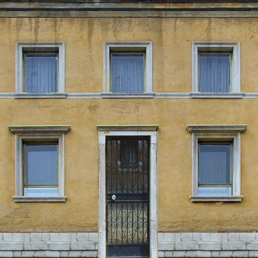
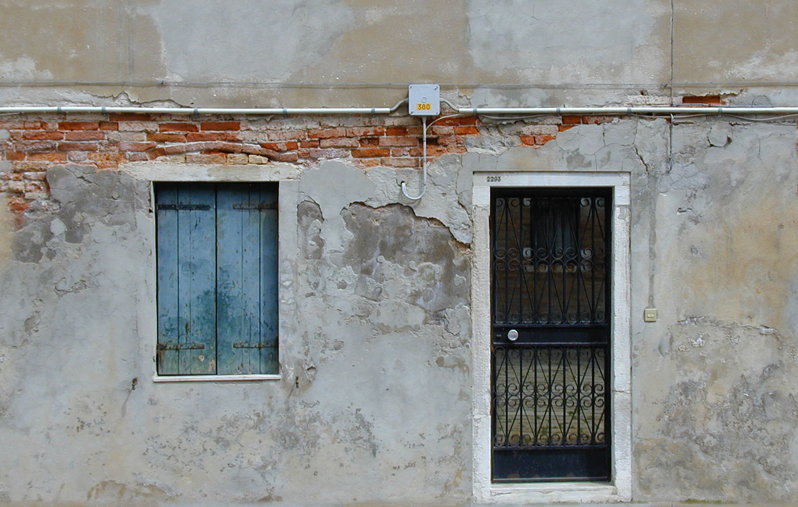
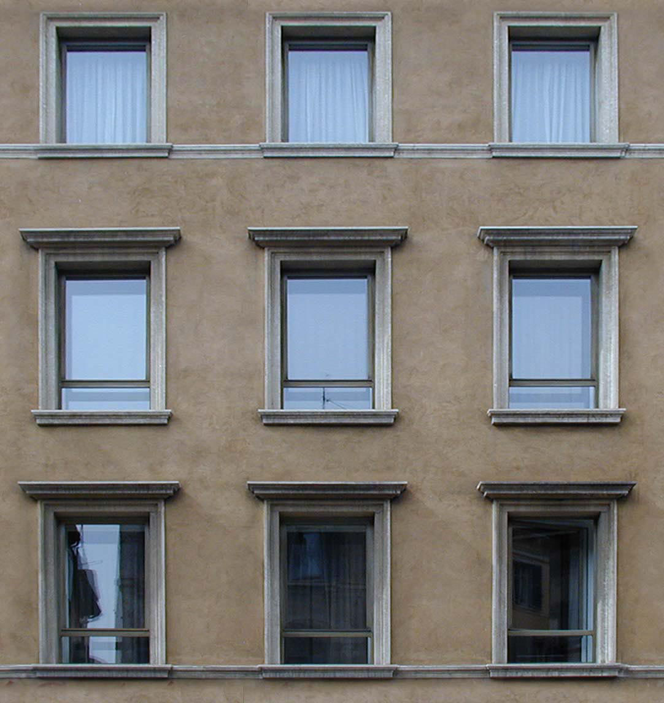
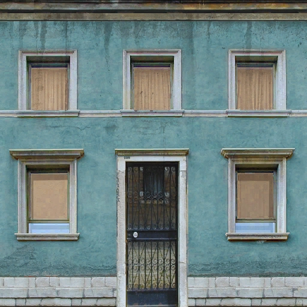
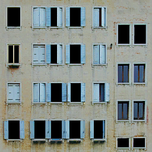
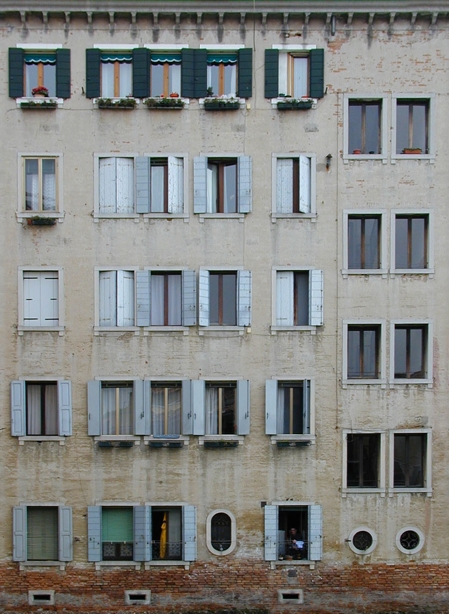
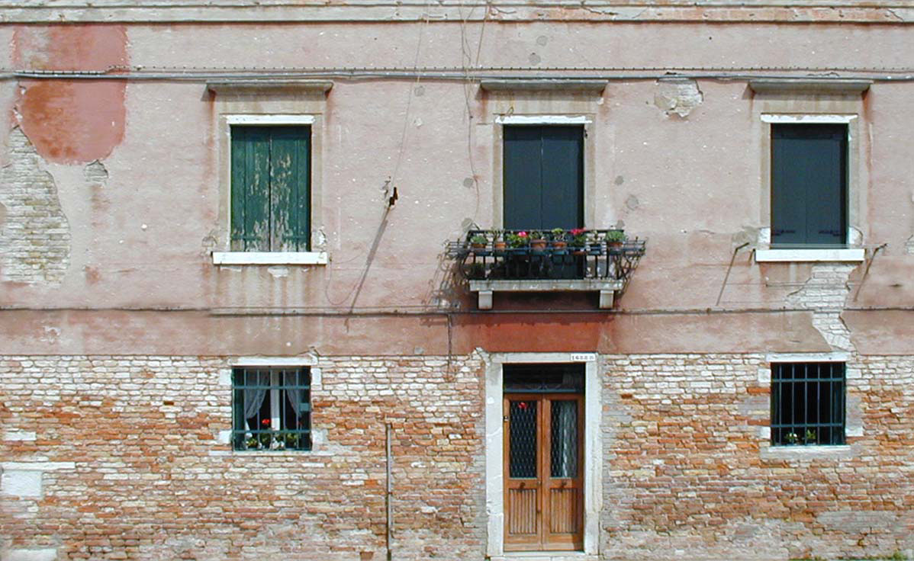

## bldc
| Texture | Come from |
|-------- | --------- |
|`materials\cs_havana\bldc.vtf`|&nbsp;&nbsp;<a href="https://davidmacalister.github.io/Valve-Textures-Documentation/jogos/Counter-Strike%20Source/Seamless%20Textures%207/" style="vertical-align: middle;">`Seamless Textures 7`</a> image: [`bldg055L.jpg`](https://davidmacalister.github.io/Valve-Textures-Documentation/jogos/Counter-Strike%20Source/Seamless%20Textures%207/#bldg055l)   &nbsp;&nbsp;<a href="https://davidmacalister.github.io/Valve-Textures-Documentation/jogos/Counter-Strike%20Source/Seamless%20Textures%207/" style="vertical-align: middle;">`Seamless Textures 7`</a> image: [`bldg003L.jpg`](https://davidmacalister.github.io/Valve-Textures-Documentation/jogos/Counter-Strike%20Source/Seamless%20Textures%207/#bldg003l)

## bldf
| Texture | Come from |
|-------- | --------- |
|`materials\cs_havana\bldf.vtf`|&nbsp;&nbsp;<a href="https://davidmacalister.github.io/Valve-Textures-Documentation/jogos/Counter-Strike%20Source/Seamless%20Textures%207/" style="vertical-align: middle;">`Seamless Textures 7`</a> image: [`bldg055L.jpg`](https://davidmacalister.github.io/Valve-Textures-Documentation/jogos/Counter-Strike%20Source/Seamless%20Textures%207/#bldg055l)   &nbsp;&nbsp;<a href="https://davidmacalister.github.io/Valve-Textures-Documentation/jogos/Counter-Strike%20Source/Seamless%20Textures%207/" style="vertical-align: middle;">`Seamless Textures 7`</a> image: [`bldg003L.jpg`](https://davidmacalister.github.io/Valve-Textures-Documentation/jogos/Counter-Strike%20Source/Seamless%20Textures%207/#bldg003l)

## building03
| Texture | Come from |
|-------- | --------- |
|`materials\cs_havana\building03.vtf`|&nbsp;&nbsp;<a href="https://davidmacalister.github.io/Valve-Textures-Documentation/jogos/Counter-Strike%20Source/Seamless%20Textures%207/" style="vertical-align: middle;">`Seamless Textures 7`</a> image: [`bldg072L.jpg`](https://davidmacalister.github.io/Valve-Textures-Documentation/jogos/Counter-Strike%20Source/Seamless%20Textures%207/#bldg072l)|

## blde
| Texture | Come from |
|-------- | --------- |
|`materials\cs_havana\blde.vtf`|&nbsp;&nbsp;<a href="https://davidmacalister.github.io/Valve-Textures-Documentation/jogos/Counter-Strike%20Source/Seamless%20Textures%207/" style="vertical-align: middle;">`Seamless Textures 7`</a> image: [`bldg091L.jpg`](https://davidmacalister.github.io/Valve-Textures-Documentation/jogos/Counter-Strike%20Source/Seamless%20Textures%207/#bldg091l)   &nbsp;&nbsp;<a href="https://davidmacalister.github.io/Valve-Textures-Documentation/jogos/Counter-Strike%20Source/Seamless%20Textures%207/" style="vertical-align: middle;">`Seamless Textures 7`</a> image: [`bldg089L.jpg`](https://davidmacalister.github.io/Valve-Textures-Documentation/jogos/Counter-Strike%20Source/Seamless%20Textures%207/#bldg089l)|

