# Counter-Strike: Source `0%`

## The current result is incomplete and is a work in progress.

## Textures by map
|assault `0%`|compound `0%`|havana `0%`|italy `0%`|office `0%`|piranesi `0%`|
|---|---|---|---|---|---|
|||||||
|**cbble** `0%`|**chateau** `0%`|**dust** `0%`|**dust2** `0%`|**militia** `0%`|**aztec** `0%`|
|||||||
|**port** `0%`|**prodigy** `0%`|**tides** `0%`|**train** `0%`|**nuke** `0%`|**inferno** `0%`|
|||||||

## Texture CD List
|Company|Library|Abandonware?|
|---|---|---|
|Marlin Studios|[Seamless Textures 2 - Rustic Exterior Surfaces](Seamless Textures 2/index.md)|Sim|
|Marlin Studios|[Seamless Textures 3 - Ultimate Interior Surfaces](Seamless Textures 3/index.md)|Sim|
|Marlin Studios|[Seamless Textures 5 - Downtown Surfaces & Signs](Seamless Textures 5/index.md)|Sim|
|Marlin Studios|[Seamless Textures 7 - Great Textures of Europe](Seamless Textures 7/index.md)|Sim|

## Disco 2

| Source Texture | Final Texture |
| -------------- | ------------- |
|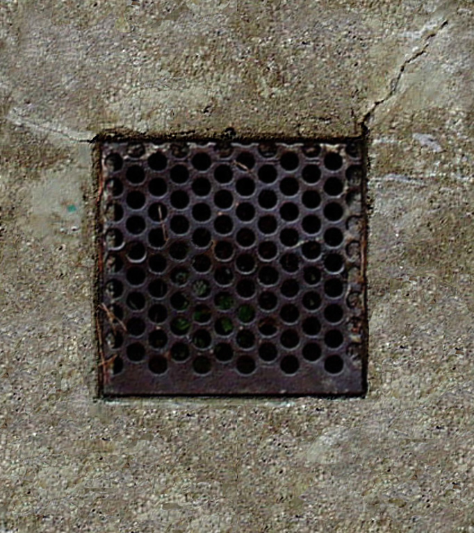`Textures\Large\grat07L.jpg`|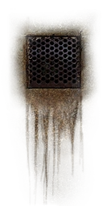`materials\decals\prodventa.vtf`|

| Source Texture | Final Texture |
| -------------- | ------------- |
|`Textures\Large\grat07L.jpg`|`materials\decals\prodplatea.vtf`|

| Source Texture | Final Texture |
| -------------- | ------------- |
|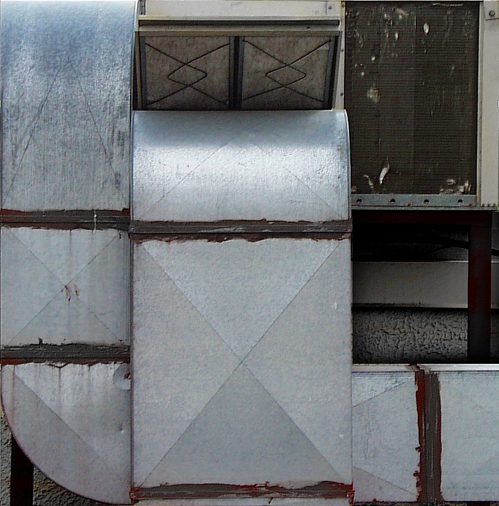`Textures\Large\metl17L.jpg`|.webp)`materials\metal\prodventa.vtf`|

| Source Texture | Final Texture |
| -------------- | ------------- |
|`Textures\Large\pile02L.jpg`|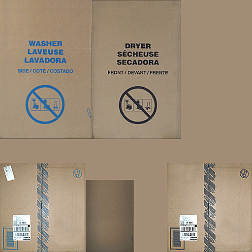`materials\models\props\cs_assault\washer_box.vtf`|

| Source Texture | Final Texture |
| -------------- | ------------- |
|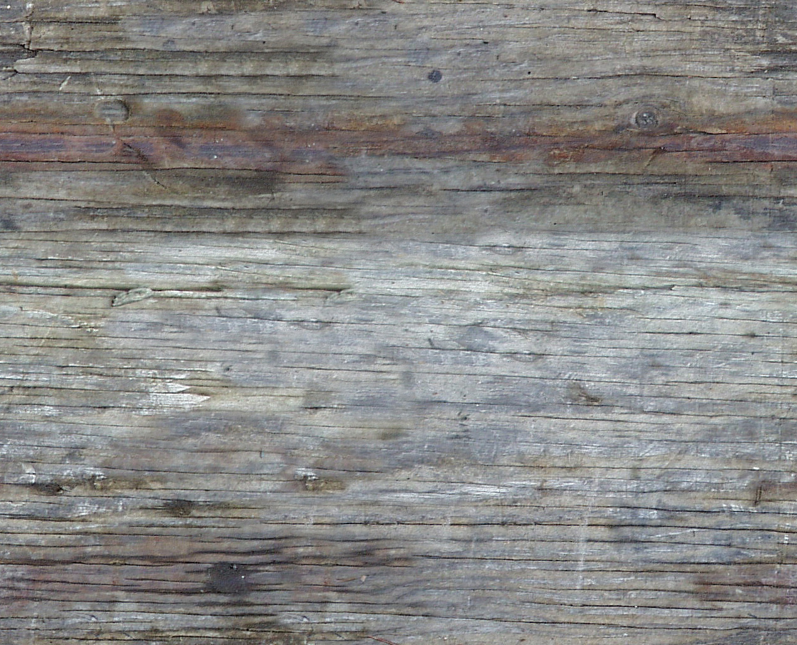`Textures\Large\wood02L.jpg`|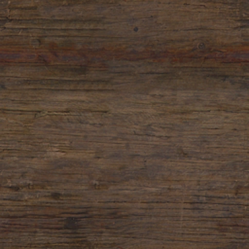`materials\cs_havana\woodm.vtf` `materials\de_chateau\woodm.vtf`   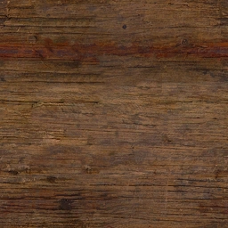`materials\test_speakers\miwoodm.vtf`   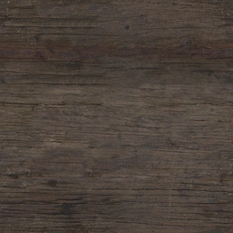`materials\test_speakers\cuwoodm.vtf`|

## Disco 5

| Source Texture | Final Texture |
| -------------- | ------------- |
|`Signs\Large1600x1200Max\comr17L.jpg`|`materials\cs_assault\assault_dumping_decal_02.vtf`|

| Source Texture | Final Texture |
| -------------- | ------------- |
|`Signs\Large800Max\dngr03L.jpg`   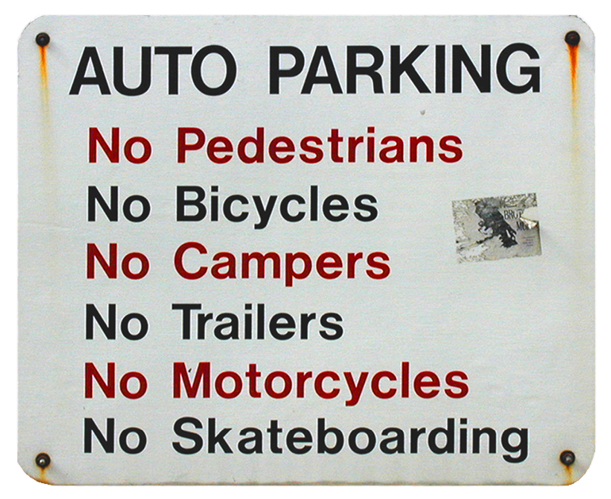`Signs\Large800Max\park13L.jpg`   `Signs\Large800Max\dngr06L.tga`|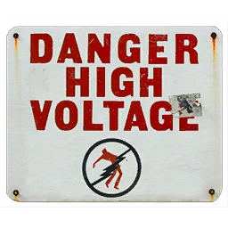`materials\de_nuke\nuksign01.vtf`|

| Source Texture | Final Texture |
| -------------- | ------------- |
|`Signs\Large800Max\park10L.tga`|`materials\cs_assault\assault_parking_decal01.vtf`|

| Source Texture | Final Texture |
| -------------- | ------------- |
|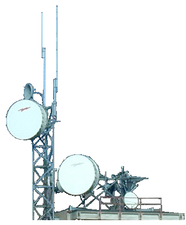`Textures\Large1600x1200Max\antn06L.tga`|`materials\building\antn03.vtf`|

| Source Texture | Final Texture |
| -------------- | ------------- |
|`Textures\Large1600x1200Max\antn07L.tga`|`materials\building\antn04.vtf`|

| Source Texture | Final Texture |
| -------------- | ------------- |
|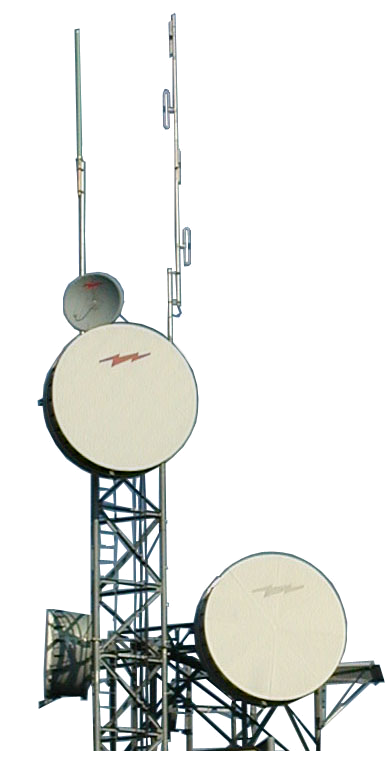`Textures\Large1600x1200Max\antn13L.tga`|`materials\building\antn02.vtf`|

| Source Texture | Final Texture |
| -------------- | ---------------------- |
|`Textures\Large1600x1200Max\antn15L.tga`|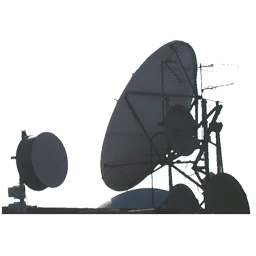`materials\building\antn01.vtf`|

| Source Texture | Final Texture |
| -------------- | ---------------------- |
|`Textures\Large1600x1200Max\clok01L.tga`|`materials\models\props\de_nuke\clock.vtf`|

| Source Texture | Final Texture |
| -------------- | ------------- |
|`Textures\Large1600x1200Max\cncr21L.jpg`|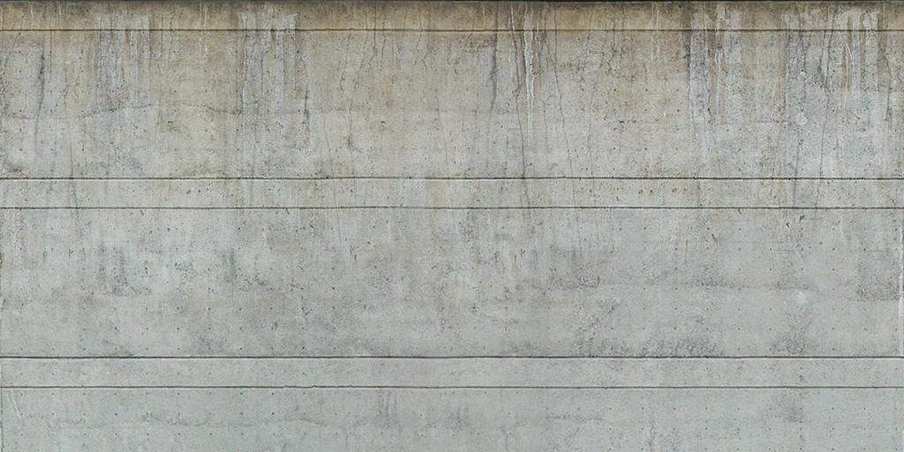`materials\de_nuke\nukconcretewallb.vtf`   `materials\de_nuke\nukconcretewalla.vtf`   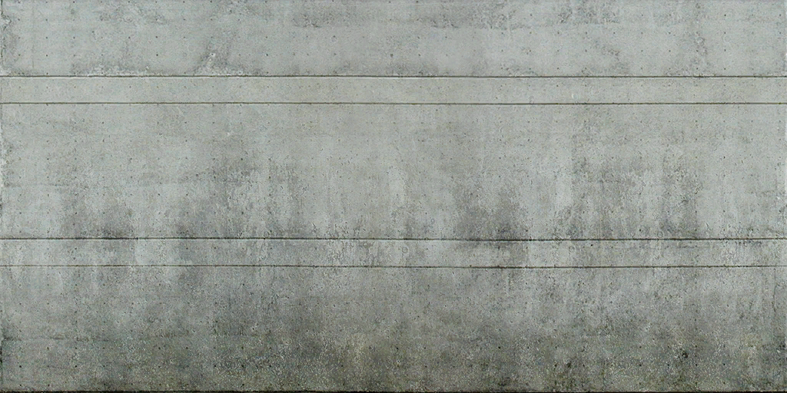`materials\de_nuke\nukconcretewallc.vtf`|

| Source Texture | Final Texture |
| -------------- | ------------- |
|`Textures\Large1600x1200Max\cran01L.tga`|`materials\cs_assault\assault_skybox_building03.vtf`|

| Source Texture | Final Texture |
| -------------- | ------------- |
|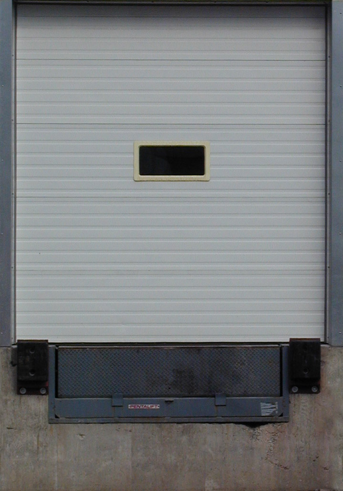`Textures\Large1600x1200Max\door44L.jpg`|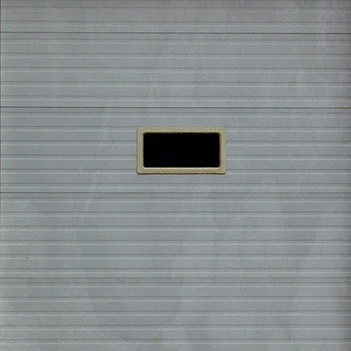`materials\cs_assault\assault_door1.vtf`|

| Source Texture | Final Texture |
| -------------- | ------------- |
|`Textures\Large1600x1200Max\grat21L.jpg`|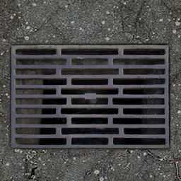`materials\de_nuke\nukfloorc_detaile.vtf`|

| Source Texture | Final Texture |
| -------------- | ------------- |
|`Textures\Large1600x1200Max\skyr11L.jpg`|`materials\buildings\gen01.vtf`|

| Source Texture | Final Texture |
| -------------- | ------------- |
|`Textures\Large1600x1200Max\skyr12L.jpg`|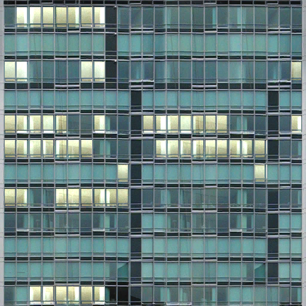`materials\buildings\gen02.vtf` `materials\cs_havana\gen02.vtf`|

| Source Texture | Final Texture |
| -------------- | ------------- |
|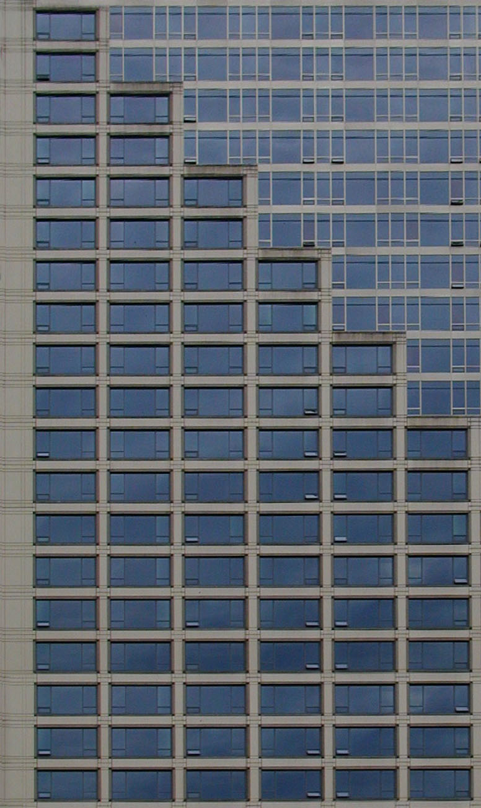`Textures\Large1600x1200Max\skyr13L.jpg`|`materials\buildings\gen03.vtf`|

| Source Texture | Final Texture |
| -------------- | ------------- |
|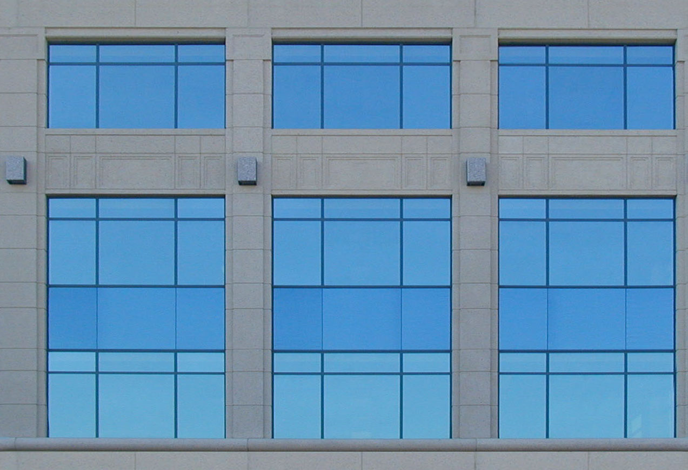`Textures\Large1600x1200Max\skyr15L.jpg`|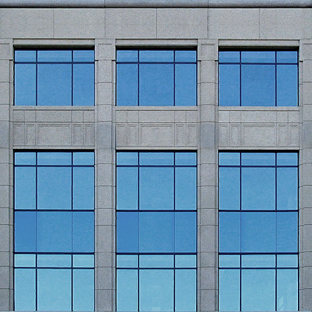`materials\buildings\gen04.vtf` `materials\cs_havana\gen04.vtf`|

| Source Texture | Final Texture |
| -------------- | ------------- |
|`Textures\Large1600x1200Max\skyr19L.jpg`|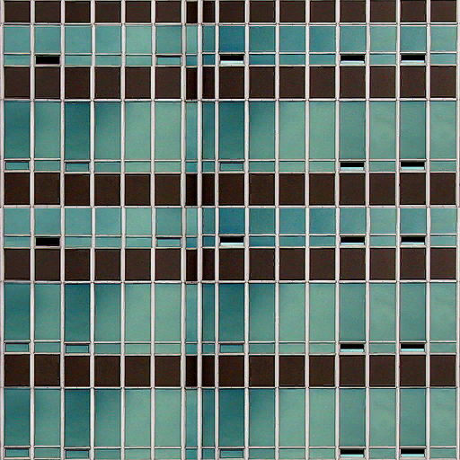`materials\cs_assault\assault_skybox_building01.vtf`|

| Source Texture | Final Texture |
| -------------- | ------------- |
|`Textures\Large1600x1200Max\skyr21L.jpg`|`materials\buildings\gen05.vtf` `materials\cs_havana\gen05.vtf`|

| Source Texture | Final Texture |
| -------------- | ------------- |
|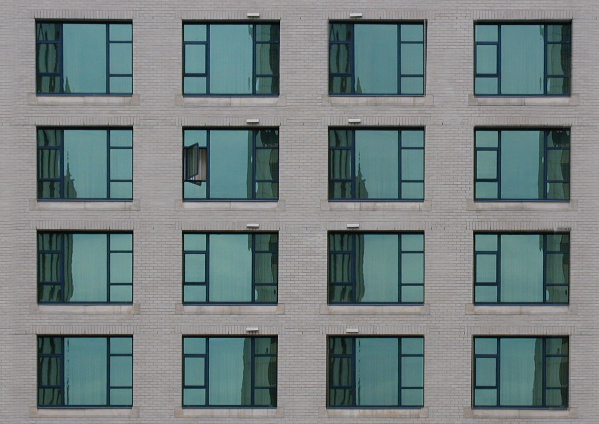`Textures\Large1600x1200Max\skyr22L.jpg`|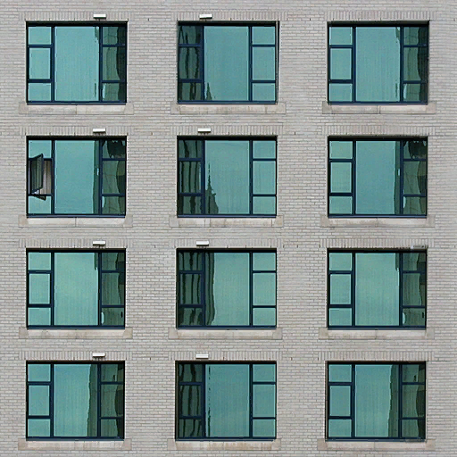`materials\buildings\gen06.vtf` `materials\cs_havana\gen06.vtf`|

| Source Texture | Final Texture |
| -------------- | ------------- |
|`Textures\Large1600x1200Max\skyr23L.jpg`|`materials\buildings\gen07.vtf`   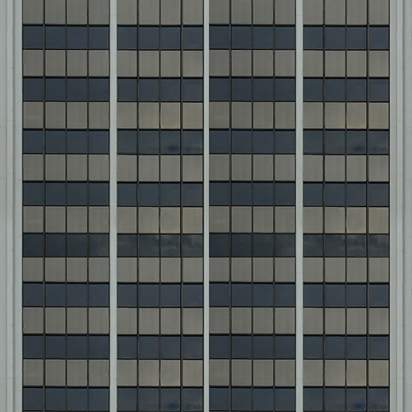`cs_assault/assault_skybox_building02.vtf`|

| Source Texture | Final Texture |
| -------------- | ------------- |
|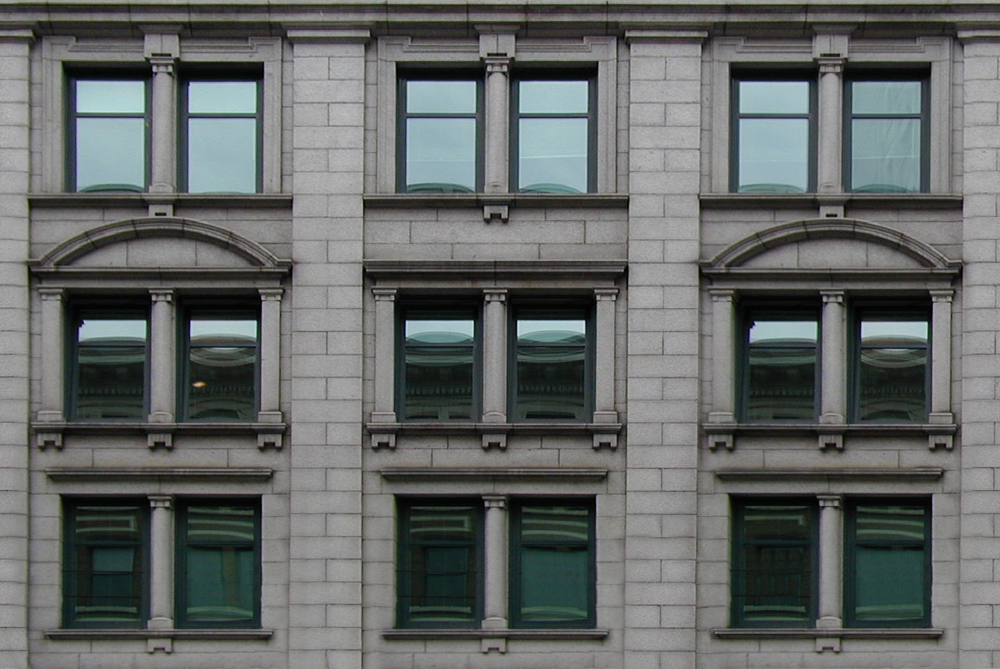`Textures\Large1600x1200Max\skyr25L.jpg`|`materials\buildings\gen08.vtf`|

| Source Texture | Final Texture |
| -------------- | ------------- |
|`Textures\Large1600x1200Max\skyr28L.jpg`|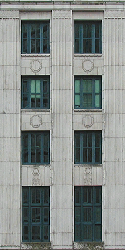`materials\buildings\gen09.vtf`   `materials\buildings\gen10.vtf` `materials\cs_havana\gen10.vtf`|

| Source Texture | Final Texture |
| -------------- | ------------- |
|`Textures\Large1600x1200Max\skyr30L.jpg`|`materials\buildings\gen11.vtf` `materials\cs_havana\gen11.vtf`|

| Source Texture | Final Texture |
| -------------- | ------------- |
|`Textures\Large1600x1200Max\skyr32L.jpg`|`materials\buildings\gen12.vtf`|

| Source Texture | Final Texture |
| -------------- | ------------- |
|`Textures\Large1600x1200Max\skyr33L.jpg`|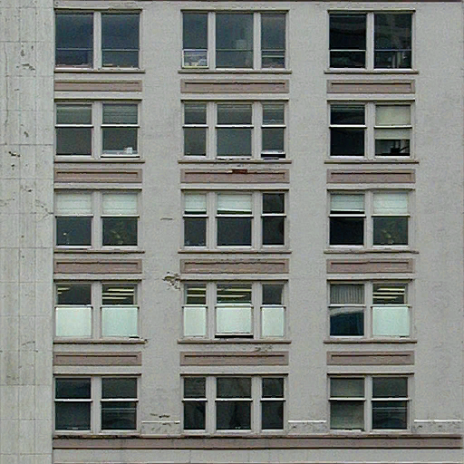`materials\buildings\gen13.vtf` `materials\cs_havana\gen13.vtf`|

| Source Texture | Final Texture |
| -------------- | ------------- |
|`Textures\Large1600x1200Max\skyr34L.jpg`|`materials\buildings\gen14.vtf` `materials\cs_hanava\gen14.vtf`|

| Source Texture | Final Texture |
| -------------- | ------------- |
|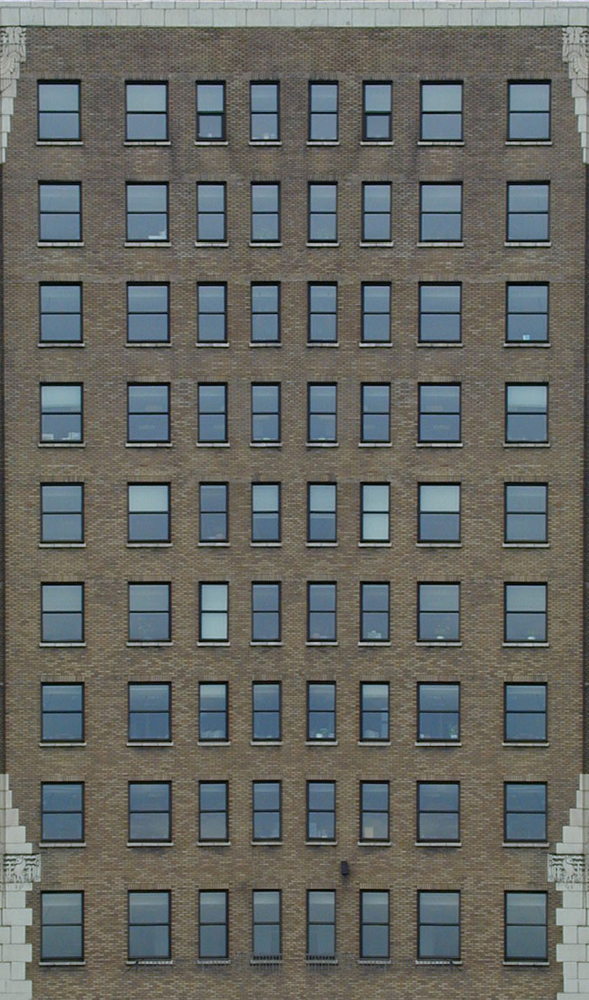`Textures\Large1600x1200Max\skyr36L.jpg`|`materials\buildings\gen15.vtf`|

| Source Texture | Final Texture |
| -------------- | ------------- |
|`Textures\Large1600x1200Max\skyr37L.jpg`|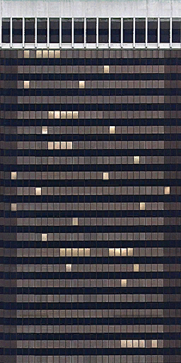`materials\buildings\gen16.vtf`|

| Source Texture | Final Texture |
| -------------- | ------------- |
|`Textures\Large1600x1200Max\skyr39L.jpg`|`materials\buildings\gen17.vtf`|

| Source Texture | Final Texture |
| -------------- | ------------- |
|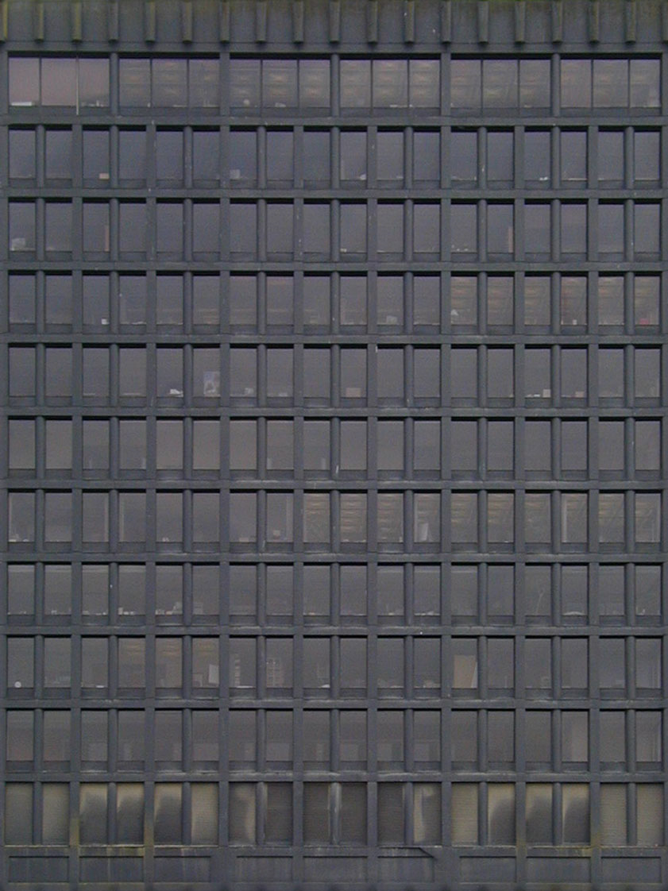`Textures\Large1600x1200Max\skyr41L.jpg`|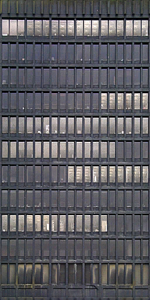`materials\buildings\gen18.vtf`|

| Source Texture | Final Texture |
| -------------- | ------------- |
|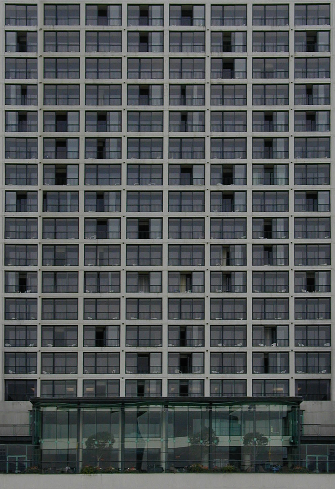`Textures\Large1600x1200Max\skyr42L.jpg`|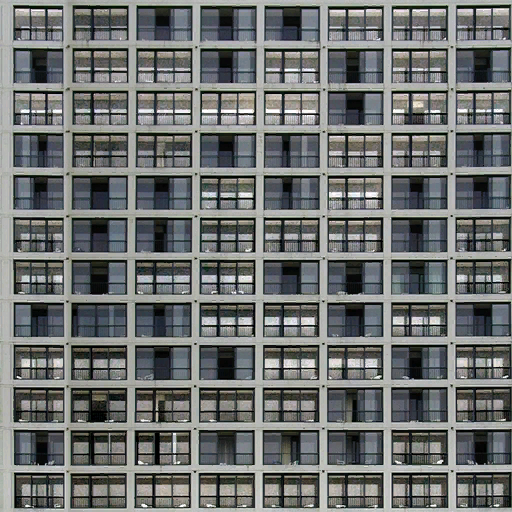`materials\buildings\gen19.vtf`|

| Source Texture | Final Texture |
| -------------- | ------------- |
|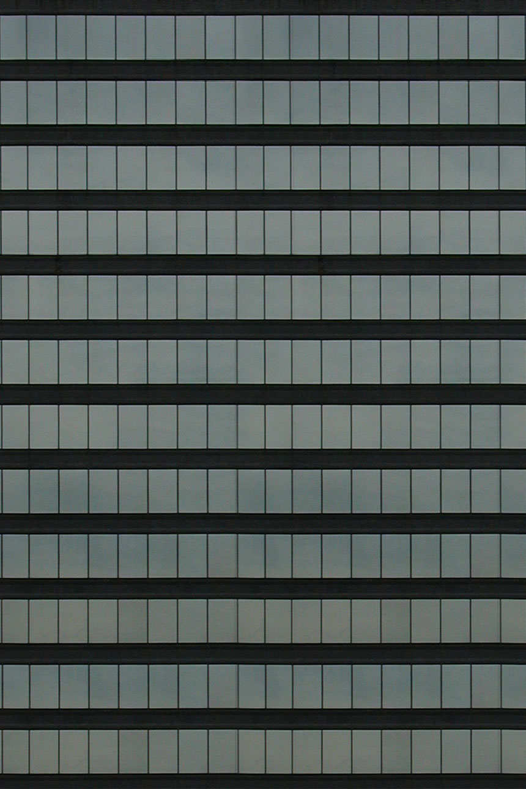`Textures\Large1600x1200Max\skyr44L.jpg`|`materials\cs_assualt\assault_skybox_building04.vtf`|

| Source Texture | Final Texture |
| -------------- | ------------- |
|`Textures\Large1600x1200Max\skyr46L.jpg`|`materials\buildings\gen20.vtf`|

| Source Texture | Final Texture |
| -------------- | ------------- |
|`Textures\Large1600x1200Max\skyr49L.jpg`|`materials\buildings\gen21.vtf`|

| Source Texture | Final Texture |
| -------------- | ------------- |
|`Textures\Large1600x1200Max\skyr58L.jpg`|`materials\buildings\gen22.vtf`|

| Source Texture | Final Texture |
| -------------- | ------------- |
|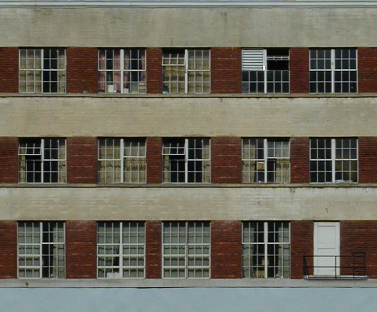||
|`Textures\Large1600x1200Max\skyr59L.jpg` | `materials\buildings\gen23.vtf` |

| Source Texture | Final Texture |
| -------------- | ---------------------- |
|||
|`Textures\Large1600x1200Max\skyr65L.jpg` | `materials\buildings\gen24.vtf` |

| Source Texture | Final Texture |
| -------------- | ---------------------- |
|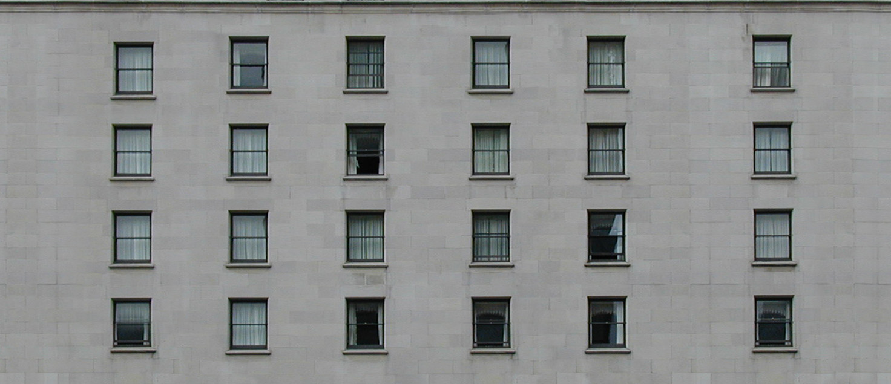`Textures\Large1600x1200Max\skyr69L.jpg`|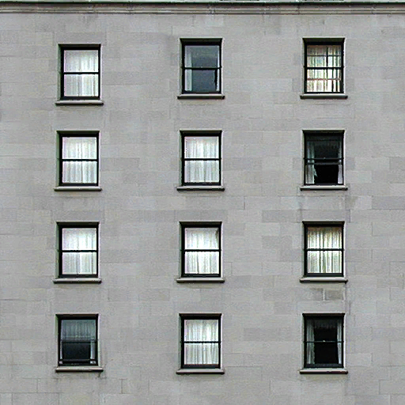`materials\buildings\gen25.vtf`|

| Source Texture | Final Texture |
| -------------- | ---------------------- |
|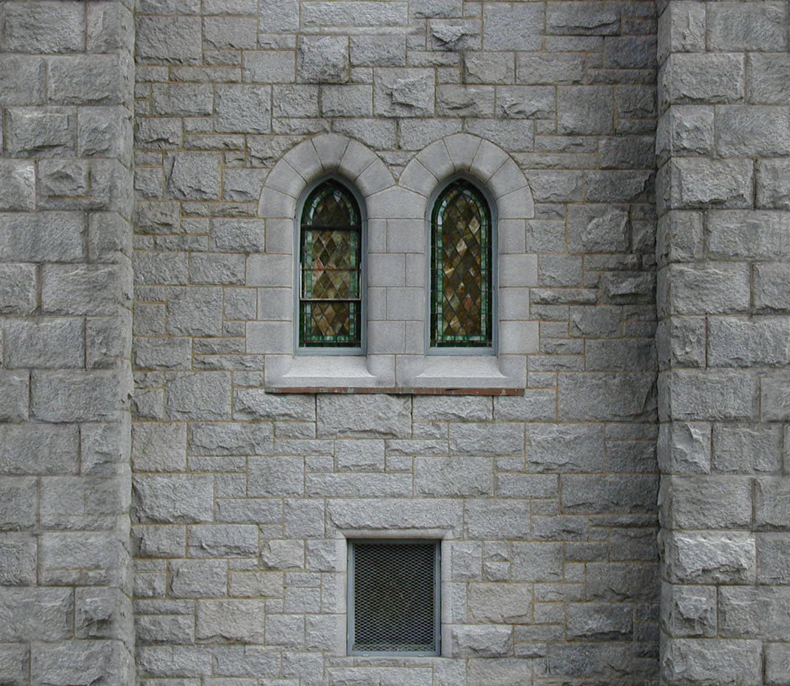`Textures\Large1600x1200Max\wal102L.jpg`|`materials\models\de_cbble\wndarch.vtf`|

| Source Texture | Final Texture |
| -------------- | ---------------------- |
|`Textures\Large1600x1200Max\wal107L.jpg`|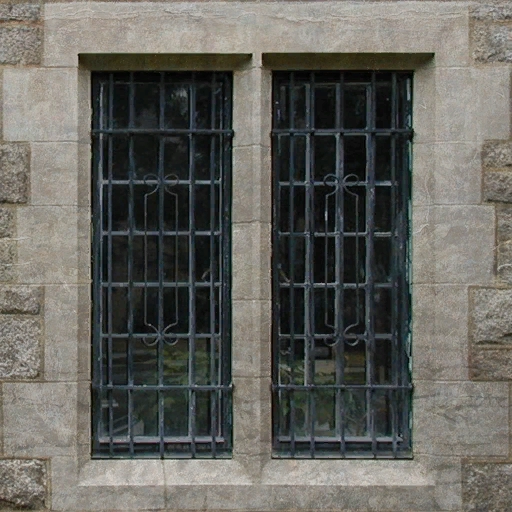`materials\models\de_cbble\wnddouble.vtf`   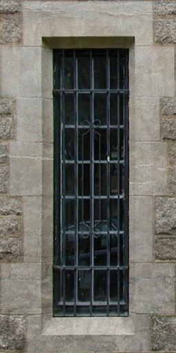`materials\models\de_cbble\wndsingle.vtf`   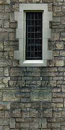`materials\de_tides\tiddecwndw01.vtf`|

| Source Texture | Final Texture |
| -------------- | ------------- |
| Tá faltando a grade | Textura contém elementos de entr123L do disco 7 |
|`Textures\Large1600x1200Max\wal105L.jpg`|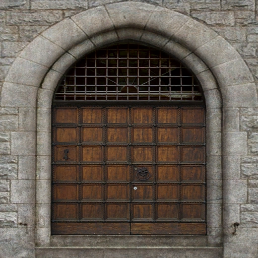`materials\models\de_cbble\doorarch.vtf`|

| Source Texture | Final Texture |
| -------------- | ------------- |
|`Textures\Large1600x1200Max\vent04L.jpg`|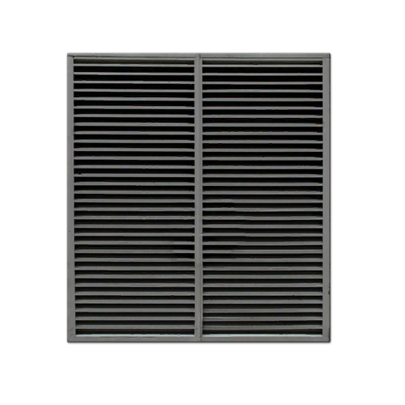`materials\de_nuke\nukventa.vtf`|

| Source Texture | Final Texture |
| -------------- | ------------- |
|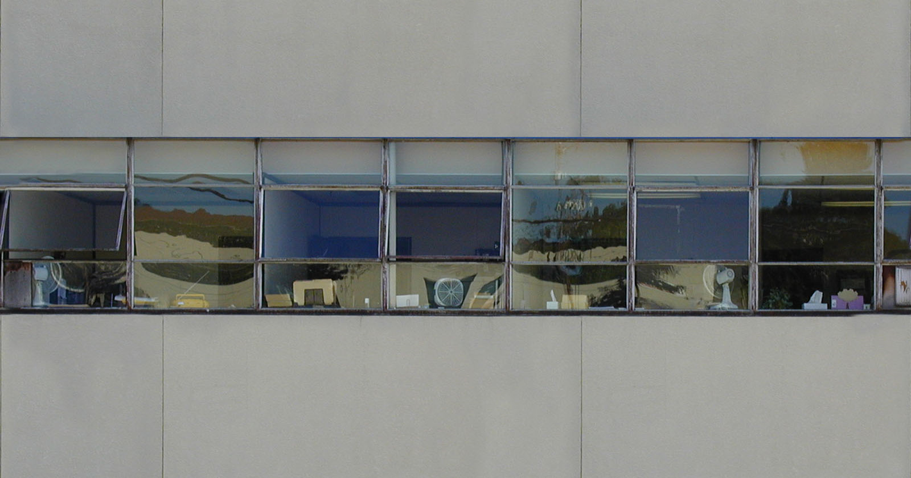`Textures\Large1600x1200Max\wal070L.jpg`|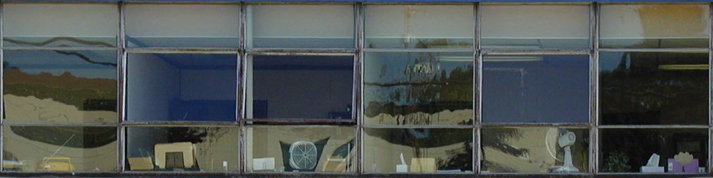`materials\de_nuke\nukwindowe.vtf`|

| Source Texture | Final Texture |
| -------------- | ------------- |
|`Textures\Large1600x1200Max\wal156L.jpg`|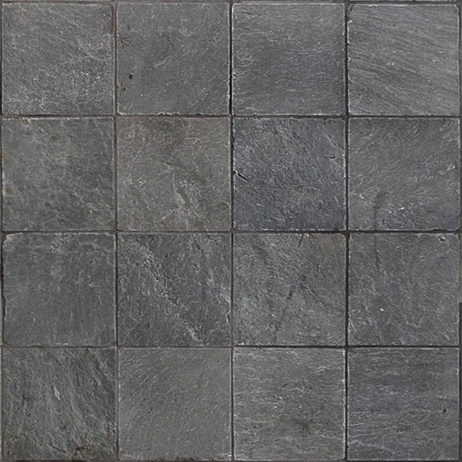`materials\de_piranese\walltrim01.vtf`|
| Source Texture | Final Texture |
| -------------- | ------------- |
|`Signs\Large800Max\park10L.tga`|`materials\cs_assault\assault_parking_decal01.vtf`|

| Source Texture | Final Texture |
| -------------- | ------------- |
|`Signs\Large800Max\dngr03L.jpg`   `Signs\Large800Max\park13L.jpg`   `Signs\Large800Max\dngr06L.tga`|`materials\de_nuke\nuksign01.vtf`|

| Source Texture | Final Texture |
| -------------- | ------------- |
|`Signs\Large1600x1200Max\comr17L.jpg`|`materials\cs_assault\assault_dumping_decal_02.vtf`|

| Source Texture | Final Texture |
| -------------- | ------------- |
|`Textures\Large1600x1200Max\antn06L.tga`|`materials\building\antn03.vtf`|

| Source Texture | Final Texture |
| -------------- | ------------- |
|`Textures\Large1600x1200Max\antn07L.tga`|`materials\building\antn04.vtf`|

| Source Texture | Final Texture |
| -------------- | ------------- |
|`Textures\Large1600x1200Max\antn13L.tga`|`materials\building\antn02.vtf`|

| Source Texture | Final Texture |
| -------------- | ---------------------- |
|`Textures\Large1600x1200Max\antn15L.tga`|`materials\building\antn01.vtf`|

| Source Texture | Final Texture |
| -------------- | ---------------------- |
|`Textures\Large1600x1200Max\clok01L.tga`|`materials\models\props\de_nuke\clock.vtf`|

| Source Texture | Final Texture |
| -------------- | ------------- |
|`Textures\Large1600x1200Max\cncr21L.jpg`|`materials\de_nuke\nukconcretewallb.vtf`   `materials\de_nuke\nukconcretewalla.vtf`   `materials\de_nuke\nukconcretewallc.vtf`|

| Source Texture | Final Texture |
| -------------- | ------------- |
|`Textures\Large1600x1200Max\cran01L.tga`|`materials\cs_assault\assault_skybox_building03.vtf`|

| Source Texture | Final Texture |
| -------------- | ------------- |
|`Textures\Large1600x1200Max\door44L.jpg`|`materials\cs_assault\assault_door1.vtf`|

| Source Texture | Final Texture |
| -------------- | ------------- |
|`Textures\Large1600x1200Max\grat21L.jpg`|`materials\de_nuke\nukfloorc_detaile.vtf`|

| Source Texture | Final Texture |
| -------------- | ------------- |
|`Textures\Large1600x1200Max\skyr11L.jpg`|`materials\buildings\gen01.vtf`|

| Source Texture | Final Texture |
| -------------- | ------------- |
|`Textures\Large1600x1200Max\skyr12L.jpg`|`materials\buildings\gen02.vtf` `materials\cs_havana\gen02.vtf`|

| Source Texture | Final Texture |
| -------------- | ------------- |
|`Textures\Large1600x1200Max\skyr13L.jpg`|`materials\buildings\gen03.vtf`|

| Source Texture | Final Texture |
| -------------- | ------------- |
|`Textures\Large1600x1200Max\skyr15L.jpg`|`materials\buildings\gen04.vtf` `materials\cs_havana\gen04.vtf`|

| Source Texture | Final Texture |
| -------------- | ------------- |
|`Textures\Large1600x1200Max\skyr19L.jpg`|`materials\cs_assault\assault_skybox_building01.vtf`|

| Source Texture | Final Texture |
| -------------- | ------------- |
|`Textures\Large1600x1200Max\skyr21L.jpg`|`materials\buildings\gen05.vtf` `materials\cs_havana\gen05.vtf`|

| Source Texture | Final Texture |
| -------------- | ------------- |
|`Textures\Large1600x1200Max\skyr22L.jpg`|`materials\buildings\gen06.vtf` `materials\cs_havana\gen06.vtf`|

| Source Texture | Final Texture |
| -------------- | ------------- |
|`Textures\Large1600x1200Max\skyr23L.jpg`|`materials\buildings\gen07.vtf`   `cs_assault/assault_skybox_building02.vtf`|

| Source Texture | Final Texture |
| -------------- | ------------- |
|`Textures\Large1600x1200Max\skyr25L.jpg`|`materials\buildings\gen08.vtf`|

| Source Texture | Final Texture |
| -------------- | ------------- |
|`Textures\Large1600x1200Max\skyr28L.jpg`|`materials\buildings\gen09.vtf`   `materials\buildings\gen10.vtf` `materials\cs_havana\gen10.vtf`|

| Source Texture | Final Texture |
| -------------- | ------------- |
|`Textures\Large1600x1200Max\skyr30L.jpg`|`materials\buildings\gen11.vtf` `materials\cs_havana\gen11.vtf`|

| Source Texture | Final Texture |
| -------------- | ------------- |
|`Textures\Large1600x1200Max\skyr32L.jpg`|`materials\buildings\gen12.vtf`|

| Source Texture | Final Texture |
| -------------- | ------------- |
|`Textures\Large1600x1200Max\skyr33L.jpg`|`materials\buildings\gen13.vtf` `materials\cs_havana\gen13.vtf`|

| Source Texture | Final Texture |
| -------------- | ------------- |
|`Textures\Large1600x1200Max\skyr34L.jpg`|`materials\buildings\gen14.vtf` `materials\cs_hanava\gen14.vtf`|

| Source Texture | Final Texture |
| -------------- | ------------- |
|`Textures\Large1600x1200Max\skyr36L.jpg`|`materials\buildings\gen15.vtf`|

| Source Texture | Final Texture |
| -------------- | ------------- |
|`Textures\Large1600x1200Max\skyr37L.jpg`|`materials\buildings\gen16.vtf`|

| Source Texture | Final Texture |
| -------------- | ------------- |
|`Textures\Large1600x1200Max\skyr39L.jpg`|`materials\buildings\gen17.vtf`|

| Source Texture | Final Texture |
| -------------- | ------------- |
|`Textures\Large1600x1200Max\skyr41L.jpg`|`materials\buildings\gen18.vtf`|

| Source Texture | Final Texture |
| -------------- | ------------- |
|`Textures\Large1600x1200Max\skyr42L.jpg`|`materials\buildings\gen19.vtf`|

| Source Texture | Final Texture |
| -------------- | ------------- |
|`Textures\Large1600x1200Max\skyr44L.jpg`|`materials\cs_assualt\assault_skybox_building04.vtf`|

| Source Texture | Final Texture |
| -------------- | ------------- |
|`Textures\Large1600x1200Max\skyr46L.jpg`|`materials\buildings\gen20.vtf`|

| Source Texture | Final Texture |
| -------------- | ------------- |
|`Textures\Large1600x1200Max\skyr49L.jpg`|`materials\buildings\gen21.vtf`|

| Source Texture | Final Texture |
| -------------- | ------------- |
|`Textures\Large1600x1200Max\skyr58L.jpg`|`materials\buildings\gen22.vtf`|

| Source Texture | Final Texture |
| -------------- | ------------- |
|||
|`Textures\Large1600x1200Max\skyr59L.jpg` | `materials\buildings\gen23.vtf` |

| Source Texture | Final Texture |
| -------------- | ---------------------- |
|||
|`Textures\Large1600x1200Max\skyr65L.jpg` | `materials\buildings\gen24.vtf` |

| Source Texture | Final Texture |
| -------------- | ---------------------- |
|`Textures\Large1600x1200Max\skyr69L.jpg`|`materials\buildings\gen25.vtf`|

| Source Texture | Final Texture |
| -------------- | ------------- |
|`Textures\Large1600x1200Max\vent04L.jpg`|`materials\de_nuke\nukventa.vtf`|

| Source Texture | Final Texture |
| -------------- | ------------- |
|`Textures\Large1600x1200Max\wal070L.jpg`|`materials\de_nuke\nukwindowe.vtf`|

| Source Texture | Final Texture |
| -------------- | ---------------------- |
|`Textures\Large1600x1200Max\wal102L.jpg`|`materials\models\de_cbble\wndarch.vtf`|

| Source Texture | Final Texture |
| -------------- | ------------- |
| Tá faltando a grade | Textura contém elementos de entr123L do disco 7 |
|`Textures\Large1600x1200Max\wal105L.jpg`|`materials\models\de_cbble\doorarch.vtf`|

| Source Texture | Final Texture |
| -------------- | ---------------------- |
|`Textures\Large1600x1200Max\wal107L.jpg`|`materials\models\de_cbble\wnddouble.vtf`   `materials\models\de_cbble\wndsingle.vtf`   `materials\de_tides\tiddecwndw01.vtf`|

| Source Texture | Final Texture |
| -------------- | ------------- |
|`Textures\Large1600x1200Max\wal156L.jpg`|`materials\de_piranese\walltrim01.vtf`|

## Disco 7

| Source Texture | Used in |
| -------------- | ------------- |
|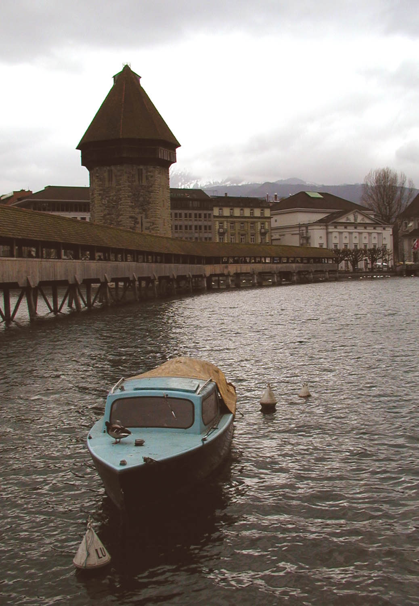`Disk 1\photos\P1010439.jpg`|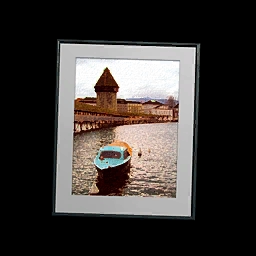`materials\cs_havana\offpaintingi.vtf`|

| Source Texture | Used in |
| -------------- | ------------- |
|`Disk 1\photos\P1010595.jpg`|`materials\cs_havana\offpaintingc.vtf`|

| Source Texture | Used in |
| -------------- | ------------- |
|`Disk 1\photos\P1010659.jpg`|`materials\cs_havana\offpaintingg.vtf`|

| Source Texture | Used in |
| -------------- | ------------- |
|`Disk 1\photos\P1010662.jpg`|`materials\models\props\cs_office\offpaintingb.vtf`|

| Source Texture | Used in |
| -------------- | ------------- |
|`Disk 1\photos\P1010663.jpg`|`materials\models\props\cs_office\offpaintingj.vtf`|

| Source Texture | Used in |
| -------------- | ------------- |
|`Disk 1\photos\P1010666.jpg`|`materials\models\props\cs_office\offpaintinga.vtf`|

| Source Texture | Used in |
| -------------- | ------------- |
|`Disk 1\photos\P1010785.jpg`|`materials\models\props\cs_office\offpaintingk.vtf`|

| Source Texture | Used in |
| -------------- | ------------- |
|`Disk 1\photos\P1010800.jpg`|`materials\models\props\cs_office\offpaintingl.vtf`|

| Source Texture | Used in |
| -------------- | ------------- |
|`Disk 1\photos\P1010811.jpg`|`materials\models\props\cs_office\offpaintingh.vtf`|

| Source Texture | Used in |
| -------------- | ------------- |
|`Disk 1\photos\P1010880.jpg`|`materials\models\props\cs_office\offpaintingm.vtf`|

| Source Texture | Used in |
| -------------- | ------------- |
|`Disk 1\photos\P1010895.jpg`|`materials\models\props\cs_office\offpaintingn.vtf`|

| Source Texture | Used in |
| -------------- | ------------- |
|`Disk 1\photos\P1010965.jpg`|`materials\models\props\cs_office\offpaintingo.vtf`|

| Source Texture | Used in |
| -------------- | ------------- |
|`Disk 1\photos\P1011082.jpg`|`materials\models\props\cs_office\offpaintingd.vtf`|

| Source Texture | Used in |
| -------------- | ------------- |
|`Disk 1\photos\P1011283.jpg`|`materials\models\props\cs_office\offpaintinge.vtf`|

| Source Texture | Used in |
| -------------- | ------------- |
|`Disk 1\photos\P1011340.jpg`|`materials\models\props\cs_office\offpaintingf.vtf`|

| Source Texture | Used in |
| -------------- | ------------- |
|`Textures\Large\bldg003L.jpg`|&nbsp;&nbsp;<a href="https://davidmacalister.github.io/Valve-Textures-Documentation/jogos/Counter-Strike%20Source/havana/" style="vertical-align: middle;">`cs_havana`</a> texture: [`bldc.vtf`](https://davidmacalister.github.io/Valve-Textures-Documentation/jogos/Counter-Strike%20Source/havana/#bldc)   &nbsp;&nbsp;<a href="https://davidmacalister.github.io/Valve-Textures-Documentation/jogos/Counter-Strike%20Source/havana/" style="vertical-align: middle;">`cs_havana`</a> texture: [`bldf.vtf`](https://davidmacalister.github.io/Valve-Textures-Documentation/jogos/Counter-Strike%20Source/havana/#bldf)

| Source Texture | Used in |
| -------------- | ------------- |
|`Textures\Large\bldg024L.jpg`|`materials\composite\buildingset022b.vtf`|

| Source Texture | Used in |
| -------------- | ------------- |
|`Textures\Large\bldg055L.jpg`|&nbsp;&nbsp;<a href="https://davidmacalister.github.io/Valve-Textures-Documentation/jogos/Counter-Strike%20Source/havana/" style="vertical-align: middle;">`cs_havana`</a> texture: [`bldc.vtf`](https://davidmacalister.github.io/Valve-Textures-Documentation/jogos/Counter-Strike%20Source/havana/#bldc)   &nbsp;&nbsp;<a href="https://davidmacalister.github.io/Valve-Textures-Documentation/jogos/Counter-Strike%20Source/havana/" style="vertical-align: middle;">`cs_havana`</a> texture: [`bldf.vtf`](https://davidmacalister.github.io/Valve-Textures-Documentation/jogos/Counter-Strike%20Source/havana/#bldf)|

| Source Texture | Used in |
| -------------- | ------------- |
|`Textures\Large\bldg066L.jpg`|`materials\cs_havana\bldb.vtf`|

| Source Texture | Used in |
| -------------- | ------------- |
|`Textures\Large\bldg067L.jpg`|`materials\cs_havana\building05.vtf`|

| Source Texture | Used in |
| -------------- | ------------- |
|`Textures\Large\bldg072L.jpg`|&nbsp;&nbsp;<a href="https://davidmacalister.github.io/Valve-Textures-Documentation/jogos/Counter-Strike%20Source/havana/" style="vertical-align: middle;">`cs_havana`</a> texture: [`building03.vtf`](https://davidmacalister.github.io/Valve-Textures-Documentation/jogos/Counter-Strike%20Source/havana/#building03)

| Source Texture | Used in |
| -------------- | ------------- |
|`Textures\Large\bldg089L.jpg`|&nbsp;&nbsp;<a href="https://davidmacalister.github.io/Valve-Textures-Documentation/jogos/Counter-Strike%20Source/havana/" style="vertical-align: middle;">`cs_havana`</a> texture: [`blde.vtf`](https://davidmacalister.github.io/Valve-Textures-Documentation/jogos/Counter-Strike%20Source/havana/#blde)

| Source Texture | Used in |
| -------------- | ------------- |
|`Textures\Large\bldg091L.jpg`|&nbsp;&nbsp;<a href="https://davidmacalister.github.io/Valve-Textures-Documentation/jogos/Counter-Strike%20Source/havana/" style="vertical-align: middle;">`cs_havana`</a> texture: [`blde.vtf`](https://davidmacalister.github.io/Valve-Textures-Documentation/jogos/Counter-Strike%20Source/havana/#blde)

| Source Texture | Used in |
| -------------- | ------------- |
|Não sei o que na real.`Textures\Large\bldg196L.jpg`|`materials\composite\buildingset022b.vtf`|

| Source Texture | Used in |
| -------------- | ------------- |
|`Textures\Large\bldg232L.jpg`|`materials\de_tides\tides_window_1.vtf`|

| Source Texture | Used in |
| -------------- | ------------- |
|`Textures\Large\entr002L.jpg`|`materials\de_tides\tides_wooden_arc_door_2.vtf`|

| Source Texture | Used in |
| -------------- |-------------- |
|`Textures\Large\entr004L.jpg`|`materials\de_tides\tides_wooden_arc_door.vtf`|

| Source Texture | Used in |
| -------------- | ------------- |
|`Textures\Large\entr036L.jpg`|`materials\de_dust\door011.vtf` `materials\de_cbble\door011.vtf`|

| Source Texture | Used in |
| -------------- | ------------- |
|`Textures\Large\entr046L.jpg`|`materials\cs_italy\entarch1.vtf`|

| Source Texture | Used in |
| -------------- | ------------- |
|`Textures\Large\entr048L.jpg`|`materials\cs_italy\entarch2.vtf`|

| Source Texture | Used in |
| -------------- | ------------- |
|`Textures\Large\entr057L.jpg`|`materials\cs_italy\doora.vtf`|

| Source Texture | Used in |
| -------------- | ------------- |
|`Disk 1\photos\entr077L.jpg`|`materials\de_tides\tides_storagedoor.vtf`|

| Source Texture | Used in |
| -------------- | ------------- |
|`Textures\Large\entr090L.jpg`|`materials\cs_italy\doorb.vtf`|

| Source Texture | Used in |
| -------------- | ------------- |
|`Textures\Large\entr096L.jpg`|`materials\cs_italy\pdoor1.vtf`|

| Source Texture | Used in |
| -------------- | ------------- |
|`Textures\Large\entr123L.jpg`|`materials\de_piranese\wooddoor01.vtf`|

| Source Texture | Used in |
| -------------- | ------------- |
|`Textures\Large\entr130L.jpg`|`materials\de_cbble\door010.vtf`   `materials\de_chateau\brickfdoorc01.vtf`   `materials\de_chateau\brickfdoorc.vtf`|

| Source Texture | Used in |
| -------------- | ------------- |
|`Textures\Large\entr141L.jpg`|`materials\de_chateau\extdoor01.vtf`   `materials\de_chateau\brickfdoor.vtf`|

| Source Texture | Used in |
| -------------- | ------------- |
|`Textures\Large\wndw021L.jpg`|`materials\de_tides\tides_brick_wall_l.vtf`|

| Source Texture | Used in |
| -------------- | ------------- |
|`Textures\Large\wndw096L.jpg`|`materials\cs_havana\wndx2.vtf`   `materials\plaster\infwndwf.vtf`|

| Source Texture | Used in |
| -------------- | ------------- |
| Não é certeza ainda`Textures\Large\wndw108L.jpg` |`materials\cs_havana\wndx1.vtf`   `materials\models\cs_havana\wndc.vtf`   `materials\models\cs_italy\wndb.vtf`|

| Source Texture | Used in |
| -------------- | ------------- |
|`Textures\Large\wndw118L.jpg`|`materials\de_tides\tides_brick_wall_l.vtf`|

| Source Texture | Used in |
| -------------- | ------------- |
|`Textures\Large\wndw126L.jpg`|`materials\cs_italy\pwal8.vtf`   `materials\cs_italy\cuwndg.vtf`|

| Source Texture | Used in |
| -------------- | ------------- |
|`Textures\Large\wndw127L.jpg`|`materials\cs_havana\wndf.vtf`   `materials\cs_havana\cuwndf.vtf`|

| Source Texture | Used in |
| -------------- | ------------- |
|`Textures\Large\wndw157L.jpg`|`materials\models\de_dust\windows\window_4x4_square_flat.vtf`|

| Source Texture | Used in |
| -------------- | ------------- |
|`Textures\Large\wndw209L.jpg`|`materials\models\cs_italy\wnda.vtf`   `materials\models\cs_italy\cuwndb.vtf`   `materials\models\cs_italy\wndb.vtf`|

| Source Texture | Used in |
| -------------- | ------------- |
|`Textures\Large\wndw219L.jpg`|`materials\models\cs_italy\wnda.vtf`|

| Source Texture | Used in |
| -------------- | ------------- |
|`Textures\Large\wndw227L.jpg`|`materials\de_tides\tides_brick_wall_l.vtf`|