# Half-Life 2

## Disco 1
| Source Texture | Final Texture |
| -------------- | ------------- |
|  | Origem: `hl2_textures_dir` |
|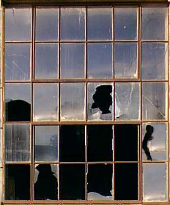|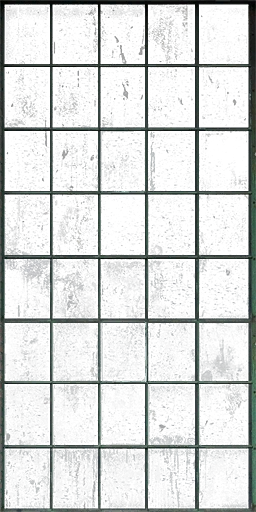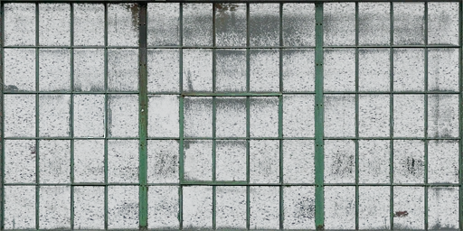|
| Caminho: `Textures\window06.jpg` |  Caminho: `materials\glass\glasswindow041a.vtf` `materials\glass\glasswindow041b.vtf` `materials\glass\glasswindow048a.vtf` |

## Disco 7

| Source Texture | Final Texture |
| -------------- | ---------------------- |
| | Origem: `hl2_textures_dir` |
|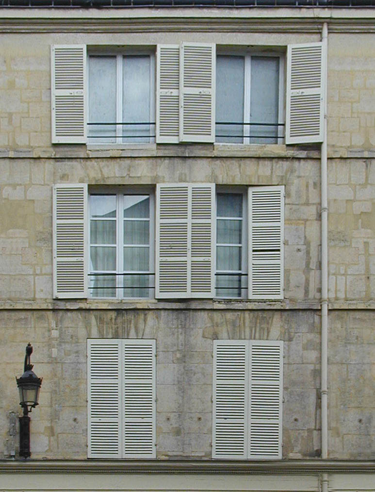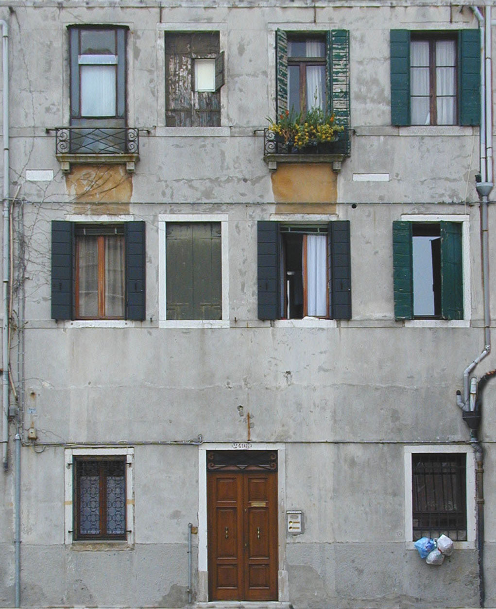||
| Caminho: `Textures\Large\bldg011L.jpg` `Textures\Large\bldg062L.jpg` |  Caminho: `materials\composite\buildingset053a.vtf` |

| Source Texture | Final Texture |
| -------------- | ---------------------- |
| | Origem: `hl2_textures_dir` |
|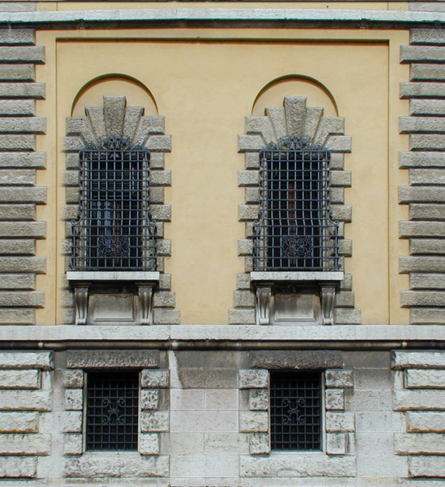||
| Caminho: `Textures\Large\bldg011L.jpg` |  Caminho: `materials\composite\buildingset052a.vtf` |

| Source Texture | Final Texture |
| -------------- | ---------------------- |
| | Origem: `hl2_textures_dir` |
|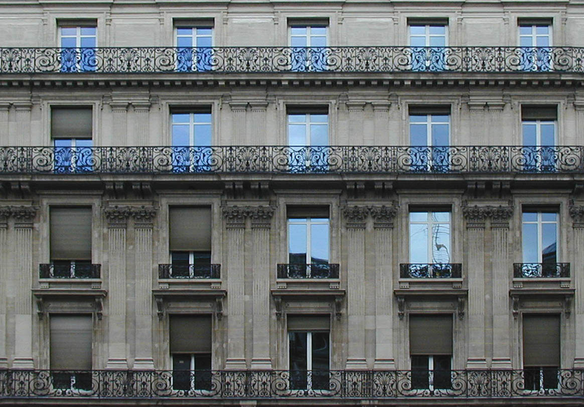||
| Caminho: `Textures\Large\bldg024L.jpg` |  Caminho: `materials\composite\buildingset022a.vtf` |

| Source Texture | Final Texture |
| -------------- | ---------------------- |
| | Origem: `hl2_textures_dir` |
|||
| Caminho: `Textures\Large\bldg072L.jpg` |  Caminho: `materials\composite\buildingset054a.vtf` |

| Source Texture | Final Texture |
| -------------- | ---------------------- |
| | Origem: `hl2_textures_dir` |
|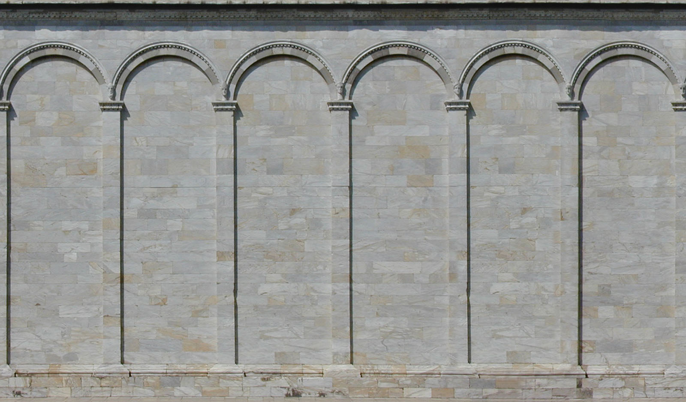||
| Caminho: `Textures\Large\bldg137L.jpg` |  Caminho: `materials\composite\buildingset035a.vtf` |

| Source Texture | Final Texture |
| -------------- | ---------------------- |
| | Origem: `hl2_textures_dir` |
||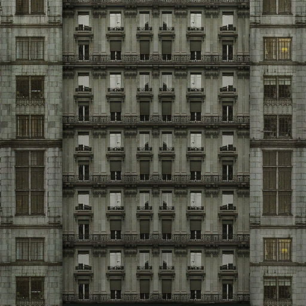|
| Caminho: `Textures\Large\bldg196L.jpg` |  Caminho: `materials\composite\buildingset022b.vtf` |

| Source Texture | Final Texture |
| -------------- | ---------------------- |
| | Origem: `hl2_textures_dir` |
|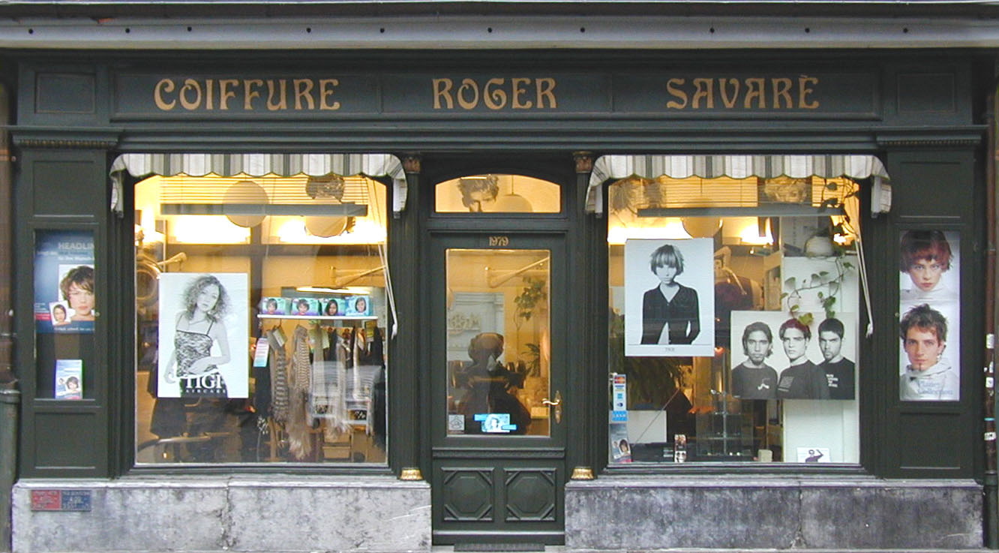||
| Caminho: `Textures\Large\bldg232L.jpg` |  Caminho: `materials\composite\buildingset015a.vtf` |

| Source Texture | Final Texture |
| -------------- | ---------------------- |
| | Origem: `hl2_textures_dir` |
|||
| Caminho: `Textures\Large\bldg261L.jpg` |  Caminho: `materials\composite\buildingset019a.vtf` |

| Source Texture | Final Texture |
| -------------- | ---------------------- |
| | Origem: `hl2_textures_dir` |
|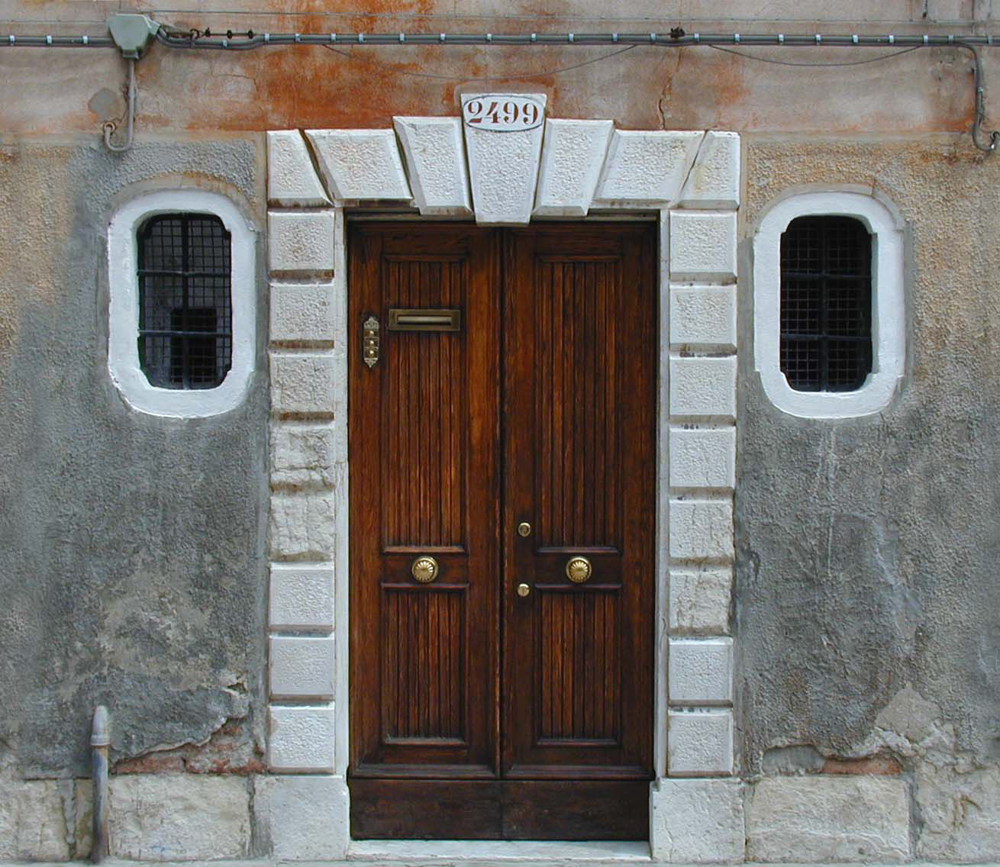||
| Caminho: `Textures\Large\entr092L.jpg` |  Caminho: `materials\plaster\plasterwall001g.vtf` |

| Source Texture | Final Texture |
| -------------- | ---------------------- |
| | Origem: `hl2_textures_dir` |
|||
| Caminho: `Textures\Large\entr116L.jpg` |  Caminho: `materials\building_template\building_template012l.vtf` |

| Source Texture | Final Texture |
| -------------- | ---------------------- |
| | Origem: `hl2_textures_dir` |
|||
| Caminho: `Textures\Large\entr130L.jpg` |  Caminho: `materials\building_template\building_template012l.vtf` |

| Source Texture | Final Texture |
| -------------- | ---------------------- |
| | Origem: `hl2_textures_dir` |
|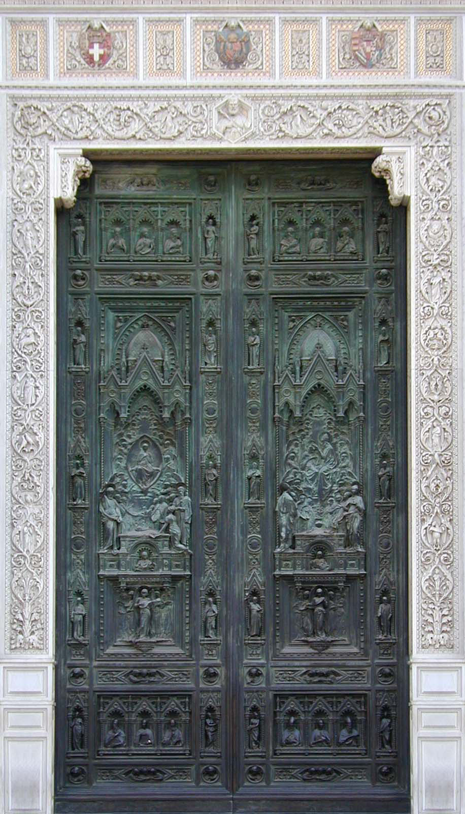||
| Caminho: `Textures\Large\entr132L.jpg` |  Caminho: `materials\metal\metaldoor015a.vtf` |

| Source Texture | Final Texture |
| -------------- | ---------------------- |
| | Origem: `hl2_textures_dir` |
|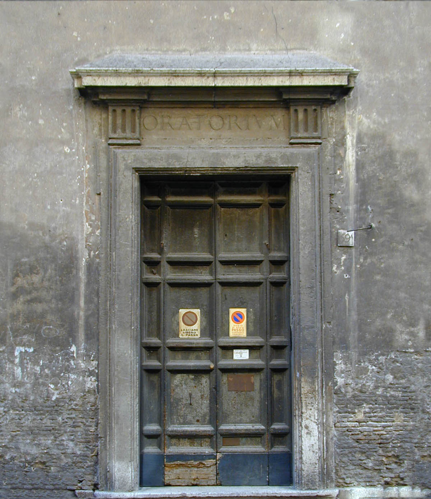||
| Caminho: `Textures\Large\entr145L.jpg` |  Caminho: `materials\metal\metaldoor036a.vtf` |

| Source Texture | Final Texture |
| -------------- | ---------------------- |
| | Origem: `hl2_textures_dir` |
|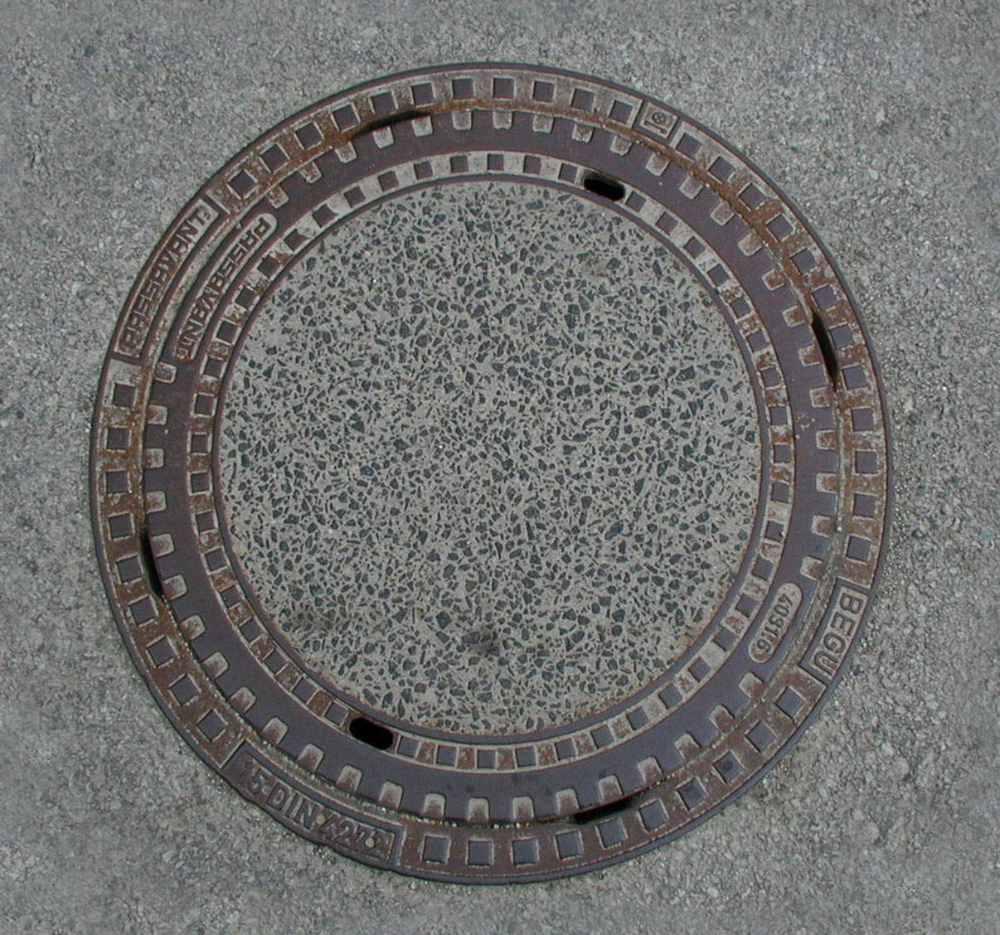||
| Caminho: `Textures\Large\surf012L.jpg` |  Caminho: `materials\decals\decalmetalmanhole004a.vtf` |

| Source Texture | Final Texture |
| -------------- | ---------------------- |
| | Origem: `hl2_textures_dir` |
|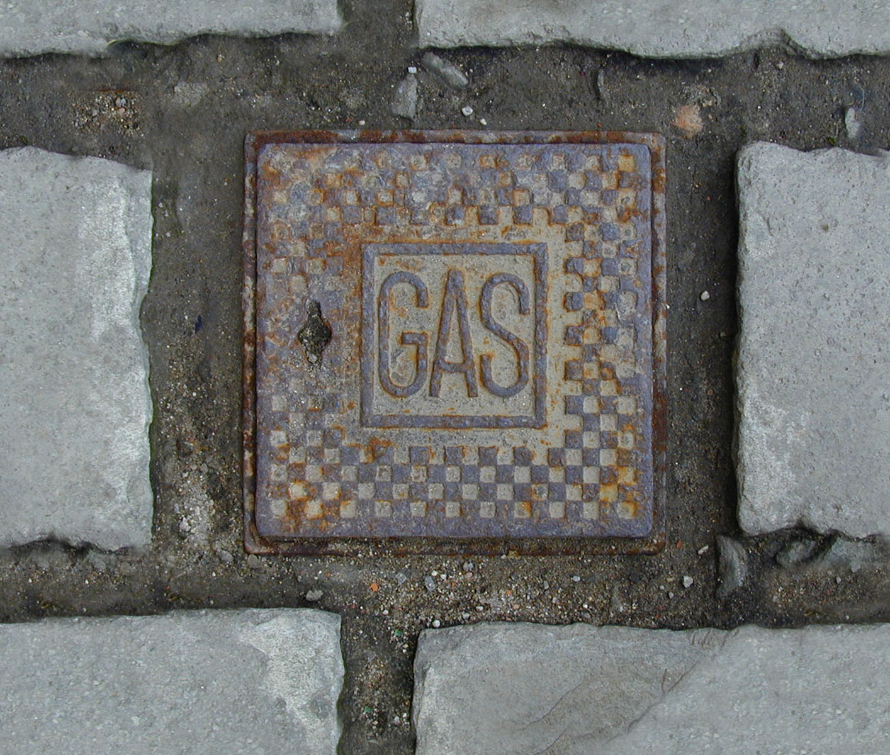||
| Caminho: `Textures\Large\surf031L.jpg` |  Caminho: `materials\decals\decalmetalgrate019a.vtf` |

| Source Texture | Final Texture |
| -------------- | ---------------------- |
| | Origem: `hl2_textures_dir` |
|||
| Caminho: `Textures\Large\surf033L.jpg` |  Caminho: `materials\brick\brickwall017a.vtf` |

| Source Texture | Final Texture |
| -------------- | ---------------------- |
| | Origem: `hl2_textures_dir` |
|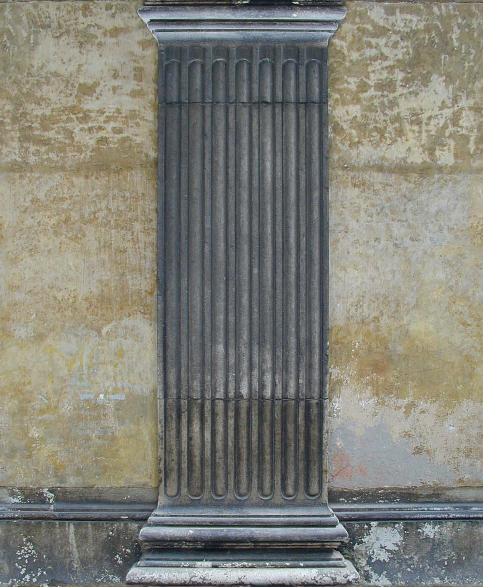||
| Caminho: `Textures\Large\surf038L.jpg` |  Caminho: `materials\plaster\plasterwall001h.vtf` `materials\plaster\plasterwall001i.vtf` `materials\plaster\plasterwall001j.vtf` |

| Source Texture | Final Texture |
| -------------- | ---------------------- |
| | Origem: `hl2_textures_dir` |
|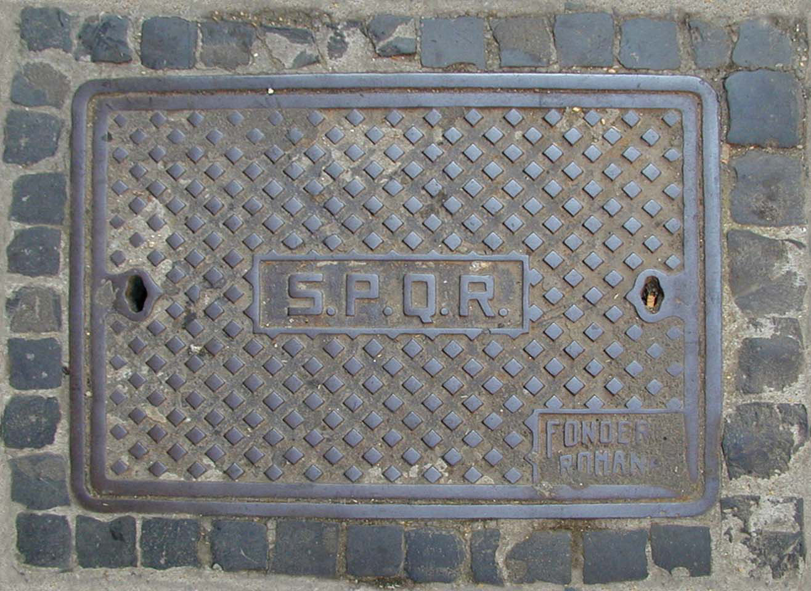||
| Caminho: `Textures\Large\surf066L.jpg` |  Caminho: `materials\decals\decalmetalgrate014a.vtf` |

| Source Texture | Final Texture |
| -------------- | ---------------------- |
| | Origem: `hl2_textures_dir` |
|||
| Caminho: `Textures\Large\surf090L.jpg` |  Caminho: `materials\brick\brickwall007a.vtf` |

| Source Texture | Final Texture |
| -------------- | ---------------------- |
| | Origem: `hl2_textures_dir` |
|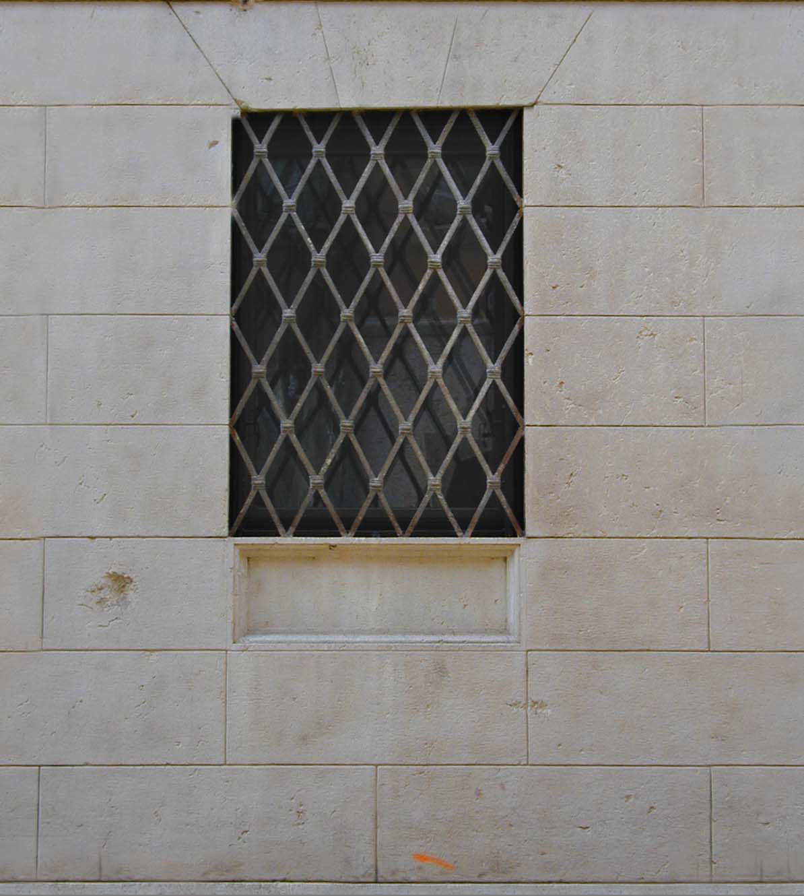||
| Caminho: `Textures\Large\wndw116L.jpg` |  Caminho: `materials\metal\metalfence007a.vtf` |

| Source Texture | Final Texture |
| -------------- | ---------------------- |
| | Origem: `hl2_textures_dir` |
|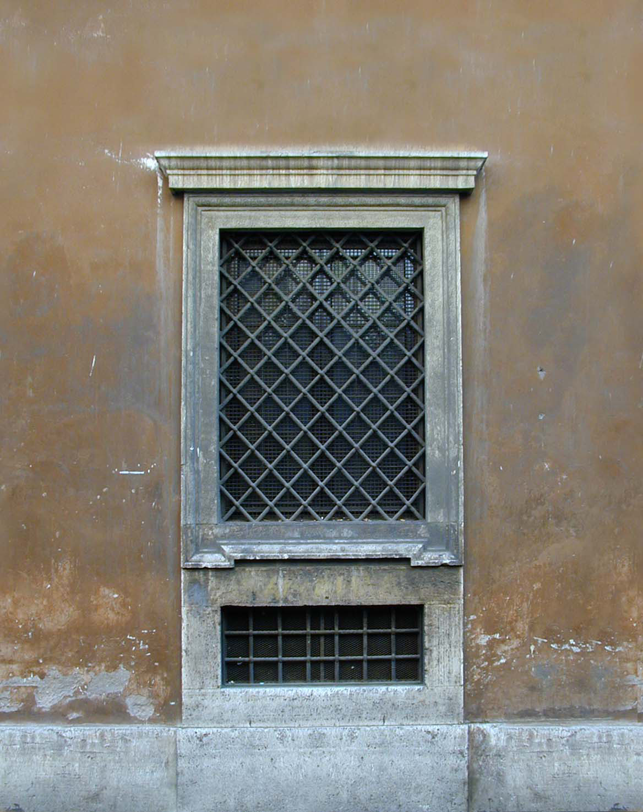||
| Caminho: `Textures\Large\wndw228L.jpg` |  Caminho: `materials\concrete\concretewall015d.vtf` |
